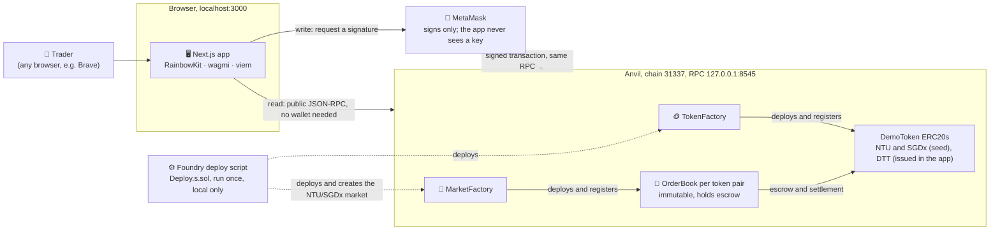
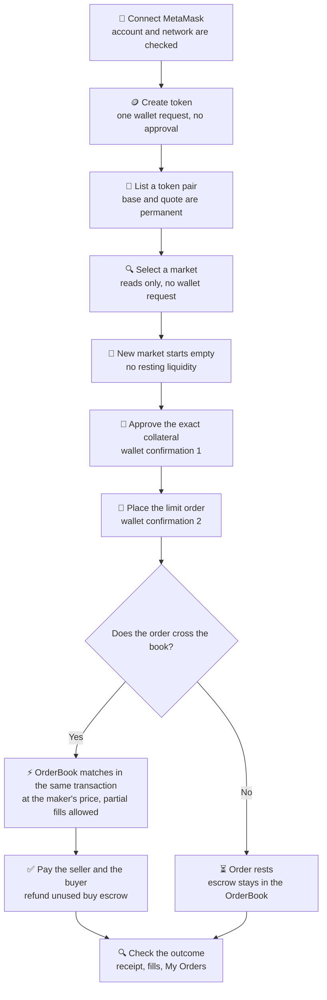

<div align="center">

  <h1>SC4053 DEX</h1>

  <p>
    <strong>A non-custodial limit-order-book exchange for the NTU SC4053 Blockchain Technology course</strong>
    <br />
    Issue tokens, list a market, and trade on a local Anvil chain. Your keys stay in MetaMask.
  </p>

  
  
  
  
  
  
  
  
  
  

</div>

<table align="center">
  <tr>
    <td align="center" width="230">
      <a href="#feature-overview">
        <strong>🪙 Issue tokens</strong><br />
        Create a fixed-supply ERC20 in the app
      </a>
    </td>
    <td align="center" width="230">
      <a href="#architecture">
        <strong>🏪 List markets</strong><br />
        Any two 18-decimal tokens, through MarketFactory
      </a>
    </td>
    <td align="center" width="230">
      <a href="#user-journey">
        <strong>📖 Trade on-chain</strong><br />
        Limit orders, partial fills, maker-price settlement
      </a>
    </td>
  </tr>
</table>

---

## 📌 About

SC4053 DEX is a small exchange for the SC4053 course. It is an **order book, not an AMM**: traders post buy and sell limit orders, the smart contract matches them on-chain at the resting order's price, and partial fills are supported. Tokens stay in the trader's wallet until an order escrows them.

Everything runs on a **local Anvil chain** (chain ID `31337`). Nothing is deployed to a public network, and this repository makes no claim about one.

> **Scope.** The official assignment brief (kept locally in `docs/Development_Project.pdf`, git-ignored) is the authority for requirements. The shared engine implements cancelling orders, batch matching and stop-limit orders; the app has a **Cancel** action (P2-8B.2) and a **Match Orders** panel (P2-8B.3) and, since P2-8B.4, a **Stop-limit** mode in the order ticket with a **Trigger Stops** panel (see [Implemented and pending](#implemented-and-pending)).

---

## ✨ Feature overview

<a id="feature-overview"></a>

| Feature | Status | Where in the app |
|---|---|---|
| 🪙 **Token issuance**: a fixed-supply ERC20 (18 decimals) through `TokenFactory` | ✅ Built. Automated and scratch-chain tests pass. The project owner reported creating a token (DTT) in the app with MetaMask | **Create token** |
| 🏪 **Permissionless token-pair listing**: one `OrderBook` per unordered pair, registered by `MarketFactory` | ✅ Built. Duplicate and reversed pairs are rejected | **List market** |
| 🦊 **Self-custodial wallet authorization**: every transaction is signed in MetaMask; the app holds no keys | ✅ Built | **Connect wallet** |
| 📖 **On-chain limit-order trading** for buy and sell orders | ✅ Built | **Trade** |
| ⚡ **Automatic matching, partial fills and maker-price settlement** inside the order transaction | ✅ Built in the engine. The SPEC worked example was checked with MetaMask by the owner | **Trade** |
| 🔐 **Token approvals and escrow**: the exact amount is approved, and escrow is shown as its own balance | ✅ Built. Approval and order are separate wallet confirmations | Order ticket |
| 🧾 **Refunds and order history**: refunds, fills and remaining escrow, plus a transaction page | ✅ Built | **My Orders**, `/tx/<hash>` |
| 📊 **Multi-market dashboard and token holdings**: choose any listed market; balances per token, never added together | ✅ Built (P2-6.1) | **Dashboard** |
| 🔁 **Transaction replacement tracking and local chain-reset detection**: a sped-up, cancelled or replaced transaction is followed to what was mined; a restarted chain is reported with its evidence | ✅ Built (P2-7). Mock-wallet and real-chain tests pass; the wallet's own speed-up and cancel buttons are not yet tested by hand | Result cards, chain-reset notice |
| ❌ **Cancel an order** (Bonus 1) | ✅ Built (P2-8B.2). A **Cancel** action on your own open, partly filled and pending orders states the refund first, needs no approval, and reports success only from the confirmed receipt. Verified with a mock wallet and on a scratch chain; **MetaMask not tested** | **My Orders** |
| 🧮 **Match crossed orders** (Bonus 2) | ✅ Built (P2-8B.3). When the market reports a crossed book (a placement stopped at the engine's 10-fill cap), a **Match Orders** panel under the order book lets any connected wallet send `matchOrders`: it is reviewed and simulated first, needs no approval, and the result is shown only from the confirmed receipt's `Trade` events. Each transaction settles at most 10 fills and is one deliberate click. Verified with a mock wallet and a real scratch chain; **the happy path was also confirmed with MetaMask by the owner on a scratch chain (2026-11-08)**; the MetaMask rejection and account-switch cases are not yet run | **Trade** |
| 🎯 **Stop-limit orders** (Bonus 3) | ✅ Built (P2-8B.4). A **Stop-limit** mode in the ticket takes a trigger and a limit price, escrows at the **limit** price with an exact approval, and shows the order as **pending** (never filled) until a **Trigger stops** transaction, which anyone can send, activates it. My Orders tells *waiting for price* apart from *eligible now: needs a Trigger stops transaction*; the Trigger Stops panel reports what each activated stop actually did (rests, fills, or is refunded by the engine) only from the confirmed receipt. Verified with a mock wallet and a real scratch chain; **the happy path was run with MetaMask by the owner on 2026-11-08** (see `docs/TESTING.md`, Test 14); a cancelled stop's history line currently reads "Activated", a known wording defect | **Trade** |

---

## 🏗️ Architecture

<a id="architecture"></a>



*Reads go straight to the node, so market data shows even with no wallet connected. Every write is signed in MetaMask. MetaMask and the app must point at the **same** Anvil. The app has no backend, database or indexer.*

**MarketFactory in one paragraph.** `MarketFactory` is the accepted mechanism for creating and registering markets. It deploys a new, unmodified `OrderBook(base, quote)` for each unordered token pair and records it in an on-chain registry, so the app can discover markets. It is **not** an AMM, a liquidity pool, a token router, an escrow contract or an off-chain matcher. It holds no tokens and is never the sender of an order. A new market starts **with no trading liquidity**.

> 🔎 **Detailed workflow:** the step-by-step market-creation diagram (duplicate check, constructor validation, the `MarketCreated` event and discovery) is in **[docs/MARKET_FACTORY.md](docs/MARKET_FACTORY.md#market-creation-workflow)**. The "why MarketFactory" comparison and tradeoffs are in the same file.

---

## 🧭 User journey

<a id="user-journey"></a>



*Creating a token and listing a market are optional when the market already exists, as the seed NTU/SGDx market does. The other trader repeats the approve and place steps with the quote token, and the escrow is rounded up. An order that rests waits for a counterparty; it does not trade with the market.*

---

## 🧰 Technology

| Layer | Technology | Purpose in this project |
|---|---|---|
| Contracts | **Solidity** (`^0.8.20` pragma, compiled with 0.8.24) | `OrderBook` matching engine, `TokenFactory`, `MarketFactory`, `DemoToken` |
| | **OpenZeppelin** (`ERC20`, `SafeERC20`, `ReentrancyGuard`, `Math`) | Standard token behaviour, safe transfers, reentrancy protection |
| Local chain | **Foundry**: `forge` (build, test, deploy), `anvil` (local chain), `cast` (reads and sends from the shell) | Compiling, testing and deploying, and the local node on port 8545 |
| Frontend | **Next.js 16** (App Router), **React 19**, **TypeScript** | The web app, served on port 3000 |
| | **Tailwind CSS 4**, **shadcn/ui**, **lucide-react** | Styling and the component primitives in `web/components/ui/` |
| Wallet and chain | **RainbowKit 2** (connect dialog), **wagmi 2** (hooks), **viem 2** (JSON-RPC, decoding, bigint-exact formatting) | Wallet connection, reads and writes, and event decoding |
| | **TanStack Query** | Caching and refreshing on-chain reads |
| Tests | **Vitest** (unit and gated real-chain suites), **Foundry** (contract tests), **Playwright** (`playwright-core` driving Chromium with a mock wallet) | Automated checks at each layer; see [docs/TESTING.md](docs/TESTING.md) |

Versions are pinned in `web/package.json` and `web/package-lock.json`. The Solidity compiler version is in `contracts/foundry.toml`.

---

<a id="ai-assisted-development-and-verification"></a>

## 🤖 AI-Assisted Development and Verification

AI assistance was used across the project for planning, coding, design exploration, independent review, testing and documentation. The phases were checked with the tools below, and each claim in the audit files is tied to a recorded test, reproduction or review. AI tools supplement contract tests, real-chain tests, manual wallet checks and human review; they do not replace them.

| Category | Tools and models | Recorded status |
|---|---|---|
| Claude Code and model roles | Claude Code; Opus 5.5, Sonnet 5.5 and Haiku 5.5 in different phases | Used in every phase. Model attribution is given where the prompt logs record it, and is marked "not recorded" otherwise |
| Context7 and MCPs | Context7 (library documentation); shadcn and Awwwards MCPs (P2-4); Playwright MCP | Context7 accepted in P2-3 to P2-5. The Playwright MCP was attempted and did not launch. Awwwards results were rejected |
| Solidity Security skill and Slither | `solidity-security` skill (P2-3 and P2-8A); Slither 0.11.6 on the Person 2 contracts and deployment script | Slither: 0 results (P2-1), 5 accepted notes (P2-2), 6 accepted notes (P2-3), re-run at HEAD in P2-8A. The skill is a checklist and produced no finding of its own. Slither has not been run on `OrderBook.sol` by Person 2 |
| Foundry and contract testing | `forge` (335 tests, including fuzz and the engine's invariant suite), `anvil` and `cast` on scratch chains | Unit, fuzz, invariant and integration tests exist (335 passed in the 2026-11-08 run) |
| Playwright and browser testing | `playwright-core` 1.64.1 with Chromium, and a mock wallet | Mock-wallet suites pass. These are not MetaMask results |
| Frontend design and quality | `frontend-design`, `ui-ux-pro-max`, `impeccable`, `taste-skill` (P2-4); `impeccable detect` later; `react-best-practices` and a temporary pinned axe-core (P2-8A) | Design work in P2-4. The detector runs regex rules only, so its zero results are an undercount. The P2-8A audit measured performance and found two accessibility violation types, reported and not yet fixed |
| Independent reviews and AI audit evidence | Read-only reviewers in P2-1 to P2-6; prompt logs; issue reports; test evidence | P2-3 reproduced two Medium defects, which were fixed. Other reviews found no High or Medium contract defects |

Full methodology, including each tool's status (invoked, attempted, or only installed), the model per phase where recorded, the static-analysis and review findings, and the checks still owed for future engine changes, is in [docs/ai-audit/tooling-and-methodology.md](docs/ai-audit/tooling-and-methodology.md).

## 🗂️ Project structure

```
SC4053-BlockChain-Project/
├── contracts/                 Solidity project (Foundry)
│   ├── src/                   OrderBook (matching engine), TokenFactory, MarketFactory, DemoToken
│   ├── test/                  Foundry unit, fuzz, invariant and integration tests (335)
│   └── script/                Deploy.s.sol (deployment), export-web.mjs (ABIs and addresses for the app)
├── web/                       Next.js app
│   ├── app/                   Routes: overview, markets, tokens, trade, create-token, list-market, tx/[hash]
│   ├── components/            Screens and widgets: shell, wallet, dashboard, trade, create, registry, data, ui
│   ├── hooks/                 Chain reads, the transaction lifecycle, the chain-reset watcher
│   ├── lib/                   Validation, bigint units, the transaction runners, decoding, and their tests
│   │   └── contracts/         GENERATED by export-web.mjs (ABIs and deployment addresses); do not edit
│   └── e2e/                   Browser suites run with a mock wallet on a scratch chain
├── scripts/
│   └── check-local.sh         Read-only environment check (run it before deploying)
├── docs/                      Deployment, frontend, testing, MarketFactory and bonus-integration guides
│   └── ai-audit/              AI audit report: prompt logs, issues, test evidence
├── SPEC.md                    Engine behaviour (shared; Person 1's engine rules)
├── CONTRACT_INTERFACE.md      Frozen contract interface (shared)
├── PRODUCT.md                 What the product is for, what it does today, and its limits
└── DESIGN.md                  Approved visual design system for the web app
```

---

<a id="quickstart"></a>

## 🚀 Quickstart

Run everything inside the **Ubuntu (WSL) terminal**. Keep the project in the Linux filesystem (for example `~/projects/`), not under `/mnt/c`. The app is opened in a Windows browser with MetaMask installed. Brave is the browser this project was tested with.

> **New to Anvil, MetaMask or local blockchains?** Read the [Beginner's Guide](docs/BEGINNERS_GUIDE.md) first: it explains what each command does and why, the three test environments (3000/8545, 3100/8546, 3101/8547), MetaMask setup and troubleshooting. This Quickstart is the short version.

### First-time setup (once per machine)

**1. Install the tools.**

| Tool | Version used here | Check |
|---|---|---|
| Foundry (`forge`, `anvil`, `cast`) | 1.9.0 | `forge --version && anvil --version && cast --version` |
| Node.js and npm | Node 22.18 or newer (`web/package.json` engines) | `node -v && npm -v` |
| git | any | `git --version` |

Install Foundry from https://getfoundry.sh (`curl -L https://foundry.paradigm.xyz | bash`, open a new terminal, then `foundryup`). If `forge` is not found, add this to `~/.bashrc`:
```bash
export PATH="$HOME/.foundry/bin:$PATH"
```

**2. Get the code and build it.**
```bash
# any folder, e.g. ~/projects
git clone https://github.com/Nitecry7/SC4053-BlockChain-Project.git
cd SC4053-BlockChain-Project          # the "repo root" for every command below
git submodule update --init --recursive   # forge-std and OpenZeppelin, needed to compile

cd contracts && forge build && cd ..  # run in contracts/
cd web && npm ci && cd ..             # run in web/ (exact versions from package-lock.json)
```

**3. Add the local network to MetaMask (once).** See [MetaMask and local accounts](#metamask-and-local-accounts) for the fields and for importing accounts.

### Every working session

Anvil keeps its state **only while it runs**. A restart gives a new, empty chain at block 0, and everything on the former chain (contracts, custom tokens, market listings, balances, orders) is gone. **Starting Anvil does not deploy anything**, and **rebuilding or merging source code does not upgrade contracts that are already deployed.** The six separate steps are start Anvil, `forge build`, deploy with `Deploy.s.sol`, export ABIs and addresses, `scripts/check-local.sh`, and `npm run dev`; [docs/DEPLOYMENT.md](docs/DEPLOYMENT.md#the-local-flow-one-step-at-a-time) says what each does and does not do. Use three WSL terminals:

| Terminal | Directory | Command | Stays running? |
|---|---|---|---|
| 1. Chain | repo root | `anvil` | Yes. Closing it destroys the chain |
| 2. Checks | repo root | `scripts/check-local.sh` | No, run once |
| 3. App | `web/` | `npm run dev` | Yes |

**Terminal 1.** Expected: a banner with `Available Accounts`, `Private Keys`, a mnemonic and `Chain ID 31337`, ending with `Listening on 127.0.0.1:8545`.

**Terminal 2.** `scripts/check-local.sh` is read-only. It never deploys, never stops anything and never touches a key. It checks the tools, the RPC on chain 31337, the contract code at each exported address, that the export is current, and that the app answers.

| The check says | Meaning | Do |
|---|---|---|
| `Result: ready` | Deployment exists and matches the export | Nothing. Go to terminal 3 |
| `no JSON-RPC answer` | Anvil is not running | Start Anvil (terminal 1) |
| `chain id is N` | Wrong network | Fix the RPC URL. Never deploy to it |
| `NO contract code` (none of the exported contracts exist) | Fresh or restarted Anvil | **Deploy once** (see below) |
| `export check failed` while the contracts exist | The chain is fine; the export record is stale or from another run | **Do not redeploy.** See [docs/TESTING.md](docs/TESTING.md), troubleshooting |

**Terminal 3.** `cd web && npm run dev`. Expected (from a recorded run; the port is `3000` by default):
```
▲ Next.js 16.4.5 (Turbopack)
- Local:         http://localhost:3000
✓ Ready in 223ms
```
Open **http://localhost:3000**. The dashboard's Network card should say `Anvil (local)`, `Chain ID 31337` and a block number. If it says **"No SC4053 DEX deployment on this chain"**, use the table above.

### Deploy and export (only on a fresh or restarted chain)

Deploy only when `check-local.sh` reports no contract code. This creates `TokenFactory`, `MarketFactory`, the NTU and SGDx tokens (1,000,000 each, minted to Anvil account 0), the NTU/SGDx market **through `MarketFactory`**, and sends 10,000 NTU and 10,000 SGDx to Anvil accounts 1 to 3.

```bash
# contracts/
cd contracts
export RPC_URL=http://127.0.0.1:8545
export DEPLOYER=0xf39Fd6e51aad88F6F4ce6aB8827279cffFb92266   # Anvil account 0: a public address, not a key
forge script script/Deploy.s.sol:Deploy --rpc-url "$RPC_URL" --broadcast --unlocked --sender "$DEPLOYER"
cd ..

# repo root: write the ABIs and addresses the app reads, then confirm them
node contracts/script/export-web.mjs --rpc-url "$RPC_URL"
node contracts/script/export-web.mjs --check --rpc-url "$RPC_URL"
```
The deploy script refuses any chain that is not 31337 and uses no private key: Anvil's accounts are unlocked, and `--unlocked --sender` makes the node sign for account 0. On a fresh Anvil the addresses are always the same and `web/lib/contracts/deployments.ts` does not change. Always trust what the exporter writes over any table. Details: [docs/DEPLOYMENT.md](docs/DEPLOYMENT.md).

**When deployment is and is not needed:**

| Situation | Deploy? |
|---|---|
| You restarted your computer, but Anvil is running and `check-local.sh` says ready | No |
| You restarted **Anvil** (state is gone) | Yes, once, then export |
| You only restarted `npm run dev` | No |
| The app shows a stale deployment after you redeployed | Export again (do not deploy again) |
| You changed contract code (engine or factory) | Yes, on a scratch chain first; see [docs/DEPLOYMENT.md](docs/DEPLOYMENT.md) |

---

## 🧾 Command reference

Run each command in the directory shown. "Observed" means it was run on the project owner's local Anvil for this document (read-only), on 2026-11-06. Other examples are illustrative.

| Command | Run in | Purpose | Example output and what it means |
|---|---|---|---|
| `anvil` | repo root | Start the local chain on `127.0.0.1:8545` | Banner ending `Listening on 127.0.0.1:8545`. A fresh chain starts at block 0 |
| `cast chain-id --rpc-url http://127.0.0.1:8545` | any | Check which chain the node is | Observed: `31337`. Anything else means the wrong network |
| `cast block-number --rpc-url http://127.0.0.1:8545` | any | Latest block height | Observed: `13`. This is the **height**: 13 blocks have been mined. It is **not** the number of trades |
| `cast call <NTU> "decimals()(uint8)" --rpc-url …` | any | Read ERC20 decimals | Observed for NTU: `18`. Both demo tokens must read 18 |
| `cast call <NTU> "totalSupply()(uint256)" --rpc-url …` | any | Read total supply in base units | Observed: `1000000000000000000000000 [1e24]` = 1,000,000 NTU with 18 decimals. A different value means a different deployment |
| `cast code <address> --rpc-url …` | any | Check that a contract exists at an address | Long hex output means code is present. Empty `0x` means nothing is deployed there (for example after an Anvil restart) |
| `cast receipt <txHash> --rpc-url …` | any | Read a transaction's receipt | `status 1 (success)` means it was mined and succeeded. A missing receipt means it is not mined yet, or the node has dropped it |
| `cast call <MarketFactory> "marketCount()(uint256)" --rpc-url …` | any | Count the registered markets | Observed: `2` (NTU/SGDx and one more on the owner's chain) |
| `forge build` | `contracts/` | Compile | Ends with `Compiler run successful`. Regenerated artifacts go to `contracts/out/` |
| `forge test` | `contracts/` | Contract tests | Observed for the recorded run (2026-11-08, P2-8B.1): `335 passed`. Any `failed` line means a broken contract or test |
| `node --test contracts/script/export-web.test.mjs` | repo root | Exporter tests | Recorded: `21 passed` |
| `forge script script/Deploy.s.sol:Deploy --rpc-url … --broadcast --unlocked --sender …` | `contracts/` | Deploy (local only) | Logs with the deployer, `TokenFactory`, `MarketFactory`, NTU, SGDx and the NTU/SGDx market, then `ONCHAIN EXECUTION COMPLETE & SUCCESSFUL`. Run only on a chain with no contract code |
| `node contracts/script/export-web.mjs --rpc-url …` | repo root | Write ABIs and addresses for the app | Writes `web/lib/contracts/`. Refuses to write if the chain, the deployment record and the build disagree |
| `node contracts/script/export-web.mjs --check --rpc-url …` | repo root | Confirm the export is current; writes nothing | `up to date` means the files match. A `stale deployment` message means the chain was restarted without a redeploy |
| `scripts/check-local.sh` | repo root | Read-only environment check | Observed: `Result: ready. 0 warning(s). No deployment is needed.` See the table above for other results |
| `npm run dev` | `web/` | Start the Next.js dev server on `localhost:3000` | `Ready in …` and `Local: http://localhost:3000` |
| `scripts/seed-crossed-book.sh` (`status`, `verify-after`) | repo root | Builds a **crossed order book** on a **scratch** chain for the manual Match orders test, then verifies it from the chain. It **never sends `matchOrders`**, refuses port 8545 and any chain id other than 31337, uses no private key, and writes nothing in the repository | See `docs/TESTING.md`, Test 13. Run on 2026-11-08 against a scratch Anvil on 8546 (all checks passed); the owner then ran the MetaMask happy path against it and `verify-after` passed (2026-11-08) |
| `scripts/seed-stop-orders.sh` (`status`, `prepare`, `move-price`, `add-bid`, `verify-after`) | repo root | Prepares and checks a **scratch** chain for the manual stop-limit test: funds the stop owner, makes the trades that set and move the last trade price, and verifies the keeper's trigger transaction. It **never sends `triggerStopOrders` and never places a stop**, refuses port 8545 and any chain id other than 31337, uses no private key, and writes nothing in the repository | See `docs/TESTING.md`, Test 14. Run on 2026-11-08 against a scratch Anvil on 8547: a full dry run in a reverted snapshot, then `prepare` for real (all checks passed); the MetaMask test itself has **not** been performed |
| `npm test` | `web/` | Unit tests (Vitest, no chain needed) | Recorded (P2-8C): `604 passed`, and `76` gated real-chain tests skipped (576 and 75 in P2-8B.4) |
| `npm run typecheck`, `npm run lint`, `npm run build` | `web/` | Types, lint, production build | Each exits with no errors |
| `npm run e2e`, `e2e:create`, `e2e:dashboard`, `e2e:hardening`, `e2e:liveness`, `e2e:cancel`, `e2e:match`, `e2e:stop`, `e2e:ux` | `web/` | Browser tests with a **mock wallet** | These need a **scratch** chain (port 8546) and a scratch server (port 3100), set up as described in [docs/FRONTEND.md](docs/FRONTEND.md). They never touch your main chain |

---

<a id="metamask-and-local-accounts"></a>

## 🦊 MetaMask and local accounts

**The three parts.** The app reads the chain itself over its RPC URL, with or without a wallet. MetaMask has its own RPC setting, so it can show balances and send transactions to the same node. "Connect wallet" in the app is a separate permission: it lets the site see one account.

**Add the network in MetaMask** (menu names vary by version: *Settings, Networks, Add network, Add a network manually*):

| Field | Value |
|---|---|
| Network name | Anvil Local (any name) |
| New RPC URL | `http://127.0.0.1:8545` |
| Chain ID | `31337` |
| Currency symbol | `ETH` |

**Public address versus private key.** An address (`0x7099…79C8`) is public, like an account number, and is safe to show. A private key is a secret that signs transactions; whoever holds it controls the account. This app never sees a key. Keys are used only by MetaMask.

**Anvil's test accounts.** Anvil starts with accounts derived from a **public default mnemonic**. Its keys are published widely. Use them only on a local, disposable chain. **Never send real assets to them.** The default mnemonic is not secret, but treat any key you derive from it as disposable.

**Alice and Bob** are the two development accounts used in [docs/TESTING.md](docs/TESTING.md):

| Name | Anvil account index | Address starts with |
|---|---|---|
| Alice | 0 | `0xf39F…` |
| Bob | 1 | `0x7099…` |

**Import an account into MetaMask.** Account selector, *Add account or hardware wallet*, *Import account*, keep the type *Private Key*, paste the key from the Anvil banner (under `Private Keys`), and press *Import*. Do not paste a key anywhere else.

**Import the demo tokens** for each account that should show balances: *Tokens, Import tokens, Custom token*, then paste the token **address** from `web/lib/contracts/deployments.ts` or the app's **Tokens** page. MetaMask should fill in the symbol and `18` decimals. Repeat for each token.

**Derive an account's address without printing its key.** Anvil's default mnemonic is public, so this derivation is for a disposable chain only:
```bash
read -r -s ANVIL_MNEMONIC        # paste the "Mnemonic:" phrase from the Anvil banner, then Enter (nothing is echoed)
cast wallet address --mnemonic "$ANVIL_MNEMONIC" --mnemonic-index 1     # prints the address for index 1 (Bob)
unset ANVIL_MNEMONIC
```
The index is the position in the derivation path. Index `0` is Alice, `1` is Bob. The address printed for index `1` is `0x70997970C51812dc3A010C7d01b50e0d17dc79C8`, which matches Anvil account 1. Verified this session with Anvil's public test phrase. To get the **private key** itself, see the walkthrough in [docs/TESTING.md](docs/TESTING.md) (section B4). Never save or share that output.

**Why MetaMask's label differs from Anvil's index.** MetaMask names imported accounts in the order you imported them ("Imported Account 1", …). That has nothing to do with Anvil's numbering. **Check the address** under the account name before every test. You can rename accounts in MetaMask.

---

## 🛠️ Troubleshooting

Read the **Action** column first: it says whether to restart, reconnect, check, re-export or redeploy. **Never reset the chain just because a page looks stale.**

| Symptom | Cause and how to check | Action |
|---|---|---|
| "Cannot reach the local Anvil node" | Anvil is not running on 8545. `cast chain-id --rpc-url http://127.0.0.1:8545` fails | **Start** Anvil (terminal 1). Then check again |
| Network is not 31337 / wrong network banner | MetaMask is on another network, or the RPC points at a different node. `cast chain-id` shows the node's chain | **Reconnect**: switch MetaMask to *Anvil Local* (31337, `127.0.0.1:8545`) |
| Anvil was restarted and state is gone | Dashboard says "No SC4053 DEX deployment". `check-local.sh` reports no contract code | **Deploy** once, then **export**, then reload the page |
| No contracts deployed | `cast code <MarketFactory>` returns `0x` | **Deploy**, then **export** |
| Stale export or addresses (the app shows old addresses, or the exporter says `stale deployment`) | The export record is from another run or chain. Contracts still exist at the recorded addresses (`check-local.sh`) | **Re-export** only if the contracts match. Do not redeploy. See [docs/TESTING.md](docs/TESTING.md) |
| Wrong or disconnected MetaMask account | The address in MetaMask is not the one the app shows | **Reconnect**: switch account in MetaMask, then *Connect wallet* again |
| MetaMask popup never appears | The request is waiting behind the browser's *Extensions* icon. The app shows a "Waiting for MetaMask confirmation" card | **Check the toolbar**: open the Extensions menu, open MetaMask, approve. Or reject the old request, then press *Try again* |
| Token balances do not match your expectation | Wrong account or network, or the token is not imported into MetaMask. Holdings show only the connected account | **Check** the account address and the network, then **reconnect**. Import the token address into MetaMask if it is missing. No redeploy needed |
| Token allowance is insufficient | The order needs more approval than you gave. The ticket shows an approval step | **Approve** the exact amount, then place the order. The app does not reuse a stale allowance |
| Why does an order need two confirmations? | An ERC20 `approve` and the order (`placeLimitOrder`) are two transactions. The token must allow the OrderBook to move funds before the OrderBook can escrow them | **Expected.** Confirm both. Approvals are separate from the order |
| Transaction status is unknown or pending | The app waits in bounded windows. A transaction can still be mined later, or the node can drop it | **Check** *My Orders* and the transaction page before placing the order again. Do not repeat an order just because a card says "not confirmed yet" |
| A notice says the local chain was reset | Anvil restarted (block identity changed). The app shows the evidence | **Reload** the page. If the contracts are gone, **deploy** and **export** |
| MetaMask transaction pending indefinitely, especially right after you restarted Anvil | A nonce gap: MetaMask kept the former chain's nonces, so the new chain is waiting for earlier nonces. Compare `cast nonce <account>` (latest) with `cast nonce <account> --block pending` and the nonce in MetaMask | **Inspect first**, with read-only `cast` commands. Only on a disposable local chain, after confirming the transaction is pending, drop that one transaction and clear MetaMask's activity data for the network. Never reset a live chain as the default fix. Steps: [docs/DEPLOYMENT.md](docs/DEPLOYMENT.md#troubleshooting-a-local-chain) |
| App and MetaMask show different balances or blocks, though both say chain 31337 | The chain id is the same but the RPC URLs differ (for example 8545 and a second Anvil on 8546), so they are different nodes | **Check** `cast block-number --rpc-url` on each URL. Point the app (`NEXT_PUBLIC_RPC_URL`) and MetaMask at the same node |
| Command fails with "no such file" or "not a project" | Wrong terminal directory. `npm` needs `web/`, `forge` needs `contracts/`, `check-local.sh` runs from the repo root | **Change directory** (see the table in Quickstart) |
| Next.js: port 3000 already in use | Another dev server is running | **Stop** that `npm run dev` (find it with `ss -ltnp \| grep :3000`). Do not stop Anvil |
| Hydration warning mentioning an attribute such as `cz-shortcut-listen` | A browser extension changes the page before React loads. Recorded in `docs/TESTING.md`, section E | **Ignore** it or test in a window without extensions. It is not an app error |
| Chromium test tools fail with "error while loading shared libraries" | Chromium needs system libraries such as `libnss3` and `libnspr4` in WSL | **Install** them with `sudo apt-get install libnss3 libnspr4` (a system change you run yourself). Only the browser tests need this |

More detail, with diagnosis steps, is in [docs/TESTING.md](docs/TESTING.md#e-troubleshooting-and-faq) and [docs/DEPLOYMENT.md](docs/DEPLOYMENT.md).

---

## ⚙️ Trading engine (OrderBook)

*Section added by Person 1.*

**Status:** every engine function in the frozen interface is implemented and merged on `main`.
- limit orders with matching, partial fills and price-time priority
- **cancel** (Bonus 1), `cancelOrder`
- **multi-party batch matching** (Bonus 2), `matchOrders`
- **stop-limit orders** (Bonus 3), `placeStopLimitOrder` and `triggerStopOrders`

The "Not implemented" rows elsewhere in this README describe the **app**, which still needs a redeploy and the bonus UI. See the engine handoff below. `web/lib/contracts/abis.ts` is already regenerated for the current engine.

| Read | For |
|---|---|
| [SPEC.md](SPEC.md) | Behaviour: accounting rules, lifecycle, every function, who triggers execution (section 6), known limitations (section 8) |
| [docs/ENGINE_HANDOFF.md](docs/ENGINE_HANDOFF.md) | For the front end: signatures, events, errors, call flows, UI suggestions for each bonus, and what to re-run |
| [docs/ENGINE_PHASES.md](docs/ENGINE_PHASES.md) | How the engine was built, phase by phase, with the exact prompts |
| [docs/report/](docs/report/) | The engine's AI Audit Report section drafts |
| [docs/ai-audit/test-evidence/](docs/ai-audit/test-evidence/) | Test, invariant and mutation evidence. [DEBUGGING.md](docs/ai-audit/test-evidence/DEBUGGING.md) explains how to replay failures |

**Run the engine tests** (from `contracts/`). The first run compiles everything, which takes about 1 minute:
```bash
forge test --no-match-path "test/invariant/*"   # unit, fuzz and regression suites: about 15 s once compiled
forge test --match-path "test/invariant/*"      # invariant suite plus the reach test: about 10 minutes
forge test                                      # everything: 335 tests, about 12 minutes (fresh clone, 8 Nov)
FOUNDRY_PROFILE=deep forge test --match-path "test/invariant/*"   # 1,000 runs x depth 128: about 2 hours
```
On Windows (Git Bash) in a deeply nested folder, `git submodule update --init --recursive` can fail with "Filename too long", because of OpenZeppelin's own nested test submodules. Run `git config --global core.longpaths true` once, or clone into a short path such as `C:\dev`.

**Replay the whole journey on a private chain** (from the repo root). This is a backup for demos. It starts its own Anvil on port 8546 and refuses to run if anything already answers there. It deploys with `Deploy.s.sol`, without touching your chain's deployment record, then runs these steps with balance checks:
1. a limit order with a partial fill
2. a cancel
3. a 4-trader batch match in one transaction
4. a stop-limit trigger

```bash
bash contracts/script/demo-journey.sh
```

---

## 📚 Documentation

| Document | What it covers |
|---|---|
| [docs/BEGINNERS_GUIDE.md](docs/BEGINNERS_GUIDE.md) | A standalone guide for newcomers: how the system works, setup on WSL, MetaMask and accounts, troubleshooting, feature walkthroughs and what each test layer proves |
| [docs/TESTING.md](docs/TESTING.md) | The manual trading walkthrough with MetaMask (Alice and Bob), test layers, which steps were performed, and troubleshooting |
| [docs/DEPLOYMENT.md](docs/DEPLOYMENT.md) | The deploy script, the exporter and its safety checks, what each kind of change does to chain state, and size and gas after engine changes |
| [docs/FRONTEND.md](docs/FRONTEND.md) | The front end's architecture, the trading, creation and dashboard flows, transaction hardening, the test suites and known limits |
| [docs/MARKET_FACTORY.md](docs/MARKET_FACTORY.md) | The accepted MarketFactory architecture, its workflow diagram, the comparison with manual deployment, and tradeoffs |
| [docs/BONUS_INTEGRATION.md](docs/BONUS_INTEGRATION.md) | What the front end needs before the bonus engine functions can be shown. Nothing bonus is active |
| [PRODUCT.md](PRODUCT.md) | Product purpose, users, what is implemented today, and the verification status |
| [DESIGN.md](DESIGN.md) | The approved visual system for the web app |
| [CONTRACT_INTERFACE.md](CONTRACT_INTERFACE.md) | The frozen contract interface shared between the engine and the front end |
| [docs/ai-audit/](docs/ai-audit/) | The AI audit report: prompt logs, issue reports and test evidence |
| [docs/ai-audit/tooling-and-methodology.md](docs/ai-audit/tooling-and-methodology.md) | How AI tools, models and reviews were used, with each tool's recorded status |
| [docs/ai-audit/ai-audit-report-draft.md](docs/ai-audit/ai-audit-report-draft.md) | Preliminary AI Audit Report, in the brief's eight sections, with its evidence gaps |
| [docs/ai-audit/test-evidence/person2/p2-8a-audit.md](docs/ai-audit/test-evidence/person2/p2-8a-audit.md) | The pre-integration audit: requirements coverage, test baseline, React and accessibility review |

---

<a id="implemented-and-pending"></a>

## ✅ Implemented and pending

**Implemented and verified:** wallet connection; token issuance; market listing through MarketFactory; limit orders with exact approvals, escrow, matching and partial fills; order history and transaction pages; the multi-market dashboard and holdings; transaction replacement tracking and chain-reset detection.

**Verification status.** The SPEC worked example (Alice sells 10 NTU at 2 SGDx, Bob buys 4 NTU at a limit of 2.2) was checked on a scratch chain by automated tests, in a browser with a **mock** wallet, and by the project owner with real MetaMask accounts. The owner also reported creating DTT, listing DTT/SGDx and a trade on that market. Those reports are recorded in [docs/TESTING.md](docs/TESTING.md), section F, which says which steps were not performed.

**Usability polish (P2-8C):** Title Case headings, accessible information tips beside the main trading terms, coloured status badges (Pending Trigger amber), the Trigger Price shown for the whole life of a stop, and an evidence-based history line for stops; verified with a mock wallet and a scratch chain, not with MetaMask (`docs/ai-audit/test-evidence/person2/p2-8c-ux-polish.md`).

**Pending:** **stop-limit orders** (P2-8B.4) had their happy path run by the owner with MetaMask on a scratch chain (2026-11-08, `docs/TESTING.md` Test 14, hashes re-read from the chain); the rejection, account-switch, outage, chain-reset and deep-book-refund cases were not run, and the wording defect that call a stop cancelled before activation "Activated" was found by that run and fixed in P2-8C. **Cancelling an order** had its happy path run with MetaMask by the owner (2026-11-08). **Matching crossed orders** (P2-8B.3) had its happy path confirmed by the owner with MetaMask on a scratch chain (2026-11-08, `docs/TESTING.md` Test 13); the rejection (13c) and account-switch (13g) cases are not yet run. The manual MetaMask cases for negative paths, speed-up, cancel-a-transaction and the other cancel-an-order cases (Test 12g to 12i) are procedures, not yet performed.

---

## 🔒 Safety notes
- Anvil's default accounts, keys and mnemonic are **publicly known**. Use them only on local, disposable chains and never put real assets in them. No private key or seed phrase is stored in this repository.
- Never place a private key in a `NEXT_PUBLIC_` variable. Those values are shipped to the browser.
- Signing happens only in your wallet. The app has no server that holds keys.
