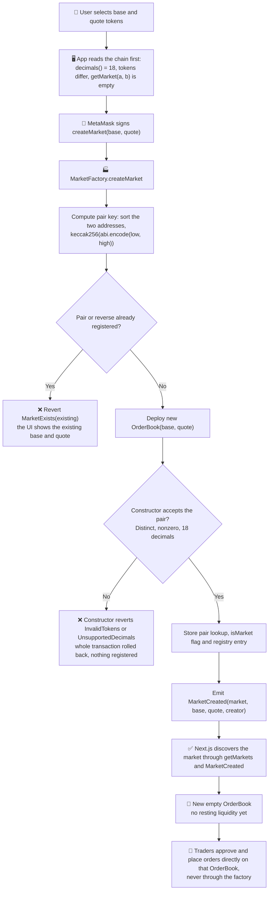

# MarketFactory (Person 2)

**Status: accepted architecture, implemented and used.** The project owner has accepted MarketFactory as the mechanism for permissionless market creation and registration. `Deploy.s.sol` creates the seed NTU/SGDx market through it, the frontend discovers and trades listed markets through its registry (including DTT/SGDx on the owner's chain), and the test suites cover it. Person 1 has been notified of this decision. No separate technical review or signed approval from Person 1 is recorded in this repository. `CONTRACT_INTERFACE.md` is updated only in its deployment handoff; no interface item changed.

**What it is not:** MarketFactory is not an AMM, a liquidity pool, a token router, an escrow contract or an off-chain matching engine. It holds no tokens, has no trading function and is never the `msg.sender` of an order.

Brief reference: section 5.1 asks for a front end that supports *token listing*, order submission and execution, and self-custody. Token **issuance** (TokenFactory) and token **listing** (this contract) are separate steps: an issued token is not tradable until a market exists for it.

## Market creation workflow
The diagram follows `createMarket` in `contracts/src/MarketFactory.sol` line by line. The app's checks run before any wallet request, so most invalid inputs never reach MetaMask.



- **Market creation adds no trading liquidity.** The new OrderBook starts empty; the first orders come from traders, through their own approvals.
- **The factory never holds trader funds.** It stores addresses only. Escrow sits in each OrderBook, and the factory is never a party to a trade.
- **A token without `decimals()`** produces an empty revert from the constructor's static call (reported as "not an ERC-20" in the UI). The duplicate check uses the same pair key as the rest of the contract, so the reversed pair is caught in either order.

## Why MarketFactory instead of manual OrderBook deployment
Before this factory, a market existed only if someone ran a deployment script for it. The table compares the two options.

| | Manual `new OrderBook(...)` by a script | MarketFactory |
|---|---|---|
| Who can list a pair | whoever has the deploy script and a node | anyone, from the app, with a wallet |
| How the app finds markets | addresses copied into configuration | on-chain registry (`getMarkets`, `MarketCreated`) |
| Duplicate and reversed pairs | nothing prevents them | rejected with `MarketExists` |
| External ERC20s | possible, but each address is wired by hand | any valid 18-decimal token, labelled as external in the UI |
| Coupling with the engine | none | none: OrderBook is unmodified, the factory only calls its constructor |

**Advantages.** Permissionless creation of several markets without redeploying anything, registry discovery for the frontend, duplicate-pair prevention, support for externally issued compatible tokens, and separation from the trading engine (the factory has no trading code).

**Tradeoffs.**
- **Deployment gas.** Each market costs one contract creation. This repository does not record a per-market gas figure; measure it with `forge test --gas-report` before quoting one.
- **Permanent base and quote orientation.** The first creator fixes it (see Limitations).
- **Potentially unsafe external tokens.** Anyone can list a valid token; `isMarket` proves provenance, not trust.
- **Separate liquidity per market.** Each OrderBook keeps its own book; a DTT/SGDx market does not share orders with NTU/SGDx.
- **Factory size grows with OrderBook.** The factory embeds the OrderBook creation code (measured below). Engine growth eventually pushes the factory toward the 24,576-byte limit.
- **No automatic upgrades.** An existing market keeps the bytecode it was deployed with. A new engine means a new factory and new markets; nothing migrates, and orders in old markets stay in those markets.

## What it does
`contracts/src/MarketFactory.sol` deploys `new OrderBook(base, quote)` for a token pair and records it in an on-chain registry. It does nothing else.

```
anyone ──createMarket(base, quote)──► MarketFactory ──new OrderBook(base, quote)──► market
traders ──approve + placeLimitOrder──► market   (never through the factory)
```

- **Permissionless.** No owner, no admin function, no pause. Anyone can list any pair of valid tokens.
- **Non-custodial.** The factory holds no tokens and has no trading function, so it is never `msg.sender` of an order and has no standing in any market.
- **OrderBook is untouched.** `OrderBook.sol`, `IOrderBook.sol`, the frozen interface and SPEC.md are not modified. The factory only calls the existing constructor.

## Interface
```solidity
event MarketCreated(address indexed market, address indexed base, address indexed quote, address creator);
error MarketExists(address market);

function createMarket(address base, address quote) external returns (address market);
function marketCount() external view returns (uint256);
function getMarket(address tokenA, address tokenB) external view returns (address); // order-insensitive, 0 if none
function isMarket(address market) external view returns (bool);
function getMarkets(uint256 offset, uint256 limit) external view returns (address[] memory); // oldest first
```
Errors from the OrderBook constructor pass through unchanged: `InvalidTokens` (zero address or `base == quote`), `UnsupportedDecimals` (a token is not 18-decimal), and an empty revert for a token without `decimals()` (SPEC section 8).

## Design rules and why
| Rule | Reason |
|---|---|
| One market per **unordered** pair. `createMarket(B, A)` after `(A, B)` reverts `MarketExists(market)` | The reverse is the same market with inverted prices and would split liquidity. Key is `keccak256(abi.encode(min, max))` |
| Duplicate check first, then deploy, then register | A failed deployment reverts the whole call, so no registry entry or orphan market can exist |
| `getMarkets` returns at most `limit` entries and never reverts | Bounded loop; empty past the end; safe for any `offset` and `limit` |
| Constructor validation is not duplicated in the factory | The engine owns its own token rules (SPEC section 2). One source of truth |
| No `ReentrancyGuard` | The only external calls during creation are the constructor's `decimals()` reads. They go through a `view` interface, so they are STATICCALLs, and a token cannot re-enter a state-changing function. Pinned by `test_createMarket_tokenCannotReenterFromDecimals` and its control `test_control_reenteringTokenSucceedsOutsideStaticContext` |

## Limitations (for the report)
- **Orientation is first-come, and it is permanent.** Whoever creates the pair first fixes which token is base and which is quote, and the reversed pair can never be listed. Usually that only inverts prices. In an extreme case it can make the market unusable: prices move in steps of `TICK_SIZE` (1e-9 quote per base), so if the first creator makes a very low-value token the base, its real price can fall below one tick and cannot be placed. `test_market_orientationFixesTheSmallestTradablePrice` shows a price of 1e-12 quote per base reverting `InvalidTickSize` while the reversed pair is rejected with `MarketExists`. With the 18-decimal demo tokens at similar values this does not bite. Mitigation: the deploy script creates the seed markets before the factory address is published, and the UI catches `MarketExists`, then reads `baseToken()` and `quoteToken()` from the existing market.
- **Anyone can list any valid token pair**, including tokens made to look like others (names and symbols are not unique). `isMarket` proves a market came from this factory, not that its tokens are trustworthy. SPEC section 8 limits apply (for example, a token that can refuse transfers to one address can block takers).
- **Registry spam** is possible and costs only gas. Reads are paginated, so it cannot block anyone on-chain, but a UI that lists everything will show it.
- **A token can burn the gas of its own listing.** A token that makes its `decimals()` call fail inside a static context makes that single `createMarket` consume the gas forwarded to it. Only the caller of that transaction pays.
- **Embedded engine bytecode.** The factory contains OrderBook's creation code (about 7 KB). If Person 1 changes OrderBook after deployment, markets created by an already-deployed factory keep the old code, so redeploy the factory with the engine.
- **Factory size tracks OrderBook size.** The factory's runtime code embeds OrderBook's creation code, so it reaches the 24,576-byte limit before OrderBook does. Measured: factory runtime 8,358 B against OrderBook initcode 6,974 B. If the stop-order bonus makes OrderBook's initcode much larger, re-run `forge build --sizes` after every engine change.
- **Deployment entry point.** `Deploy.s.sol` creates the seed market through this factory. `CONTRACT_INTERFACE.md`'s deployment handoff now says so; the interface items themselves did not change.

## Notes for the UI
- Read `baseToken()` and `quoteToken()` from a market before pricing anything. `getMarket(a, b)` ignores argument order, so it says nothing about orientation.
- Identify tokens by address, never by name or symbol. Treat `isMarket` as provenance, not trust.
- Page `getMarkets` with a fixed limit (for example 50), because a spammed registry could make one huge read hit the RPC's call gas cap.
- `creator` in `MarketCreated` is `msg.sender`, which can be a contract.

## Integration checklist (forward-looking)
Person 1 has been notified of the architecture. The items below are what must hold whenever the engine changes. They are a checklist, not a record of any review.

- [ ] **Engine compatibility.** `forge test` passes, including `MarketFactoryIntegration.t.sol`, which checks that a factory market and a direct deployment behave the same through the public API.
- [ ] **Size.** `cd contracts && forge build --root . --sizes`: factory runtime stays below 24,576 B and initcode below 49,152 B (`Deploy.t.sol` asserts these limits). Last recorded: factory runtime 8,358 B, OrderBook initcode 6,974 B.
- [ ] **Constructor behaviour.** The constructor's only external calls are the `decimals()` reads, which the no-reentrancy-guard argument depends on. Any new external call needs a new review of that argument.
- [ ] **Orientation rule.** The unordered-pair rule and "first creator fixes orientation" still suit the engine, including the tick-size consequence under Limitations.
- [ ] **ABI and records.** After any engine change: rebuild, redeploy a compatible factory on a scratch chain, regenerate `web/lib/contracts/` with `contracts/script/export-web.mjs`, review the diff, then run the real-chain and browser suites. Redeploying the main Anvil needs the project owner's approval, and it discards the existing chain state.
- [ ] **Security.** Re-check the risks in this file (external tokens, orientation, spam) against the new engine before publishing it.
- [ ] **Interface.** `CONTRACT_INTERFACE.md` stays frozen. A changed engine interface is a shared decision, not a change to this file.
