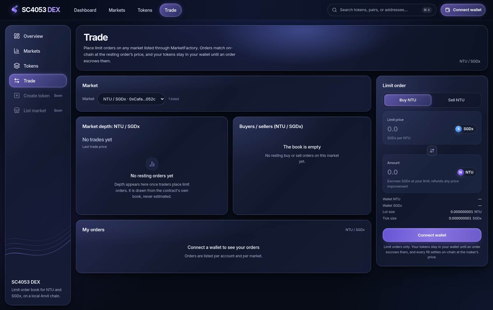
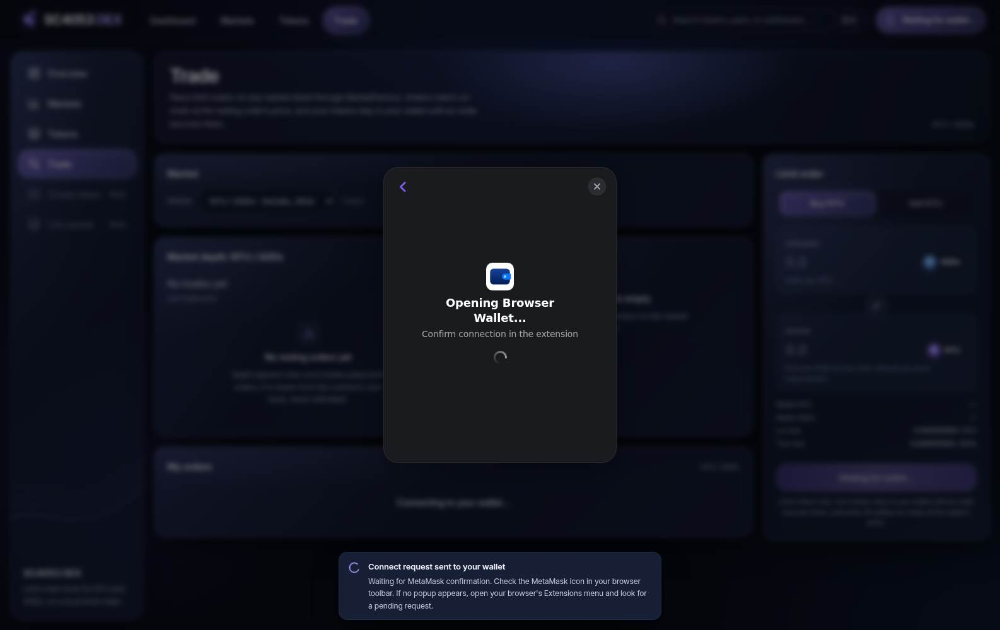
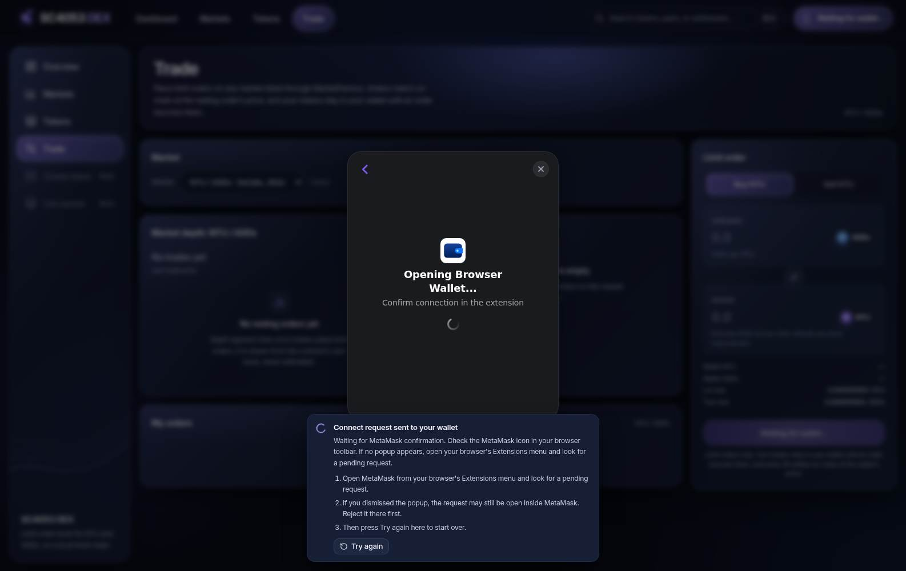
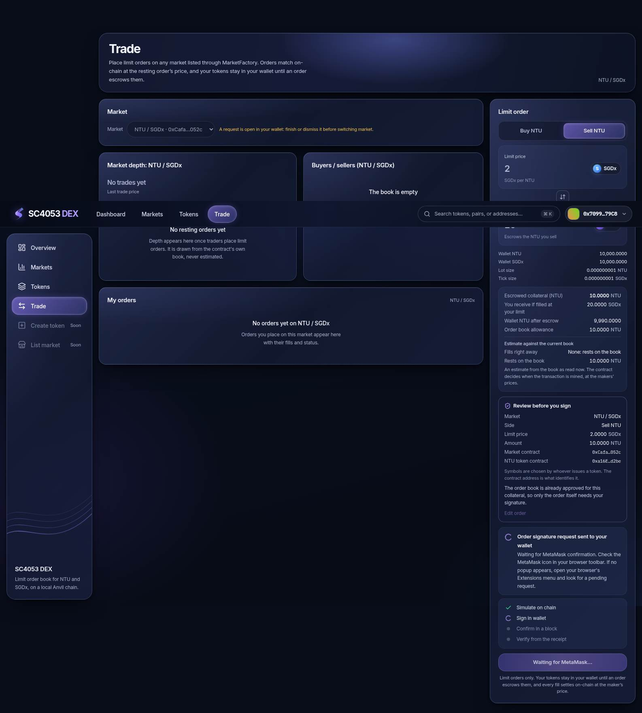
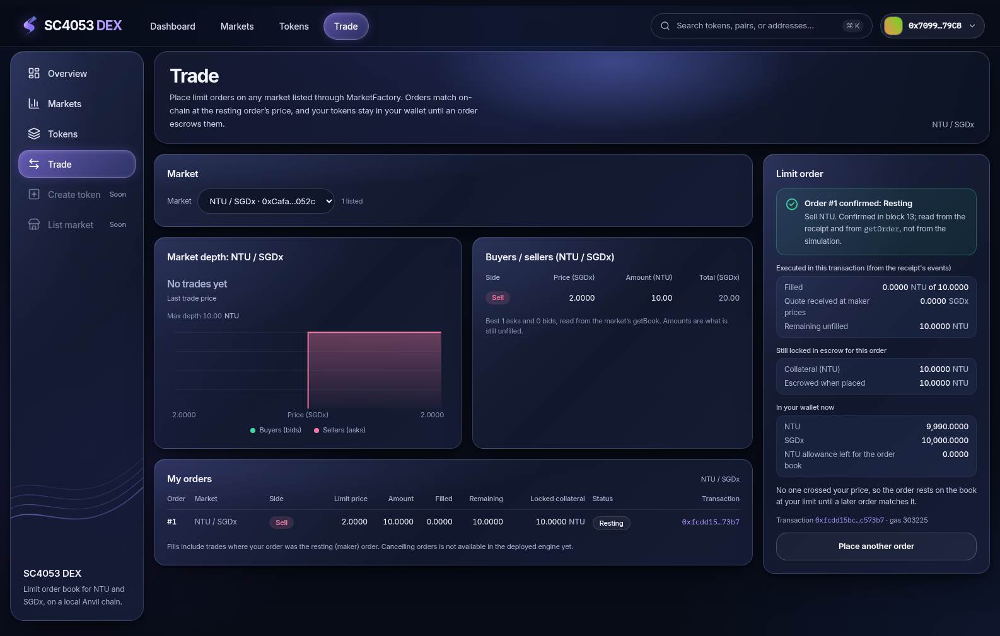
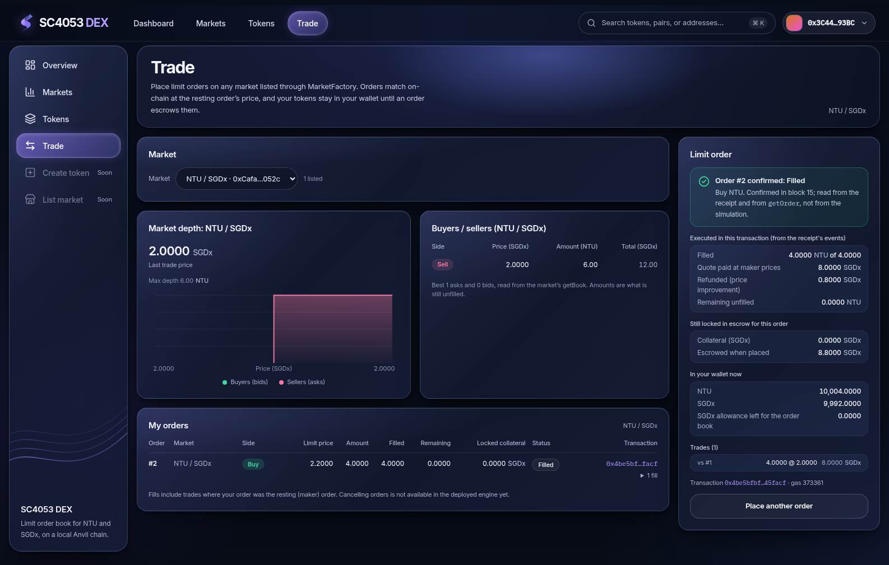
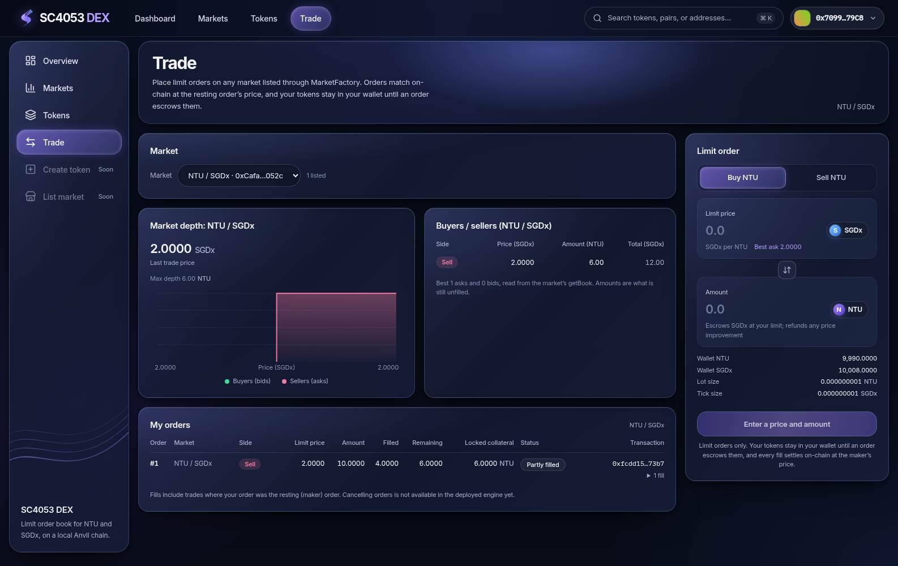
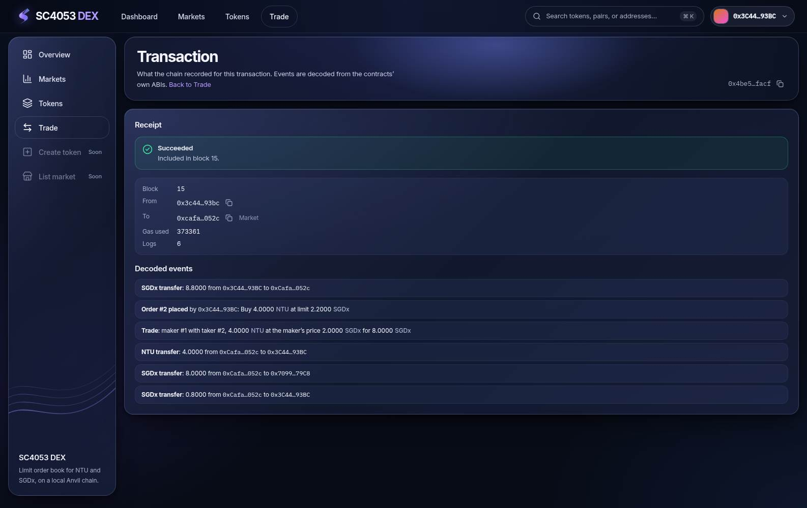

# Manual testing guide for the SC4053 DEX

How to bring the project up after restarting your computer, and how to verify the exchange by hand with **MetaMask**. It assumes you have never used Anvil, MetaMask or this DEX. For a quick start see the [README](../README.md); for deployment and front-end internals see [DEPLOYMENT.md](DEPLOYMENT.md) and [FRONTEND.md](FRONTEND.md).

Everything here runs on a **local Anvil chain**. The walkthrough sends real (local, worthless) transactions, so use a chain you are happy to change.

## How to read this guide: what has actually been verified

Every test below is tagged. Nothing is described as passed unless that is true.

| Tag | Meaning |
|---|---|
| **Owner-verified with MetaMask** | The project owner performed it with real MetaMask accounts in Windows Brave and reported the result (2026-11-06). I (the AI) then checked the resulting chain state read-only |
| **Mock-wallet result** | An automated browser run passed with an injected *mock* wallet. This is **not** MetaMask |
| **Procedure only** | Written down, **not yet performed manually**. Do not read it as a passed test |

Screenshots are labelled the same way: **Reference render** = a screenshot of this DEX from the automated mock-wallet run (it shows the UI, **never** a MetaMask window; its accounts differ from this guide, see the note under Section D); **Screenshot to supply** = a real image the owner still has to capture (list in Section D).

---

# A. Prepare the test environment

### A1. Start WSL and open the project
In Windows, open **Ubuntu** from the Start menu (or run `wsl` in PowerShell). Then:
```bash
cd ~/projects/SC4053-BlockChain-Project        # wherever you cloned it; this folder is the "repo root"
export PATH="$HOME/.foundry/bin:$PATH"          # once per terminal if Foundry is not already on your PATH
```
First time on this machine? Do the one-time setup in the [README, section 1](../README.md#1-first-time-setup-once-per-machine) first.

### A2. Start Anvil (terminal 1)
```bash
anvil
```
Leave this terminal open: **closing it destroys the chain**. You should see `Available Accounts`, `Private Keys`, `Wallet`, `Chain ID 31337` and, last, `Listening on 127.0.0.1:8545`.

### A3. Verify the chain ID (terminal 2, any folder)
```bash
cast chain-id --rpc-url http://127.0.0.1:8545
```
Expected: `31337`.

### A4. Is a deployment already there? (do this before deploying)
From the repo root:
```bash
scripts/check-local.sh
```
It is read-only (it never deploys or changes anything). Read the last line:

| Result | Meaning | What to do |
|---|---|---|
| `Result: ready ... No deployment is needed.` | The contracts exist on this chain and match the export | **Skip to A7.** Do not deploy again |
| `NO contract code ... None of the exported contracts exist` | Fresh or restarted Anvil | Deploy once (A5, A6) |
| `export check failed` but the contracts exist | The chain is fine; the export record is stale | **Do not deploy.** See Section E, item 3 |
| `no JSON-RPC answer` | Anvil is not running | Do A2 |

### A5. Deploy (only when A4 said there is no deployment)
```bash
cd contracts
export RPC_URL=http://127.0.0.1:8545
export DEPLOYER=0xf39Fd6e51aad88F6F4ce6aB8827279cffFb92266     # Anvil account 0: a public address, not a key
forge script script/Deploy.s.sol:Deploy --rpc-url "$RPC_URL" --broadcast --unlocked --sender "$DEPLOYER"
cd ..
```
Expected: a `== Logs ==` block listing `TokenFactory`, `MarketFactory`, `NTU (base)`, `SGDx (quote)` and `NTU/SGDx market`, then `ONCHAIN EXECUTION COMPLETE & SUCCESSFUL.` On a fresh Anvil the addresses are always the same (listed in the README).

### A6. Export the ABIs and addresses
From the repo root:
```bash
node contracts/script/export-web.mjs --rpc-url http://127.0.0.1:8545
node contracts/script/export-web.mjs --check --rpc-url http://127.0.0.1:8545
```
The second command must print `export-web: abis.ts, deployments.ts are up to date for chain 31337`.

### A7. Start the app (terminal 3)
```bash
cd web
npm run dev
```
Expected: `Next.js 16.4.5 (Turbopack)`, `Local: http://localhost:3000` and `Ready`. Open **http://localhost:3000** in Windows Brave.

### A8. Confirm the dashboard sees the deployment
On the **Dashboard** the *Network* card should read `Anvil (local)`, `Chain ID 31337 · block N`, and there must be **no** yellow banner saying "No SC4053 DEX deployment on this chain". The **Markets** page should list `NTU / SGDx`. If you see the banner, the chain has no deployment: go back to A4.

### A9. Configure MetaMask for Anvil
In MetaMask add a custom network (menu names vary by MetaMask version):

| Field | Value |
|---|---|
| Network name | Anvil Local |
| New RPC URL | `http://127.0.0.1:8545` |
| Chain ID | `31337` |
| Currency symbol | `ETH` |

Then switch MetaMask to **Anvil Local**. The app and MetaMask must use the *same* Anvil: the app reads the chain over its own RPC connection (even before you connect a wallet), and MetaMask uses the RPC you just entered. "Connect wallet" in the app is a third, separate thing: permission for the site to see one account.

> **Screenshot to supply:** `images/manual-testing/01-metamask-add-network.png` (the filled-in network form).

### A10. Verify balances
Two accounts matter (details in Section B): **Alice** = Anvil account 0 `0xf39F…2266`, **Bob** = account 1 `0x7099…79C8`. From the repo root, read-only:
```bash
RPC=http://127.0.0.1:8545
NTU=$(grep -E '^\s*baseToken:'  web/lib/contracts/deployments.ts | grep -oE '0x[0-9a-fA-F]{40}' | head -1)
SGDX=$(grep -E '^\s*quoteToken:' web/lib/contracts/deployments.ts | grep -oE '0x[0-9a-fA-F]{40}' | head -1)
for who in 0xf39Fd6e51aad88F6F4ce6aB8827279cffFb92266 0x70997970C51812dc3A010C7d01b50e0d17dc79C8; do
  n=$(cast call "$NTU"  "balanceOf(address)(uint256)" $who --rpc-url $RPC | cut -d' ' -f1)
  s=$(cast call "$SGDX" "balanceOf(address)(uint256)" $who --rpc-url $RPC | cut -d' ' -f1)
  echo "$who NTU=$(cast from-wei $n) SGDx=$(cast from-wei $s) ETH=$(cast balance $who --rpc-url $RPC --ether)"
done
```
**Expected right after a fresh deployment, before any test:**

| Account | ETH | NTU | SGDx |
|---|---|---|---|
| Alice (account 0, the deployer) | about 10,000 (a little less after deploy gas) | **970,000** (1,000,000 minus 3 × 10,000 sent to accounts 1 to 3) | **970,000** |
| Bob (account 1) | about 10,000 | **10,000** | **10,000** |

(I ran this snippet on the owner's chain after their MetaMask test and it printed 969,990 / 970,008 for Alice and 10,004 / 9,992 for Bob, exactly the values Section C predicts after the trades.)

To show the tokens in MetaMask, import them once per account (README, "Import NTU and SGDx into MetaMask"): *Import tokens, Custom token*, paste the NTU address, then the SGDx address (both are in `web/lib/contracts/deployments.ts` and on the app's **Tokens** page).

---

# B. Alice and Bob: two local accounts

### B1. Address versus private key
- An **address** (`0x7099…79C8`) is public, like an account number. It identifies an account and is safe to share.
- A **private key** (a 64-hex-digit secret) is what *signs* transactions. Whoever has it controls the account.
- MetaMask holds keys and signs; this app never sees a key. Anvil's accounts are **unlocked** on the node, which is why the deploy script needs no key.

> **Anvil's default accounts, keys and mnemonic are publicly known.** They exist only for local, disposable chains. **Never** send real assets to them or reuse them anywhere else. Do not paste a key or seed phrase into the repository, a document, a screenshot or a chat. This repository contains none.

### B2. The two accounts
| Name | Anvil account | Address starts with |
|---|---|---|
| Alice | 0 | `0xf39F…` (full: `0xf39Fd6e51aad88F6F4ce6aB8827279cffFb92266`) |
| Bob | 1 | `0x709979…` (full: `0x70997970C51812dc3A010C7d01b50e0d17dc79C8`) |

### B3. Where is Bob's private key?
Look in the terminal where you started Anvil (A2), under **`Private Keys`**: the line numbered **`(1)`** belongs to account 1. Alice's is `(0)`. The `Available Accounts` list above it shows the matching addresses, so you can confirm that `(1)` pairs with `0x7099…79C8`.

### B4. The terminal output has scrolled away or Anvil was restarted
If you started Anvil with the defaults, its mnemonic is Anvil's default phrase and is the same on every run. You can read it again **without touching your main chain** by starting a throwaway Anvil on another port:
```bash
anvil --port 8599          # read the "Mnemonic:" line in its banner, then press Ctrl+C
```
Then derive account 1 locally (the two `cast` commands were verified with Foundry 1.9.0 on this project; `read -s` is ordinary bash):
```bash
read -r -s ANVIL_MNEMONIC                                   # paste the phrase from the "Mnemonic:" line, press Enter (nothing is echoed)
cast wallet private-key "$ANVIL_MNEMONIC" 1                 # account index 1 = Bob; prints a private key (do not save or share it)
cast wallet address --private-key "$(cast wallet private-key "$ANVIL_MNEMONIC" 1)"   # sanity check: must print 0x70997970C51812dc3A010C7d01b50e0d17dc79C8
unset ANVIL_MNEMONIC
```
The long form `cast wallet private-key --mnemonic "$ANVIL_MNEMONIC" --mnemonic-index 1` gives the same key. Use index `0` for Alice. If you started Anvil with your own `--mnemonic`, use your phrase instead.

*What was verified here:* the commands above, run against a scratch Anvil, produced `0x70997970C51812dc3A010C7d01b50e0d17dc79C8` for index 1 (equal to the address in that Anvil's banner), both syntaxes matched, and two separate Anvil instances printed the identical phrase (compared by hash, not displayed).

### B5. Import an account into MetaMask
In MetaMask (menu names vary by version): open the **account selector** at the top, choose **Add account or hardware wallet**, then **Import account**, keep the type **Private Key**, paste the key, and press **Import**. Do this once for Alice's key and once for Bob's key. Make sure **Anvil Local** is the selected network afterwards.

> **Screenshot to supply:** `images/manual-testing/02-metamask-import-account.png`. Capture the dialog **without** the key visible (before pasting, or with the field cropped out).

### B6. The label "Imported Account 1" does not mean Anvil account 1
MetaMask names imported accounts in the order *you* imported them ("Imported Account 1", "Imported Account 2", …). That has nothing to do with Anvil's numbering. **The address is the only authority**: Alice is the account that starts `0xf39F…`, Bob is the one that starts `0x7099…`. Check the shortened address under the account name (click it to copy the full address) before every test. You can rename accounts in MetaMask to "Alice" and "Bob" to avoid mistakes.

> **Screenshot to supply:** `images/manual-testing/03-metamask-account-list-alice-bob.png`.

---

# C. Step-by-step trading walkthrough

Use the **Trade** page (**http://localhost:3000/trade**, or *Open Trade view* on the dashboard's order panel). It shows the ticket (right), the market depth and book, and **My orders** (bottom). The expected numbers assume a **fresh deployment with an empty order book** (order ids start at 1); on a chain that already has orders, ids and balances will differ.

## Test 1: connect MetaMask and check the account and network
**Status: owner-verified with MetaMask (connection of Alice and Bob).**

1. In MetaMask select **Alice** (`0xf39F…`) on **Anvil Local**.
2. In the app press **Connect wallet** (top right).

   > Reference render (mock wallet, not MetaMask): the page before connecting.
   > 
3. In the dialog **Connect a Wallet**, choose the browser-wallet entry. (In the automated run it was labelled "Browser Wallet"; with MetaMask installed the label may differ. Pick the only wallet entry listed.)
4. Approve the connection in the **MetaMask window** that opens, choosing the account you want the site to see.

   > **Screenshot to supply:** `images/manual-testing/04-dex-connect-wallet-dialog.png` and `images/manual-testing/05-metamask-connect-request.png`.
5. **If nothing seems to happen:** the MetaMask request may be hidden. The app shows a card: *"Waiting for MetaMask confirmation. Check the MetaMask icon in your browser toolbar. If no popup appears, open your browser's Extensions menu and look for a pending request."* In Brave, click the **Extensions (puzzle) icon** in the toolbar, open **MetaMask** and approve the pending request. After 20 seconds the card adds recovery steps and a **Try again** button.

   > Reference render (mock wallet): the card above RainbowKit's dialog, then with recovery steps.
   > 
   > 

**Expected:** the header chip shows `0xf39F…2266`; the dashboard *Wallet* card shows the same address and the *Network* card shows `Anvil (local)`, chain 31337; the Trade ticket's button changes from "Connect wallet" to "Enter a price and amount". The ticket's rows "Wallet NTU" and "Wallet SGDx" show Alice's balances (970,000 each on a fresh deployment).

> **Screenshot to supply:** `images/manual-testing/06-dex-connected-alice.png`.

## Test 2: Alice places a Sell NTU limit order
**Status: owner-verified with MetaMask (Alice sold 10 NTU at 2 SGDx and it rested).**

Remember: an **ERC20 approval** and **placing the order** are two *different* blockchain transactions with two MetaMask confirmations. The token contract must first let the order book move your tokens (approval, `approve`); only then can the order book pull them into escrow (placing the order, `placeLimitOrder`).

1. With Alice connected, click the **Sell NTU** tab.
2. **Limit price:** `2`. **Amount:** `10`.
3. The summary shows *Escrowed collateral (NTU)* `10.0000 NTU`, *You receive if filled at your limit* `20.0000 SGDx`, and under *Estimate against the current book* "Fills right away: None: rests on the book".
4. Click **Review order**. A card **Review before you sign** appears: market `NTU / SGDx`, side `Sell NTU`, price `2.0000 SGDx`, amount `10.0000 NTU`, the market and NTU contract addresses, and *"Step 1 of 2: approve exactly 10 NTU for the order book … Step 2 is a separate wallet request to place the order."*
5. Click **Approve 10 NTU**. A MetaMask window opens asking you to approve a **spending cap** for NTU (wording varies by MetaMask version: look for a request naming the NTU token, the amount **10** and the **market address** as the spender). Confirm it. While you decide the app shows the "Waiting for MetaMask confirmation…" card.

   > Reference render (mock wallet): review card and the waiting card (the mock run's seller is `0x7099…`, not Alice).
   > 
   >
   > **Screenshot to supply:** `images/manual-testing/07-dex-sell-form-review.png`, `images/manual-testing/08-metamask-spending-cap-ntu.png`.
6. When the approval is mined the app says **"The order book can move 10 NTU for you. Place the order when ready."** and the main button changes to **Place sell order**.

   > **Screenshot to supply:** `images/manual-testing/09-dex-approval-confirmed.png`.
7. Click **Place sell order** and confirm the second MetaMask window (a contract interaction on Anvil Local with a small ETH fee).

   > **Screenshot to supply:** `images/manual-testing/10-metamask-confirm-place-sell.png`.

**Expected result:** the card **Order #1 confirmed: Resting** (a fresh book gives id 1). *Executed in this transaction*: Filled `0.0000 NTU of 10.0000`, Remaining unfilled `10.0000 NTU`. *Still locked in escrow*: Collateral (NTU) `10.0000 NTU`. *In your wallet now*: NTU `969,990.0000` (a drop of exactly 10 from 970,000) and an allowance left of `0.0000` (the approval was exactly the amount and the order used it). The depth chart and the **Buyers / sellers** book show a **Sell** row at `2.0000` for `10.00`, and **My orders** lists `#1`, `Sell`, status `Resting`.

   > Reference render (mock wallet): a resting sell result.
   > 
   >
   > **Screenshot to supply:** `images/manual-testing/11-dex-order1-resting.png`.

**Check on the chain (read-only):** `cast call <market> "getUserOrderIds(address)(uint256[])" 0xf39Fd6e51aad88F6F4ce6aB8827279cffFb92266 --rpc-url http://127.0.0.1:8545` prints `[1]`. (Alice's receipt has two events: an NTU transfer of 10 into the market and the order-placed event; I confirmed that on the owner's chain.)

## Test 3: switch MetaMask from Alice to Bob
**Status: owner-verified with MetaMask (Bob connected and traded).**

1. Open MetaMask and click the **account selector** at the top (the current account's name).
2. Choose the account whose address starts **`0x7099…`** (it may be named "Imported Account 1"; the address is what matters, see B6).
3. If MetaMask asks whether to connect this account to `localhost:3000`, accept (this prompt's exact behaviour depends on the MetaMask version and has not been verified here).

**Expected:** within a moment the header chip shows `0x7099…79C8`; the *Wallet* card changes; the ticket's rows show Bob's balances (`10,000.0000` NTU and `10,000.0000` SGDx on a fresh deployment); the previous account's review step and result card are gone; **My orders** shows no orders for Bob. Nothing from Alice's session appears under Bob.

> **Screenshot to supply:** `images/manual-testing/12-metamask-account-selector-bob.png`, `images/manual-testing/13-dex-connected-bob.png`.

## Test 4: Bob places a Buy NTU limit order
**Status: owner-verified with MetaMask.**

1. Click the **Buy NTU** tab. **Limit price:** `2.2`. **Amount:** `4`. The price hint "Best ask 2.0000" shows Alice's resting order.
2. The summary shows *Escrowed collateral (SGDx)* `8.8000 SGDx`, and under the estimate: *Fills right away* `4.0000 NTU in 1`, *Paid at maker prices* `8.0000 SGDx`, *Refund for price improvement* `0.8000 SGDx`.
3. Click **Review order**. It states *"approve exactly 8.8 SGDx"*.
4. Click **Approve 8.8 SGDx**. **MetaMask popup 1:** a spending-cap request for **SGDx**, amount **8.8**, spender the market address. Confirm.

   > **Screenshot to supply:** `images/manual-testing/14-metamask-spending-cap-sgdx.png`.
5. When the app says the order book can move 8.8 SGDx, click **Place buy order**. **MetaMask popup 2:** the contract-interaction confirmation. Confirm.

   > **Screenshot to supply:** `images/manual-testing/15-metamask-confirm-place-buy.png`.

**Expected result:** **Order #2 confirmed: Filled**. *Executed in this transaction*: Filled `4.0000 NTU of 4.0000`; Quote paid at maker prices `8.0000 SGDx` (Alice's price of 2, not your limit of 2.2); **Refunded (price improvement) `0.8000 SGDx`**; Remaining unfilled `0.0000`. *Trades (1)*: `vs #1   4.0000 @ 2.0000   8.0000 SGDx`. *In your wallet now*: NTU `10,004.0000`, SGDx `9,992.0000`, allowance left `0.0000`. In short: Bob received 4 NTU and paid 8 SGDx net (8.8 escrowed, 0.8 refunded).

   > Reference render (mock wallet): the same example (accounts differ).
   > 
   >
   > **Screenshot to supply:** `images/manual-testing/16-dex-order2-filled.png`.

## Test 5: switch back to Alice and inspect Order #1
**Status: not separately reported by the owner. The chain state below was checked read-only (see Section F); the on-screen steps are a procedure.**

1. Switch MetaMask back to the `0xf39F…` account (as in Test 3).
2. On the Trade page look at **My orders** (and the **Buyers / sellers** book).

**Expected:** order `#1`, `Sell`, `2.0000`, Amount `10.0000`, Filled `4.0000`, Remaining `6.0000`, Locked collateral `6.0000 NTU`, status **`Partly filled`**. The book shows a Sell row of `6.00` at `2.0000`. Alice's SGDx rose by 8 (to `970,008.0000` on a fresh deployment) and her NTU is `969,990.0000`; the market contract holds the 6 NTU.

**Chain check (verified on the owner's chain):** `getOrder(1)` returns side `1` (Sell), amount `10e18`, filled `4e18`, status `1` (PartiallyFilled); `getOrder(2)` returns status `2` (Filled); the market holds `6` NTU.

> **Screenshot to supply:** `images/manual-testing/17-dex-alice-order1-partly-filled.png`.
> Reference render (mock wallet): My orders with a partly filled order.
> 

## Test 6: My orders and transaction details
**Status: procedure. The decoded events below were verified read-only against the owner's real transaction.**

1. In **My orders**, the columns are *Order, Market, Side, Limit price, Amount, Filled, Remaining, Locked collateral, Status, Transaction*. A row with fills has a **"1 fill"** disclosure that lists each fill's amount, price and transaction.
2. Click a **Transaction** link (a shortened `0x…` hash). The **Transaction** page opens at `/tx/<hash>`.
3. Check the **Receipt**: **Succeeded**, *Included in block N*, From (the trader), To (the **Market**), Gas used.
4. **Bob's order transaction, "Decoded events", in order:**
   1. `SGDx transfer: 8.8000` from Bob to the market (the escrow);
   2. `Order #2 placed` by Bob: Buy `4.0000` NTU at limit `2.2000` SGDx;
   3. `Trade: maker #1 with taker #2, 4.0000 NTU at the maker's price 2.0000 SGDx for 8.0000 SGDx`;
   4. `NTU transfer: 4.0000` from the market to Bob;
   5. `SGDx transfer: 8.0000` from the market to Alice (the maker is paid at her price);
   6. `SGDx transfer: 0.8000` from the market to Bob (the refund).
   Alice's order transaction has two events: an NTU transfer of `10.0000` into the market and `Order #1 placed`.
5. Reconcile the numbers: escrow 8.8 = paid 8 + refund 0.8 + still locked 0. Filled 4 of 4. Alice's remaining 6 NTU is still escrowed in the market.
6. On the command line (read-only): `cast receipt <hash> --rpc-url http://127.0.0.1:8545` shows `status 1`; `cast call <market> "getOrder(uint256)((uint256,address,uint8,uint256,uint256,uint256,uint256,uint256,uint64,uint8))" 2 --rpc-url http://127.0.0.1:8545` shows the order.

   > Reference render (mock wallet): the transaction page.
   > 
   >
   > **Screenshot to supply:** `images/manual-testing/18-dex-tx-page-bob.png`.

## Test 7: negative and recovery cases
**Status: every case here is a PROCEDURE ONLY. None has been performed manually with MetaMask.** Where an automated mock-wallet run covered the same behaviour, that is noted; it does not count as a MetaMask result.

| # | Case | Do this | Expect | Existing evidence |
|---|---|---|---|---|
| 7a | Rejected approval | Start an order, press **Approve …**, then **Reject** in the MetaMask window | Card *"You rejected the approval request"*; *Nothing was sent*; **Try again** | Mock-wallet run |
| 7b | Rejected order signature | After the approval, press **Place …order**, then **Reject** | *"You rejected the order request"*; no order is created; **Try again** returns to the review step | Mock-wallet run |
| 7c | Wrong network | In MetaMask switch to another network (for example Ethereum Mainnet) | Header **Wrong network**; a yellow banner "Your wallet is on chain N"; the ticket button becomes **Switch to Anvil**. Pressing it shows the waiting card; approve it in MetaMask to return | Mock-wallet run |
| 7d | Account switch | Switch account (Test 3) | Result cards and review steps from the other account disappear. Switching *while a MetaMask request is open* shows "Your account, network or market changed" with **Dismiss** (whether MetaMask lets you switch with a popup open is not verified) | Mock-wallet run |
| 7e | Duplicate submission | Double-click **Approve …** or **Place …order** quickly | Only **one** MetaMask request opens | Mock-wallet run |
| 7f | Missing deployment | Stop Anvil and start a fresh one (`anvil`) **without deploying** (this destroys your chain) | Yellow banner **"No SC4053 DEX deployment on this chain"**; the ticket button reads **Market unavailable**. Fix: A4 to A6 | Rendered in an earlier phase |
| 7g | Unavailable RPC | Stop Anvil (Ctrl+C) | Red banner **"Cannot reach the local Anvil node"**; nothing is shown as live | Rendered in an earlier phase |
| 7h | Hidden MetaMask request | Press **Connect wallet** or **Approve …** and do not open MetaMask | The "Waiting for MetaMask confirmation…" card; after 20 s, recovery steps and **Try again**. Use the Extensions icon (see Test 1). If you dismissed a popup, **reject the old request in MetaMask first**, then press Try again | Mock-wallet run (wording and timing); real behaviour reported by the owner |

After 7f or 7g you may need to reset MetaMask's cached nonce (Section E, item 1).

## Test 8: create a token and list a market (P2-6)
**Status: PROCEDURE ONLY. Not performed with MetaMask.** The same flows have passed an automated browser run with a **mock** wallet and a scratch-chain integration suite (see `ai-audit/test-evidence/person2/p2-6-issuance-listing.md`); neither is a MetaMask result. Use Alice (as in Tests 1 to 6) unless stated.

| # | Do this | Expect |
|---|---|---|
| 8a | Open **Create token**. Enter name `Fizz Coin`, symbol `FIZZ`, supply `1000000`; press **Review token** | A review card repeats the three values and says 18 decimals and no owner or minting |
| 8b | Press **Create token** and confirm the single MetaMask request | The waiting card, then a result card: token address, name, symbol, 18 decimals, total supply 1,000,000, your balance 1,000,000, "Issued by TokenFactory". Only one MetaMask request opened (no approval is needed) |
| 8c | In a terminal: `cast call <token> "totalSupply()(uint256)" --rpc-url http://127.0.0.1:8545` and `balanceOf(<your address>)` | Both return `1000000000000000000000000` |
| 8d | In MetaMask, Import tokens with the address from the card | FIZZ shows 1,000,000 (MetaMask wording unverified) |
| 8e | Open **Tokens** (no reload) | FIZZ is listed |
| 8f | From the result press **List a market for this token**; choose SGDx as quote | A review with the pair FIZZ / SGDx, both addresses, "quoted in SGDx per 1 FIZZ", an orientation warning and a checkbox; **List market** stays disabled until the box is ticked |
| 8g | Tick the box, press **List market**, confirm in MetaMask | A result card naming the market address, base FIZZ and quote SGDx |
| 8h | Open **Markets** | The FIZZ / SGDx market is listed |
| 8i | Press **Trade this market** | The Trade page opens on FIZZ / SGDx with an empty book and no trades |
| 8j | Sell 10 FIZZ at 2 (approval of exactly 10 FIZZ, then the order). Switch to Bob and buy 4 FIZZ with a limit of 2.2 | The same result as Test 4 on this market: trade at 2, refund 0.8 SGDx |
| 8k | Go back to **List market** and choose SGDx as base and FIZZ as quote | "This pair already has a market" with a link to it, and no sign button; nothing is sent |
| 8l | Press **Reject** on a create-token or list-market confirmation | "You rejected the request"; nothing is created; **Try again** works |

---

# D. Screenshots

**Reference renders** used above live in [`ai-audit/test-evidence/person2/p2-5-screens/`](ai-audit/test-evidence/person2/p2-5-screens/) (reused, not copied: about 1.9 MB in total). They were captured by an automated browser run with a **mock wallet** against a scratch chain. They show this DEX's interface faithfully, but they are **not MetaMask screenshots**, and in them the acting accounts are `0x7099…` (the seller, "Alice") and `0x3C44…` (the buyer, "Bob"). In **this guide** Alice is account 0 (`0xf39F…`) and Bob is account 1 (`0x7099…`). Compare addresses against this guide, not against those images.

**Real screenshots still needed from the project owner.** None were present in the repository when this guide was written, so the steps above carry placeholders. Save each as a PNG in `docs/images/manual-testing/` using exactly these names, then replace the placeholder line with ``. Keep images under about 300 KB (crop to the relevant window) and **never include a private key or seed phrase**.

| File | What to capture |
|---|---|
| `01-metamask-add-network.png` | The Anvil Local network form, filled in |
| `02-metamask-import-account.png` | The Import account dialog (key field empty or cropped out) |
| `03-metamask-account-list-alice-bob.png` | The account selector with both accounts, addresses visible |
| `04-dex-connect-wallet-dialog.png` | The app's "Connect a Wallet" dialog |
| `05-metamask-connect-request.png` | MetaMask's connection request |
| `06-dex-connected-alice.png` | Dashboard or Trade page connected as Alice |
| `07-dex-sell-form-review.png` | Sell NTU, price 2, amount 10, with the "Review before you sign" card |
| `08-metamask-spending-cap-ntu.png` | MetaMask's spending-cap request for NTU (10) |
| `09-dex-approval-confirmed.png` | "The order book can move 10 NTU for you…" and the Place sell order button |
| `10-metamask-confirm-place-sell.png` | MetaMask confirmation of the order transaction |
| `11-dex-order1-resting.png` | "Order #1 confirmed: Resting" |
| `12-metamask-account-selector-bob.png` | MetaMask account selector, choosing Bob |
| `13-dex-connected-bob.png` | The app showing Bob's address and balances |
| `14-metamask-spending-cap-sgdx.png` | MetaMask's spending-cap request for SGDx (8.8) |
| `15-metamask-confirm-place-buy.png` | MetaMask confirmation of the buy order |
| `16-dex-order2-filled.png` | "Order #2 confirmed: Filled" with the refund and final balances |
| `17-dex-alice-order1-partly-filled.png` | Alice's My orders with #1 Partly filled, 6 NTU locked |
| `18-dex-tx-page-bob.png` | The transaction page for Bob's order |
| `19-metamask-extensions-pending-request.png` | Brave's Extensions menu with a pending MetaMask request |

---

# E. Troubleshooting and FAQ

Each item says how sure we are: **Verified here** (reproduced or checked in this project), **Reported by the owner**, or **Unverified** (a plausible explanation, not a confirmed cause).

### 1. Anvil lost its state after restarting Windows
- **Symptom:** the dashboard says "No SC4053 DEX deployment on this chain"; balances are zero; MetaMask transactions fail or look stuck.
- **Cause (verified here):** plain `anvil` keeps the chain in memory only. Restarting a scratch Anvil in this project gave block 0 with no contracts.
- **Check:** `scripts/check-local.sh` reports `NO contract code`.
- **Fix:** deploy and export once (README section 3 / A5, A6). Then reset MetaMask's cached nonce for the Anvil network: *Settings, Advanced, Clear activity tab data* (standard MetaMask behaviour; **not tested** in this project).
- **Not covered:** `anvil --state <file>` exists in Anvil's help and can persist a chain, but it has **not been tested** with this project's deployment and export checks.

### 2. Ports 3000, 3100, 8545 and 8546
| Port | Meaning |
|---|---|
| 8545 | Your main Anvil: the chain you and MetaMask use |
| 3000 | Your `npm run dev` server: the app you open |
| 8546 | A **scratch** Anvil used by automated tests |
| 3100 | A **scratch** app build/server pointed at 8546 for the automated browser test |

*Verified here.* The automated tests use 8546 and 3100 so they never write to 8545. The real-chain test refuses port 8545. Check what is listening: `ss -ltnp | grep -E ':(3000|3100|8545|8546) '`.

### 3. Stale deployments and generated addresses
- **Symptom A:** the app or `check-local.sh` says there is no deployment although you deployed. Or: `export-web: stale deployment: block 1 on this chain is 0x…, but the broadcast file recorded 0x…`.
- **Cause (verified here, issue p2-005):** `web/lib/contracts/deployments.ts` and the exporter's record `contracts/broadcast/Deploy.s.sol/31337/run-latest.json` describe one particular chain. A different or restarted chain, or a later deploy to a scratch chain (which overwrites the record), makes them disagree. The record is git-ignored and local.
- **Check:** `scripts/check-local.sh`. If the contracts have code but the export check fails, **the chain is fine**: do not redeploy.
- **Fix when the record belongs to another run:** find the timestamped copy that matches your chain, then restore it. Read your chain's block-1 hash (`cast block 1 --rpc-url http://127.0.0.1:8545`), find the run that recorded it (`grep -l <block-1-hash> contracts/broadcast/Deploy.s.sol/31337/run-*.json`), copy that file over `run-latest.json`, and run the export check again.
- **Prevention (verified):** when you deploy to a *scratch* chain, redirect forge's output: `FOUNDRY_BROADCAST=/tmp/scratch-broadcast FOUNDRY_CACHE_PATH=/tmp/scratch-cache forge script …`.
- **Symptom B:** contract addresses in `deployments.ts` have no code on the chain: that really is an empty chain, redeploy (A5).

### 4. MetaMask's connection notification is hidden in the Extensions menu
- **Symptom:** after pressing Connect (or Approve, or Place order) nothing appears to happen.
- **Cause (reported by the owner):** the MetaMask popup did not come to the front; the request was waiting inside the extension. A web page cannot see whether the popup is open.
- **Fix:** click the **Extensions (puzzle) icon** in Brave's toolbar and open **MetaMask**; approve or reject the pending request. The app shows a card explaining this and, after 20 seconds, recovery steps. If you dismissed the popup, reject the old request in MetaMask before pressing **Try again**.

### 5. Importing and switching between local test accounts
See B5 and Test 3. Always confirm the **address**, never the MetaMask label (B6).

### 6. Terminal output scrolled away, no private key visible
See B3 and B4: read the `Private Keys` section of Anvil's banner, or derive account 1 with `cast wallet private-key "$ANVIL_MNEMONIC" 1` (verified). A throwaway `anvil --port 8599` reprints the same default banner.

### 7. Unexpected native-token-symbol warnings
- **Symptom:** MetaMask warns that the currency symbol or network details do not match what it knows for chain ID 31337.
- **Status: unverified.** This was not reproduced here and the exact wording is not recorded, so no root cause is claimed.
- **What is safe:** use `ETH` as the symbol (README, A9). The symbol is a display label in MetaMask and does not affect the contracts or the app. If a warning blocks you, double-check the chain ID is `31337` and the RPC URL is `http://127.0.0.1:8545`.

### 8. Next.js hydration errors from browser extensions (ColorZilla)
- **Symptom:** the dev overlay or console shows a hydration mismatch mentioning an attribute such as `cz-shortcut-listen="true"` on `<body>`.
- **Likely cause (unverified here):** a browser extension (ColorZilla is a known one) adds that attribute to the page before React hydrates it, so the server HTML and the browser DOM differ. This was **not reproduced**: the automated Chromium has no such extension, and nothing in this repository sets that attribute.
- **Verify:** open `http://localhost:3000` in a private window or a browser profile with extensions disabled. If the warning disappears, an extension is the cause.
- **Resolution:** disable that extension for `localhost`, or use a clean profile. (A code change, `suppressHydrationWarning` on `<body>` in `web/app/layout.tsx`, is possible but has **not** been made; it needs the project owner's approval.)

### 9. Why approval and order submission need separate confirmations
Tokens live in the **token contracts**, not in the order book. Placing an order makes the order book call `transferFrom` on a token, which only works if you first allowed it with `approve`. Those are calls to two different contracts, so MetaMask asks twice. This app approves **exactly** the collateral (never "unlimited"), and the order uses it up, which is why the allowance is `0` again afterwards (verified on the owner's chain). *Verified by the automated tests and the owner's run.*

### 10. Why a resting order does not execute by itself
There is no background process. Matching happens **inside the transaction of a new order that crosses it**: Bob's buy transaction is what filled Alice's sell. Nothing matches orders later on its own, and the engine's `matchOrders` function is not implemented (it reverts), so a remainder left crossed after the 10-fill limit per transaction cannot be cleared yet. *Verified in the engine code and tests.*

### 11. Diagnosing insufficient allowance or balance
- **Symptom:** the ticket says "Your wallet balance is below the collateral…", or a transaction is refused with "Allowance is too low" / "Balance is too low" (the contract's `ERC20InsufficientAllowance` / `ERC20InsufficientBalance`, decoded by name; verified against a real chain).
- **Check balance:** A10's snippet. **Check allowance:** `cast call <token> "allowance(address,address)(uint256)" <owner> <market> --rpc-url http://127.0.0.1:8545`.
- **Fix:** press **Approve** again (the app asks only when the allowance is short), or fund the account with `cast send <token> "transfer(address,uint256)" <account> 10000ether --from 0xf39Fd6e51aad88F6F4ce6aB8827279cffFb92266 --unlocked --rpc-url http://127.0.0.1:8545` ([DEPLOYMENT.md](DEPLOYMENT.md), "Options").

### 12. Playwright Chromium shared-library problems in WSL
(Only relevant if you run the automated browser tests.)
- **Symptom:** launching Chromium fails with `error while loading shared libraries: libnss3.so` (or `libnspr4.so`).
- **Check:** `ldd ~/.cache/ms-playwright/chromium-*/chrome-linux64/chrome | grep "not found"` lists the missing libraries.
- **Cause (verified here):** a minimal WSL Ubuntu lacks them.
- **Fix:** `sudo apt-get install libnss3 libnspr4` (needs sudo; the owner did this, after which `ldd` showed nothing missing and Chromium launched normally). **No-sudo workaround that worked earlier:** `apt-get download libnss3 libnspr4`, extract with `dpkg-deb -x` into a temporary folder, and run the browser with `LD_LIBRARY_PATH` pointing at its `usr/lib/x86_64-linux-gnu`.

### Also seen: `web/next-env.d.ts` shows as modified
`npm run dev` and `npm run build` rewrite that generated file with different paths (verified here). It is not a real change: do not commit it. (Whether to git-ignore it is a team decision.)

---

# F. Status of manual verification (what a human has actually done)

| Test | Performed manually with MetaMask? | Evidence |
|---|---|---|
| 1. Connect | **Yes** (project owner) | Owner report; both accounts connected |
| 2. Alice sells 10 NTU at 2 | **Yes** | Owner report; chain: order #1 by `0xf39F…`, amount 10, price 2 |
| 3. Switch to Bob | **Yes** (implied: Bob traded) | Owner report |
| 4. Bob buys 4 NTU at 2.2 | **Yes** | Owner report; chain: order #2 by `0x7099…`, Filled; Bob 10,004 NTU / 9,992 SGDx |
| 5. Alice's order partly filled, 6 NTU | On-screen steps **not separately reported** | Owner reported "6 NTU remaining"; chain: filled 4e18, status 1, market holds 6 NTU |
| 6. My orders and transaction details | **Not separately reported** | Decoded events verified read-only against the owner's receipt |
| 7a to 7h. Negative and recovery cases | **No** | Procedures only |

The orders were created on-chain at 2026-11-05 15:00:21 UTC (order 1) and 15:29:48 UTC (order 2); the owner reported the result on 2026-11-06. The same SPEC example also passed in the automated mock-wallet browser run and in the real-chain suite on a scratch Anvil: see [`ai-audit/test-evidence/person2/p2-5-trading.md`](ai-audit/test-evidence/person2/p2-5-trading.md).

# G. Keeping this guide current
When a later phase materially changes behaviour (new forms, new pages, changed numbers), update the README, this guide's steps and expected values, the troubleshooting items, and the screenshot list in the same change. The rule is recorded in the project's local agent instructions.
