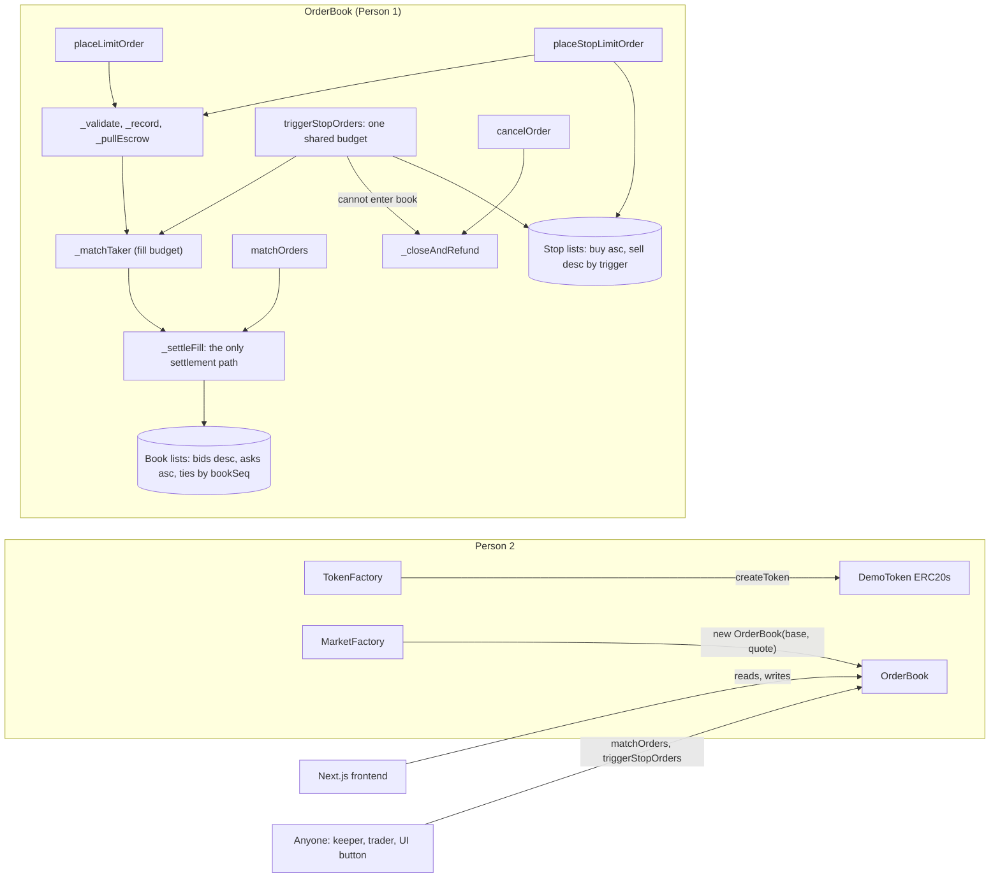

# 4. AI-Generated Architecture (engine)

## What the AI proposed (Phase 0, 28 Oct) and what happened to it

| Area | AI proposal | Outcome |
|---|---|---|
| Market structure | One `OrderBook` per token pair, immutable base and quote, 18-decimal tokens only | **Accepted.** Person 2 later added `MarketFactory`, which deploys an unmodified OrderBook per pair |
| Book storage | One sorted doubly linked list of order IDs per side, best order at the head | **Accepted.** O(1) best price and O(1) unlink; insertion bounded by `MAX_INSERT_SCAN` (`BookTooDeep`) |
| Priority | Price, then order ID | **Changed by the human (O1):** price, then an internal `bookSeq`, stamped when an order *enters the book*, so a stop triggered late queues behind earlier orders. Not in the interface |
| Escrow | Pull escrow last (strict CEI) | **Changed (1 Nov):** pull *before* matching, because fills pay out of the contract's balance. Documented as a CEI deviation that is safe under `nonReentrant`. A second deviation (payouts during the match loop) was found by review (issue 002) and documented |
| Rounding and dust | `AmountTooSmall` | **Rejected:** `LOT_SIZE = TICK_SIZE = 1e9` makes every `q * p / 1e18` exact (A1). The ceiling on buy escrow and the refund rule stay as a safety net |
| Buy escrow after a fill | (gap) | **AI proposal accepted (A5):** after each fill, `lockedQuote = requiredQuote(remaining, limit)`, and the rest is refunded. Price improvement is refunded per fill, and a resting buy is always fully funded |
| Execution | At the maker's price, at most `MAX_MATCHES_PER_TX` fills per call | **Accepted.** One internal `_settleFill` is the only settlement path, reused by placement, `matchOrders` and triggered stops |
| Stop orders | Two sorted stop lists (buy ascending, sell descending by trigger) | **Accepted, and simplified in Phase 6:** the stop lists reuse the book's linked-list code, and an order's status chooses the list |
| Trigger budget | `maxCount × MAX_MATCHES_PER_TX` | **Changed by the human:** one shared budget per call |
| Frontend helpers | A `requiredQuote` view, and `getOrder` returning zeros for unknown IDs | Accepted, and documented in the interface |
| Admin | None: no owner, no pause, no upgrade | Accepted |

## Final structure

**State:**
- `_orders` (the frozen `Order` struct) and `_userOrderIds`
- the book heads, with shared `_bookNext` and `_bookPrev` links
- `_stopHead`
- `_bookSeq` and `_lastBookSeq`
- `lastTradePrice` and `hasTradePrice`

An order is in at most one list. Its status says which: PendingTrigger orders are in a stop list; Open and PartiallyFilled orders are in the book.

**Interface:** frozen on 1 Nov and unchanged through all bonus phases. Every bonus function, event and error was in the interface from the start, as reverting stubs. Phases 4 to 6 only replaced stub bodies.
- **Changes after the freeze**, all by human decision: comments only, documentation of the inherited OpenZeppelin errors, and `getOrder` semantics.
- **The deployed ABI changed only in parameter names** when the stubs were implemented. The selectors stayed the same (`abis.ts`, `e375ff6`).

**Size:** OrderBook is 8,461 B runtime and MarketFactory 10,508 B, against the EIP-170 limit of 24,576 B (after Phase 6, `forge build --sizes`).
