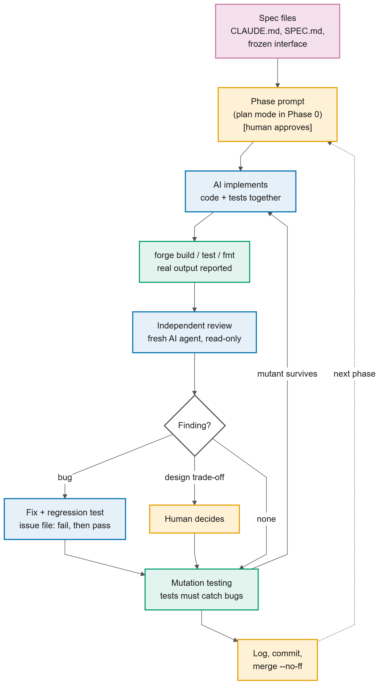
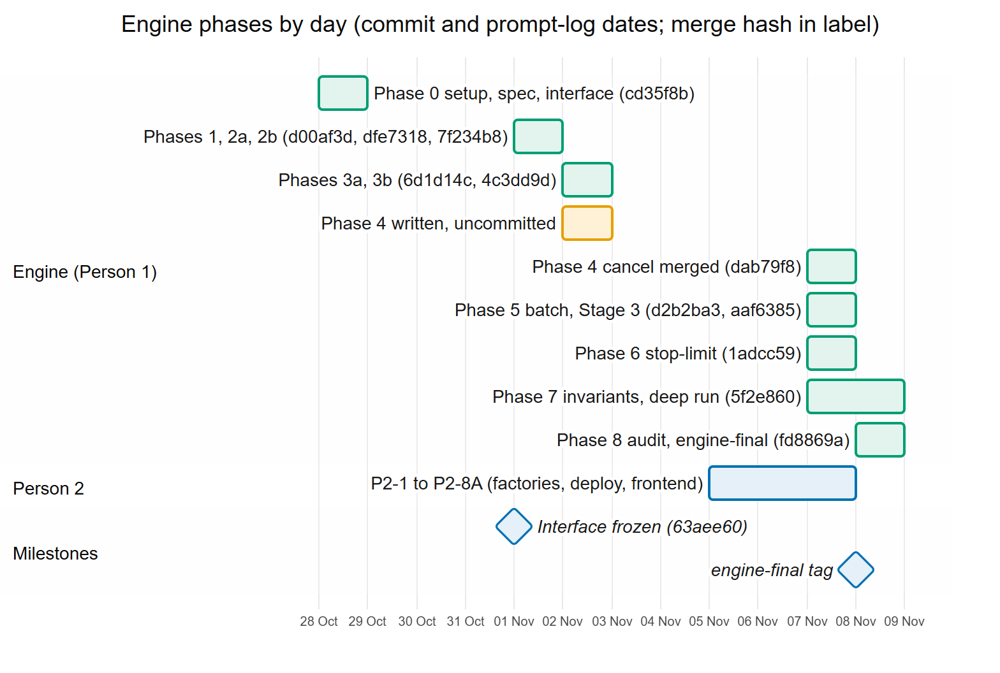
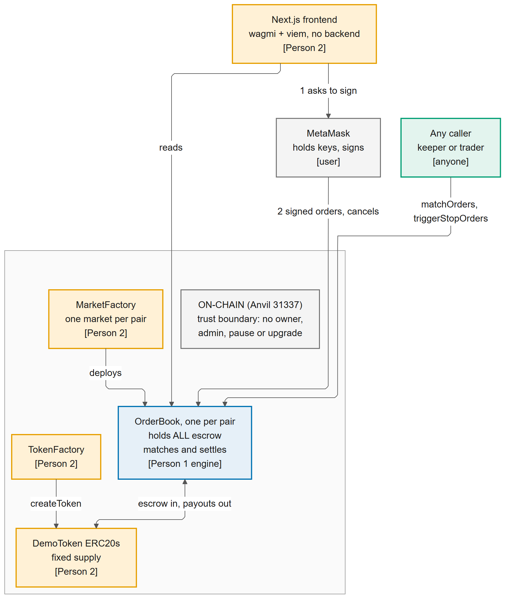
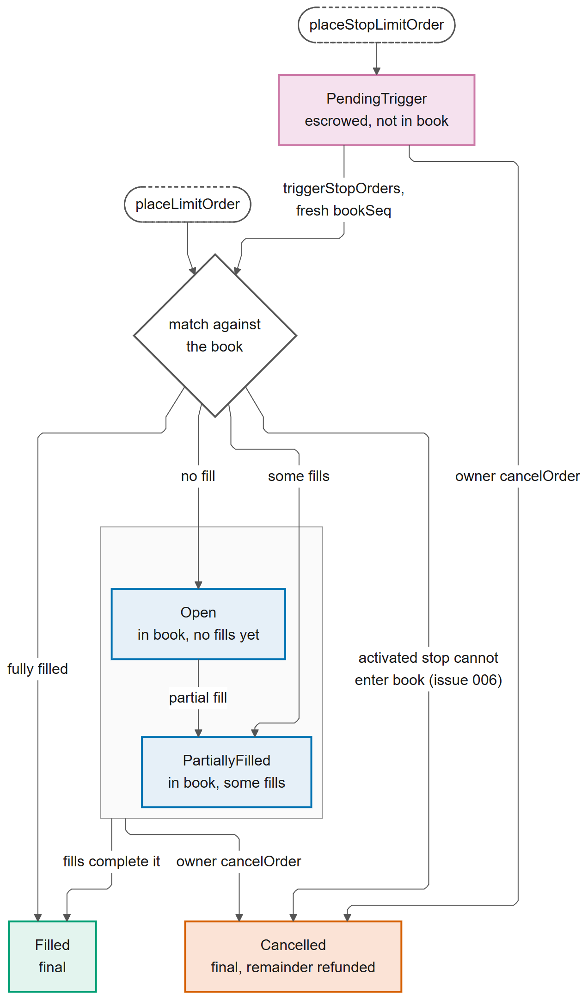
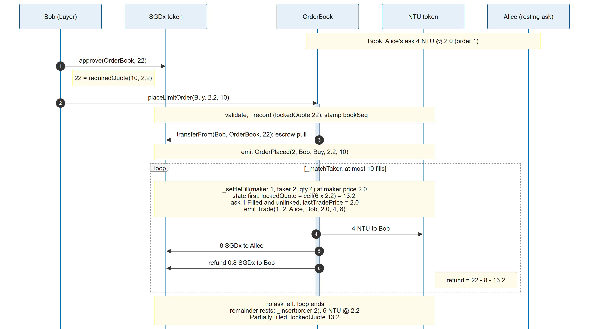
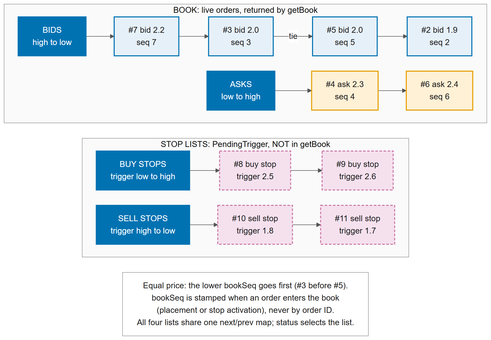
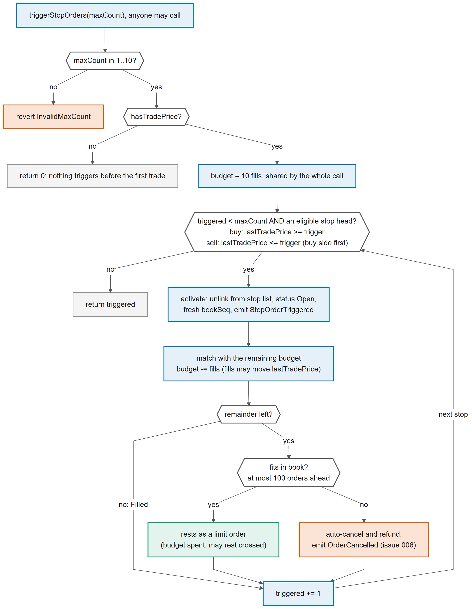
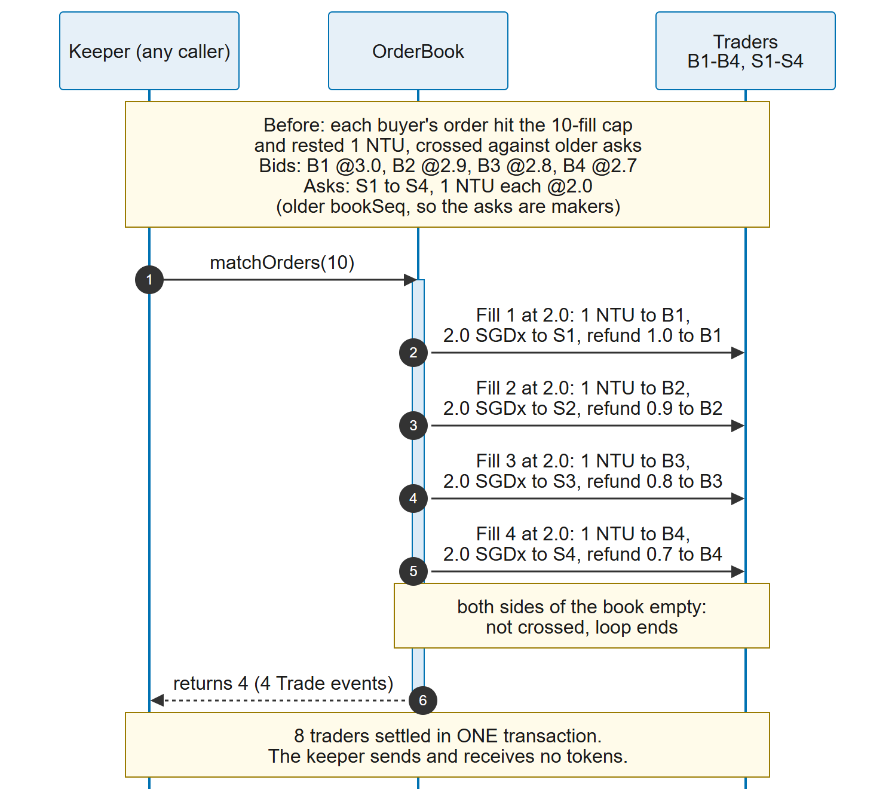
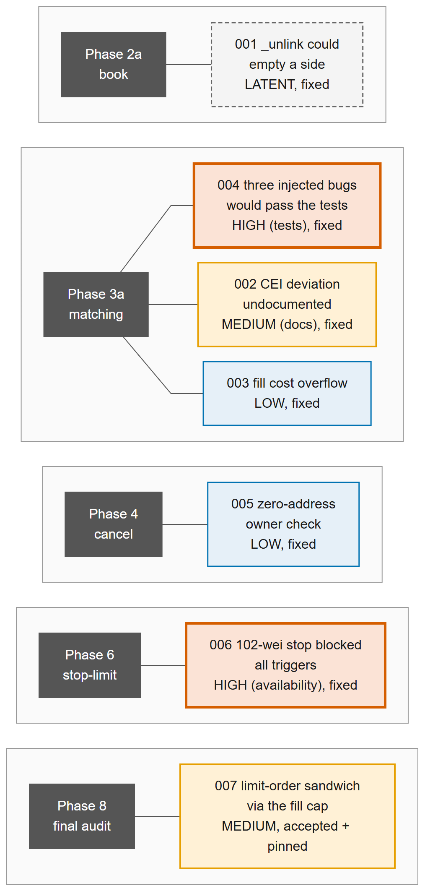
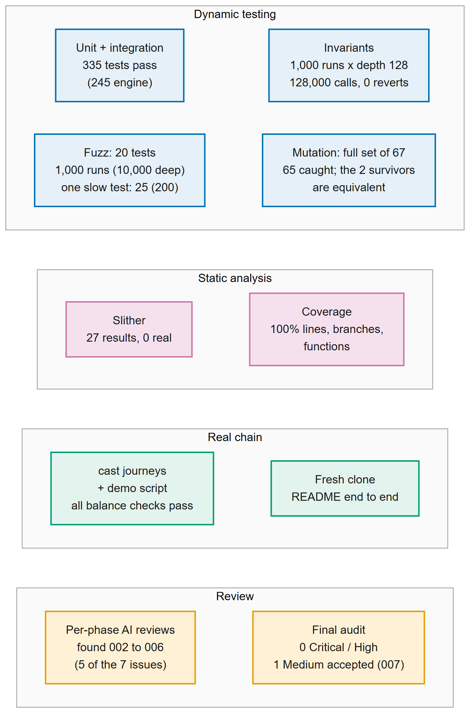

# SC4053 DEX: AI Audit Report

**Status:** full draft for team review, 8 Nov 2026. It is not yet the submission.

**Code basis:**
- `main` at the `engine-final` tag, commit `fd8869a`
- plus the documentation wrap-up that followed

**Team:**
- **Person 1:** trading engine (`OrderBook.sol`, its interface, specification and tests).
- **Person 2:** `TokenFactory`, `DemoToken`, `MarketFactory`, deployment script and exporter, Next.js front end, README.

**Brief:** `docs/Development_Project.pdf`. This report follows the brief's eight required sections (section 2.1) and the four-part breakdown for major issues (section 2.2).

**Rules used:**
- **Sources only.** Every statement is taken from a committed record, cited by file path or commit hash. Nothing is invented.
- **Two markers flag text that a teammate must confirm before submission:**
  - **[P2 to confirm]** marks text adapted from Person 2's records: [`docs/ai-audit/ai-audit-report-draft.md`](../ai-audit/ai-audit-report-draft.md), [`prompt-log-person2.md`](../ai-audit/prompt-log-person2.md), [`tooling-and-methodology.md`](../ai-audit/tooling-and-methodology.md) and the `p2-*` issue and evidence files.
  - **[P1 + P2 to confirm]** marks text that needs both teammates.
- **One exception, marked where it appears:** statements about Person 1's claude.ai chat (Sections 1.6, 2.4 and 3.1) are Person 1's own account, because the chat transcript is not committed.
- **Person 1's parts** come from [`docs/ai-audit/prompt-log.md`](../ai-audit/prompt-log.md), issues 001 to 007, and the engine evidence.

---

## Executive summary
- **Product:** a minimal, non-custodial order-book DEX on a local Ethereum chain (Anvil). Anyone can issue an ERC20 (`TokenFactory`) and list a token pair (`MarketFactory`, one `OrderBook` per pair). Traders place limit orders from MetaMask through a Next.js app. Matching runs on-chain at the maker's price with price-time priority, partial fills and per-fill refunds of price improvement.
- **All three bonuses are implemented in the engine,** with no change to the interface frozen on 1 Nov:
  - cancellation of unfilled amounts (`cancelOrder`)
  - batched multi-party matching (`matchOrders`; 4 buyers and 4 sellers settled in one transaction)
  - conditional stop-limit orders (`placeStopLimitOrder`, `triggerStopOrders`)
- **The bonus UI is not built yet (Person 2).** The regenerated ABI is already in `web/` (`e375ff6`). The app shows no bonus controls, and Person 2's local chain still needs a redeploy.
- **AI use:** Person 1 also used Claude in the claude.ai chat, minimally, as planner and reviewer (Section 2.4), and both teammates used Claude Code throughout, steered by specification files read every session (`CLAUDE.md`, `SPEC.md`, the frozen `CONTRACT_INTERFACE.md`, per-phase prompts). The human made every design trade-off. A fresh, read-only AI reviewer checked each phase.
- **Problems found in AI output:** 22 issues are logged in the four-part format: 7 engine (001 to 007) and 15 Person 2 (P2-001 to P2-015).
  - **Highest:** 006 (High availability: one 102-wei stop blocked every stop trigger, fixed) and 004 (High test quality: three matching bugs passed the suite, fixed). For Person 2, two Medium deployment-tooling defects (P2-013, P2-014, fixed).
  - **One Medium engine issue is accepted by design and pinned by a test:** 007 (a limit order can be sandwiched through the fill cap; the loss is bounded by the victim's limit).
- **Validation:**
  - **Tests:** 335 Foundry tests (245 engine, 90 Person 2) and 410 front-end unit tests (48 gated).
  - **Invariants:** a stateful invariant suite with an independent reference ledger held for 1,000 runs × depth 128 (128,000 calls, 0 reverts).
  - **Coverage:** `OrderBook.sol` 100% on lines, statements, branches and functions.
  - **Static analysis:** Slither found 0 real issues in the engine.
  - **Mutation testing:** caught every non-equivalent mutant per phase.
  - **Reviews:** a final independent audit found no Critical or High.
  - **Real chain:** scratch-chain `cast` journeys and a one-command demo replay passed.
- **Not proven:**
  - no human security audit
  - no public testnet
  - most manual MetaMask cases not performed (Person 2's `docs/TESTING.md`, Section F)
  - a mock wallet is not MetaMask

## Contents
1. [Initial Specification and System Scope](#1-initial-specification-and-system-scope)
2. [Development Methodology and AI Tooling Infrastructure](#2-development-methodology-and-ai-tooling-infrastructure)
3. [Specification Engineering and Prompt Logs](#3-specification-engineering-and-prompt-logs)
4. [AI-Generated Architecture](#4-ai-generated-architecture)
5. [Problems Discovered and Vulnerability Analysis](#5-problems-discovered-and-vulnerability-analysis)
6. [Validation Process and Testing Strategy](#6-validation-process-and-testing-strategy)
7. [Improvements and Refinements](#7-improvements-and-refinements)
8. [Lessons Learned](#8-lessons-learned)
- [Requirements traceability](#requirements-traceability)
- [Evidence index](#evidence-index)

**List of figures**

| Figure | Title | Section |
|---|---|---|
| [1](#figure-1) | AI-assisted workflow per phase | [2.4](#24-workflow-per-phase) |
| [2](#figure-2) | Engine timeline from git and log dates | [2.5](#25-timeline) |
| [3](#figure-3) | System architecture and trust boundary | [4.1](#41-system) |
| [4](#figure-4) | Order lifecycle | [4.2](#42-engine-internals) |
| [5](#figure-5) | A buy that partly fills, then rests | [4.2](#42-engine-internals) |
| [6](#figure-6) | Order book and stop-list structure | [4.2](#42-engine-internals) |
| [7](#figure-7) | `triggerStopOrders` flow | [4.2](#42-engine-internals) |
| [8](#figure-8) | Multi-party batch match in one transaction | [4.2](#42-engine-internals) |
| [9](#figure-9) | Engine issues 001 to 007 by phase and severity | [5.1](#51-inventory-most-severe-first) |
| [10](#figure-10) | Verification evidence map | [6.1](#61-layers) |

Every figure is drawn from the committed code, tests, logs and git history. The Mermaid sources and the render script are in [`diagrams/`](diagrams/).

---

## 1. Initial Specification and System Scope
### 1.1 Problem and chosen option
We chose **Option 1: Decentralized Exchange (DEX)** from the SC4053 development project brief. The brief's problem statement is that centralized exchanges hold users' private keys, which makes them honeypots for theft or misuse.

Our goal was a minimal viable DEX on Ethereum in which:
- users keep their keys in their own wallets (MetaMask)
- a smart contract acts only as a non-custodial marketplace that matches and settles trades between peers

We are a two-person team, and we split the work before writing any code:

| Role | Owner | Scope |
|---|---|---|
| Trading engine | Person 1 | `OrderBook.sol`: order placement, escrow, matching, settlement, partial fills, cancellation, batch matching, conditional orders, engine security and contract tests |
| Tokens, deployment and frontend | Person 2 | ERC20 issuance (`DemoToken`, `TokenFactory`), market listing, deployment scripts and ABI export, the Next.js frontend, wallet integration, frontend tests and documentation |
| Shared | Both | The contract interface, integration, cross-review, the AI Audit Report and the demo |

### 1.2 Required features (from the brief)
| Brief requirement | What we intended to build |
|---|---|
| Asset issuer: issue ERC20 tokens | Demo tokens (NTU, SGDx) issued through a token factory |
| Submit buy and sell limit orders | `placeLimitOrder(side, price, amount)` for both sides |
| Automatic execution of matched orders, with partial fulfilment | Matching runs inside the placing transaction, and any remainder stays on the book |
| Bonus 1: cancel unfulfilled amounts | An owner-only `cancelOrder` that refunds only the unfilled escrow |
| Bonus 2: batched multi-party matching | `matchOrders(maxMatches)`, which settles fills between many traders in one bounded transaction |
| Bonus 3: conditional orders | Stop-limit orders that activate when the last trade price crosses a trigger |

### 1.3 Intended smart contract logic
These were our design decisions before implementation:
- **Where they were recorded:** `SPEC.md` and the `CONTRACT_INTERFACE.md` draft, both committed on 28 Oct in `cd35f8b`.
- **The freeze:** the interface was frozen on 1 Nov (`63aee60`, Phase 2a), before any escrow, matching or bonus code. Phase 1's skeleton (`7c73490`, ten minutes earlier) was built against the draft.

| Decision | Our intended rule | Reason |
|---|---|---|
| Markets | One order book contract per token pair (base and quote) | Keeps matching simple. More pairs means more contracts, not more routing logic |
| Escrow | Both sides fully funded at placement: sellers lock base tokens, buyers lock quote tokens at their limit price | An order should never be accepted just because a wallet held enough tokens at one moment |
| Execution price | The resting (maker) order's price | Deterministic and easy to explain ([Figure 5](#figure-5)) |
| Price improvement | A buyer filled below their limit is refunded the difference | No funds left stuck in the contract |
| Priority | Better price first; at equal price, the older order first | Answers the brief's question of whether older orders deserve priority: yes. "Older" became the time an order enters the book (`bookSeq`, decided 28 Oct as O1), not its ID ([Figure 6](#figure-6)) |
| Who triggers execution | The trader placing the order pays the gas for matching; anyone can call batch matching or stop triggering | Answers the brief's question on how, how often and by whom execution is triggered: a contract cannot run on its own ([Figure 8](#figure-8)) |
| Bounded work | Every loop over orders has a fixed upper limit | Predictable gas, and no transaction that can never complete |
| Conditional orders | Stop-limit, triggered by the DEX's own last trade price, with an explicit "no price yet" state (`hasTradePrice`) | Avoids an external oracle. An uninitialized zero must never look like a real price ([Figure 7](#figure-7)) |
| Arithmetic | Integer base units only (18-decimal tokens), with rounding that always leaves the contract solvent | Solidity has no floating point |
| Fees and admin | No fees, no owner and no admin path to user funds | Simpler accounting, and consistent with non-custody ([Figure 3](#figure-3)) |

The resulting lifecycle is shown in [Figure 4](#figure-4).

### 1.4 Intended UI features
**[P2 to confirm and expand]** (Person 2's `PRODUCT.md` was first committed on 5 Nov in `3aba573`):
- **Wallet connection,** with clear handling of the wrong network, rejected transactions, and pending, confirmed or reverted transactions.
- **Trading views:** token balances, an order book view, buy and sell order forms with the ERC20 approval step, and the user's own orders with their status.
- **Token creation and market listing.**
- **Controls for the bonus features:** cancel, batch match and stop-limit orders.

### 1.5 Explicitly out of scope
- **Trading features:**
  - automated market makers and liquidity pools
  - market orders and trading fees
  - external price oracles
  - cross-chain features
- **Architecture:** contract upgradeability, off-chain matching and a backend database.
- **Deployment:** no real-money or mainnet deployment. The system targets a local Anvil chain.

`SPEC.md` section 1 lists the engine's out-of-scope items.

### 1.6 How AI was involved at this stage
**We did not write this specification without AI.**

**What we did first, ourselves:** we read the brief and fixed the option, the role split and the core trading rules.

**How AI was used before any contract code:** to stress-test the plan and turn it into written specification files, in two steps.
- **The plan: Claude in the claude.ai chat app (used minimally), before Claude Code was engaged.**
  - **What it did:** Person 1 used one long chat, running from 28 Oct to 8 Nov, to stress-test the brief-based plan. The chat then rewrote it as the Person 1 engine plan, `docs/DEX_Trading_Engine_Plan.md`.
  - **What came out of that review:** buy orders are escrowed too, and the stop trigger has an explicit initial state (`hasTradePrice`). We decided both ourselves, and both are in the plan.
  - **Evidence:** this is the owner's account; the chat transcript is not in the repository. The plan file's title reads "Person 1, built with Claude Code". The repository agrees on the order of events: Claude Code's first session, on 28 Oct, opens by reading this plan, which was already in `docs/` but not yet committed (prompt log, Phase 0).
- **The specification files.** `CLAUDE.md`, `SPEC.md` and the `CONTRACT_INTERFACE.md` draft were written in Claude Code's Phase 0 plan-mode session on 28 Oct (`cd35f8b`). The AI found seven specification gaps, (a) to (g), and the human replaced two of its fixes (Section 3.2).
- **The first contract code.** Claude Code was asked to write it only on 1 Nov (Phase 1), after those files were committed. It therefore built against our specification rather than inventing one.

**What predates AI use:** only the repository's initial commit (`095b2af`, 24 Oct, a one-line README).

---

## 2. Development Methodology and AI Tooling Infrastructure
### 2.1 Team and division of labour
| Area | Owner | Files |
|---|---|---|
| Trading engine | Person 1 | `contracts/src/OrderBook.sol`, `contracts/src/interfaces/`, `contracts/test/OrderBook*`, `contracts/test/invariant/`, `contracts/test/mocks/`, `SPEC.md`, `docs/ENGINE_PHASES.md` |
| Factories, deployment, front end, docs | Person 2 | `TokenFactory`, `DemoToken`, `MarketFactory`, `contracts/script/`, `web/`, `README.md` |
| Shared (both must agree) | Both | `CLAUDE.md`, `CONTRACT_INTERFACE.md`, `contracts/foundry.toml` |

- **The interface was the contract between the two halves.** It was frozen on 1 Nov (Person 2's approval was verbal, recorded in Person 1's log) and has not changed in signature since.
- **Neither AI edited the other teammate's files.** Needed changes were written down instead: in Person 2's audit (`p2-8a-audit.md`) and in Person 1's handoff (`docs/ENGINE_HANDOFF.md`).
- **The one cross-boundary change, with the owner's approval:** `web/lib/contracts/abis.ts` was regenerated with Person 2's own exporter (`e375ff6`).

### 2.2 Tools
| Tool | Person 1 (engine) | Person 2 [P2 to confirm] |
|---|---|---|
| **Claude (claude.ai chat)** | Planner and reviewer, used minimally: one long chat, 28 Oct to 8 Nov (Section 2.4). Owner's account; the transcript is not in the repository | [P2 to confirm] whether a chat assistant was used |
| **Claude Code** | Opus 5.5 (log header); plan mode for Phase 0. The implementer, which also ran the independent subagent reviews | Opus 5.5, Sonnet 5.5 and Haiku 5.5 by phase (models per phase: `tooling-and-methodology.md`; some not recorded) |
| **Independent reviewer** | A fresh, read-only Claude Code subagent per phase (1 to 7), plus a final audit | Fresh-context subagents in P2-1 to P2-6 (none for P2-5 wrap-up, P2-6.1, P2-7) |
| **Foundry 1.8.6** (`forge`, `anvil`, `cast`) | Unit, fuzz and invariant tests, gas, sizes, coverage, scratch-chain `cast` journeys | Contract tests, deploy script, scratch chains |
| **Static analysis** | Slither 0.11.6 and `forge lint` on `OrderBook.sol` (Phase 8) | Slither 0.11.6 on Person 2's contracts and script; `forge lint` |
| **Libraries** | OpenZeppelin 5.7.0 (`SafeERC20`, `ReentrancyGuard`, `Math.mulDiv`); forge-std 1.17.0 | Next.js, RainbowKit, wagmi, viem, TanStack Query; Vitest; `playwright-core` with a mock wallet |
| **Skills and MCPs** | Project commands `/review-engine` and `/log-issue` | Context7 (P2-3 to P2-5); shadcn and Awwwards MCPs; `frontend-design`, `ui-ux-pro-max`, `impeccable`, `taste-skill` (P2-4); `solidity-security` (P2-3, P2-8A); `react-best-practices` (P2-8A). The Playwright MCP was attempted but did not launch, and SkillSpector was not installed |
| **Node.js** | 26.13.0, installed 7 Nov to run Person 2's tests and exporter against engine changes | Node 22.18 or newer |

### 2.3 Custom AI infrastructure
- **Specification files, read every session:**
  - `CLAUDE.md` (source of truth, ownership, engine rules, "never weaken a failing test", "never claim something was run unless you ran it", log every session)
  - `SPEC.md` (accounting rules A1 to A8, lifecycle, per-function behaviour, known limitations)
  - the frozen `CONTRACT_INTERFACE.md`
  - `docs/ENGINE_PHASES.md` (build order, plus the verbatim prompt for each phase)
- **Project commands** (`.claude/commands/`): `review-engine` (spawns an independent reviewer), `log-issue` (the four-part issue format, "use only output actually produced in this session") and `explain-diff`.
- **Engine test infrastructure aimed at AI mistakes:**
  - `OrderBookHarness`, to see internal links without changing the interface
  - `assertSolvent` and `assertBookSorted`, called after almost every test
  - hostile tokens: `ReentrantERC20` (re-enters on the Nth transfer, optionally swallowing failures) and `ViewSpyERC20` (records views mid-transfer)
  - a mutation script with 67 hand-written mutants: `docs/ai-audit/test-evidence/mutants.sh`
  - an invariant handler with an independent reference model (Section 6)
- **Person 2's infrastructure [P2 to confirm]:**
  - a deploy script with a chain-id guard that asks the node
  - a dependency-free exporter (`contracts/script/export-web.mjs`) that refuses incomplete, stale or mismatched deployments
  - `scripts/check-local.sh`
  - a mock-wallet browser harness (`web/e2e/mock-wallet.mjs`)

### 2.4 Workflow per phase
**Person 1 used a two-tier workflow.** Below, "my" means Person 1. The chat tier was used minimally; all of the code was written through Claude Code.

| Tier | Tool | Role |
|---|---|---|
| Planner and reviewer (used minimally) | Claude in the claude.ai chat (one chat, 28 Oct to 8 Nov) | Wrote the phase prompts, reviewed Claude Code's plans and summaries, and proposed corrections |
| Implementer | Claude Code | Planned and wrote the code and tests, ran the tools, and ran the independent subagent reviews (`/review-engine`) |
| Decision-maker | Person 1 | Made every final decision |

**Evidence:** the chat's role is the owner's account, and its transcript is not in the repository. The prompt log records each of the corrections below as a human decision or a human change to the AI's proposal. This report therefore attributes them as **my corrections (drafted with the chat assistant):**

| Correction | Prompt-log entry |
|---|---|
| Lot and tick sizes instead of the AI's `AmountTooSmall` | Phase 0 planning, 28 Oct: "Human changes to the AI's proposal" (1) |
| One shared fill budget for `triggerStopOrders`, instead of `maxCount × MAX_MATCHES_PER_TX` | Phase 0 planning, 28 Oct (2) |
| The `bookSeq` tie-break decided at once (O1), on the day it was found, before any code. SPEC.md had left it "to decide before Phase 6" | Phase 0 scaffold, 28 Oct: "Human decision, O1" |
| Escrow order: follow SPEC.md, pulling escrow before matching, where the Phase 2b prompt said to pull last | Phase 2b, 1 Nov: "Human decisions" |
| Issue 006: auto-cancel and refund, option (a) of the four | Phase 6, 7 Nov |
| Issue 007: document and pin by a test rather than change the engine | Phase 8, 8 Nov: "Human decision on M-1" |

**Figure 1: AI-assisted workflow per phase (engine).** The human approves each phase prompt (`docs/ENGINE_PHASES.md`, drafted in the chat). Every AI change then passes real test output, a fresh read-only reviewer and mutation testing before it is logged and merged. A surviving mutant sends the work back to implementation.

Person 2 followed the same pattern [P2 to confirm]:
1. a read-only planning session approved by the owner
2. implementation, with tests written alongside the code
3. mutation checks and real-chain runs
4. for most phases, a fresh-context review
5. the session, including the AI's mistakes, logged in `prompt-log-person2.md`

### 2.5 Timeline

**Figure 2: Engine timeline from git and prompt-log dates.** Each bar is a calendar day with that phase's merge hash. Commit times are not working hours, so the bars show *when* the work landed, not how long it took. Phase 4 was written on 2 Nov but committed only after the 7 Nov recovery. Person 2's bar spans their non-merge commit dates (5 to 7 Nov; the initial README commit on 24 Oct is excluded), and their log has the detail. [P2 to confirm]

---

## 3. Specification Engineering and Prompt Logs
### 3.1 Specification files
| File | Role |
|---|---|
| [`CLAUDE.md`](../../CLAUDE.md) | Standing rules loaded every session |
| [`SPEC.md`](../../SPEC.md) | The behaviour contract. Prompts cite its sections, and code and tests cite its rules (A1 to A8) by name |
| [`CONTRACT_INTERFACE.md`](../../CONTRACT_INTERFACE.md) | The frozen ABI. "Do not add any error, event or function that is not in the interface" forced fixes to stay inside the agreed surface (issues 001 and 006) |
| [`docs/ENGINE_PHASES.md`](../ENGINE_PHASES.md) | The phase table and the verbatim prompts. Person 1 drafted the prompts in the claude.ai chat (Section 2.4) and refined them in Claude Code. Tests that reviews found missing were added to the rows of later phases |
| [`docs/MARKET_FACTORY.md`](../MARKET_FACTORY.md), [`PRODUCT.md`](../../PRODUCT.md), [`DESIGN.md`](../../DESIGN.md) | Person 2's specifications [P2 to confirm] |

### 3.2 Representative prompt chains
**Engine (Person 1; full text in `docs/ai-audit/prompt-log.md`):**
1. **Phase 0 planning, 28 Oct (plan mode):**
   - The AI found seven specification gaps, (a) to (g). The human accepted most of its fixes but **replaced two** (my corrections, drafted with the chat assistant):
     - `AmountTooSmall` became lot and tick sizes, because the AI's fix only guarded the total cost, not each partial fill.
     - A per-activation trigger budget became one shared budget, because the AI's version multiplied the worst-case gas.
   - Writing SPEC exposed the order-ID tie problem, which led to `bookSeq` (O1).
2. **Phase 3a, 2 Nov:** implementation, then a review with 11 findings, then each finding back to the AI as "fix with a regression test and show the failing then passing output". Result: issues 002, 003 and 004.
3. **Phase 6, 7 Nov:** a review found a 102-wei denial of service (H1). The AI laid out four options and the human chose auto-cancel. The AI reproduced the bug on the old line (3 FAIL), fixed it (3 PASS), added mutants P6x and P6y, and logged issue 006.
4. **Phase 7, 7 to 8 Nov:** a review of the AI's own tests found tautological ghost variables and a regression test that could not fail. The AI rebuilt the handler around an independent reference ledger, which mutants P7c to P7h prove.
5. **Phase 8, 8 Nov:** the final audit found M-1. The human chose to document it rather than change the engine, and the AI reproduced it in the repo to the wei (issue 007).

**Person 2 [P2 to confirm]** (full text in `prompt-log-person2.md`):

| Chain | Iterations | Outcome |
|---|---|---|
| Prompt 00, planning | three plan revisions in read-only mode | scope, ownership, the MarketFactory proposal |
| P2-3 deployment | plan, implementation, mutants, review, fixes | a design contradicted by the Foundry docs was changed before coding; two Medium review findings fixed (P2-013, P2-014) |
| P2-5 limit orders | plan, implementation, fresh-context review | 13 findings; P2-006 to P2-009 |
| P2-7 hardening | plan, two owner refinements, implementation | evidence-based chain-reset detection; P2-012 |
| P2-8A audit | plan, one owner refinement round | the coverage matrix and the first report draft |

### 3.3 Context management
- **The prompt logs carried state between sessions.** The AI wrote them and the human reviewed them. Each session started by reading `CLAUDE.md`, SPEC and the log.
- **A resumed session started with a recovery check, not code.** Person 1's 7 Nov session began with a read-only recovery and sync: uncommitted work, Person 2's 24 new commits, and a diff of the frozen files.
- **Exact context-window contents are not preserved** and are not claimed.

---

## 4. AI-Generated Architecture
### 4.1 System

**Figure 3: System architecture and trust boundary.** Everything inside the box is on-chain with no owner or admin. The front end only reads and asks MetaMask to sign, and any caller can drive `matchOrders` and `triggerStopOrders`. The labels in brackets show who owns each part.

- **Deployment:** `Deploy.s.sol` (local only) deploys the factories and lists NTU/SGDx. The front end has no backend.
- **Source:** adapted from Person 2's README diagram, with the keeper path for the bonuses added. [P2 to confirm]

### 4.2 Engine internals
- **Call paths:**
  - `placeLimitOrder` and `placeStopLimitOrder` share `_validate`, `_record` and `_pullEscrow`.
  - `placeLimitOrder` and `triggerStopOrders` match through `_matchTaker` (with a fill budget).
  - `_matchTaker` and `matchOrders` both settle through `_settleFill`, the only settlement path (maker price, A4 and the A5 refund).
  - `cancelOrder`, and an activated stop that cannot enter the book, both close through `_closeAndRefund`.
- **State:** `_orders`; the book heads with shared next and prev links; `_stopHead`; `_bookSeq`; `lastTradePrice`; `hasTradePrice`.
- **An order is in at most one list,** and its status says which: PendingTrigger orders are in a stop list, Open and PartiallyFilled orders in the book.
- **Size:** OrderBook 8,461 B runtime and MarketFactory 10,508 B, against the 24,576 B limit (`phase8/sizes.txt`).

**Figure 4: Order lifecycle.** A limit order is matched at once. A stop-limit order waits as PendingTrigger until `triggerStopOrders` activates it with a fresh `bookSeq`. Filled and Cancelled are final, and a cancel always refunds the remainder, including the issue 006 auto-cancel.

**Figure 5: A buy that partly fills, then rests (rule A5).** Bob escrows 22 SGDx for 10 NTU at 2.2 and fills 4 against Alice's ask at her price of 2.0. Settlement re-locks ceil(6 × 2.2) = 13.2 and refunds 0.8 before the 6 NTU remainder rests in the book.

**Figure 6: Order book and stop-list structure.** There are four sorted linked lists over one shared next/prev map. Price ties go to the lower `bookSeq` (orders #3 and #5 at 2.0). Stop orders are held apart and are not returned by `getBook` until they activate.

**Figure 7: `triggerStopOrders` flow.** One budget of 10 fills is shared by the whole call. The buy side is checked first. An activated remainder that cannot be placed within 100 insert steps is cancelled and refunded instead of reverting the call (the issue 006 fix).

**Figure 8: Multi-party batch match (Bonus 2).** This replays `test_batch_multiPartySettlesFourBuyersAndFourSellersInOneCall`. One `matchOrders` call settles four buyers and four sellers at the makers' price and refunds each buyer's price improvement. The keeper's balances stay at zero.

### 4.3 What the AI proposed, and what happened to it
| Area | AI proposal (Phase 0, 28 Oct, unless stated) | Outcome |
|---|---|---|
| Market structure | One `OrderBook` per pair; immutable base and quote; 18 decimals only | Accepted. Person 2's AI later proposed `MarketFactory` (P2-2), which the owner accepted as the listing mechanism [P2 to confirm] |
| Book | Sorted doubly linked lists, best order at the head, insert bounded by `MAX_INSERT_SCAN` | Accepted |
| Priority | Price, then order ID | **Changed by the human (O1):** price, then an internal `bookSeq` stamped when an order enters the book, so a late-triggered stop queues fairly |
| Escrow order | Pull last (strict CEI) | **Changed (1 Nov):** pull before matching, which fills need. A second deviation, payouts during the match loop, was found by review (issue 002). Both are documented in SPEC section 5 |
| Dust | `AmountTooSmall` | **Rejected:** `LOT_SIZE = TICK_SIZE = 1e9` makes every fill cost exact (A1) |
| Buy escrow after a fill | (gap c) A5: re-lock `requiredQuote(remaining, limit)` and refund the rest | Accepted |
| Settlement | Maker price, at most 10 fills per call, one `_settleFill` | Accepted; reused by batch and stops |
| Stops | Two sorted stop lists | Accepted; in Phase 6 they reuse the book's list code |
| Trigger budget | `maxCount × MAX_MATCHES_PER_TX` | **Changed by the human:** one shared budget per call |
| Activation into a too-deep book | Revert (`BookTooDeep`) | **Changed after review (issue 006):** cancel and refund |
| Interface helpers | `requiredQuote`; `getOrder` returns zeros for an unknown ID | Accepted |
| Deployment and export | Script with an explicit deployer; an exporter tied to build artefacts and the live chain | AI proposals refined by review (P2-013, P2-014) [P2 to confirm] |
| Front-end state | A pure lifecycle reducer (`web/lib/order-flow.ts`), shared by order, approval, token creation and listing, with runners that simulate, sign, wait and reconcile | [P2 to confirm] which parts were the AI's first proposal |

---

## 5. Problems Discovered and Vulnerability Analysis
### 5.1 Inventory (most severe first)
| ID | Area | Problem | Class | Severity | Status |
|---|---|---|---|---|---|
| [006](../ai-audit/issues/006-stop-activation-booktoodeep-blocks-all-triggers.md) | Engine | One unplaceable stop blocked every stop activation, on both sides, for 102 wei | Gas bound becomes denial of service | High (availability) | Fixed (`1adcc59`) |
| [004](../ai-audit/issues/004-matching-test-gaps.md) | Engine tests | Three matching bugs (overfill, phantom fills, wrong Trade fields) passed the suite | Test quality | High (tests) | Fixed (`6d1d14c`) |
| [007](../ai-audit/issues/007-dust-sandwich-of-capped-limit-order.md) | Engine | A dust front-run sandwiches a limit order through the fill cap, so the victim pays up to their limit | Economic / ordering | Medium | **Accepted by design**; pinned by a test |
| [002](../ai-audit/issues/002-undocumented-cei-deviation-in-matching.md) | Engine spec | Second CEI deviation (payouts during matching) undocumented | Reentrancy reasoning | Medium (docs) | Fixed |
| [P2-013](../ai-audit/issues/p2-013-chain-id-guard-bypassed-by-forge-chain-override.md) | Deploy script | Chain-id guard bypassable with `--chain 31337` | Unsafe deployment | Medium | Fixed [P2 to confirm] |
| [P2-014](../ai-audit/issues/p2-014-exporter-accepted-a-partial-broadcast.md) | Exporter | A partial broadcast was exported as complete | Integrity | Medium | Fixed [P2 to confirm] |
| [P2-015](../ai-audit/issues/p2-015-stale-data-shown-as-live-after-the-rpc-died.md) | Front end | Stale balances shown as live after the RPC died | Misleading state | Medium | Fixed [P2 to confirm] |
| [P2-006](../ai-audit/issues/p2-006-try-again-lost-a-late-signature.md), [P2-007](../ai-audit/issues/p2-007-result-not-bound-to-requested-order.md), [P2-008](../ai-audit/issues/p2-008-failure-after-submission-invited-a-duplicate.md), [P2-012](../ai-audit/issues/p2-012-replacement-detection-never-had-sender-and-nonce.md) | Front end | A late signature lost; a result not bound to the requested order; a failure after signing invited a duplicate escrow; replacement never detectable | Transaction lifecycle | Medium (P2-008 also Low for wording) | Fixed [P2 to confirm] |
| [P2-001](../ai-audit/issues/p2-001-token-errors-not-decoded.md), [P2-003](../ai-audit/issues/p2-003-review-step-survived-account-switch.md), [P2-005](../ai-audit/issues/p2-005-scratch-deploy-overwrote-exporter-record.md), [P2-009](../ai-audit/issues/p2-009-ui-fail-open-and-false-claims.md) | Front end and tooling | Token errors not decoded; review survived an account switch; scratch deploy overwrote the exporter record; five misleading UI states | Usability, correctness, workflow | Medium for usability / displayed correctness / workflow (no funds at risk) | Fixed [P2 to confirm] |
| [003](../ai-audit/issues/003-fill-cost-overflow.md) | Engine | An accepted order could panic when filled (`qty × price` overflow) | Integer math | Low | Fixed |
| [005](../ai-audit/issues/005-cancel-zero-address-owner-check.md) | Engine | `address(0)` treated as the owner of unknown orders | Access-control edge | Low | Fixed (`dab79f8`) |
| [001](../ai-audit/issues/001-unlink-empties-book-side.md) | Engine | `_unlink` could empty one side of the book | List integrity | Latent | Fixed (`dfe7318`) |
| [P2-002](../ai-audit/issues/p2-002-fill-cap-hides-crossed-remainder.md), [P2-004](../ai-audit/issues/p2-004-switch-network-no-guidance-in-ticket.md), [P2-010](../ai-audit/issues/p2-010-creation-flow-review-findings.md), [P2-011](../ai-audit/issues/p2-011-duplicate-key-ghost-row-on-market-switch.md) | Front end | Crossed-remainder warning missed; no network-switch guidance; creation-flow findings; ghost row | UI correctness | Low (P2-002: Low to Medium) | Fixed [P2 to confirm] |

**Figure 9: Engine issues by the phase that found them.** The border shows severity (thick vermillion High, orange Medium, blue Low, dashed Latent), and every box also states it in words. Six issues are fixed, and issue 007 is accepted and pinned by a test.

### 5.2 Engine issues in the four-part format (Person 1)
The full text and the real before-and-after output are in each issue file.

**006: one unplaceable stop blocked every trigger.**
1. **Why the AI erred:** it reused the book's insert path, whose `BookTooDeep` revert is a gas bound, for stop activation. It missed that this reverts a permissionless call serving every stop, and that the failing stop stays at the head, so every later call fails too. It saw the revert but called it an accident.
2. **Impact:** a self-owned stop with the lowest trigger, plus 101 one-lot bids at 1 wei of escrow each (102 wei in all), made every `triggerStopOrders` call revert permanently. No stop-loss on either side could fire.
3. **Fix:** a non-reverting `_tryInsert`. An activated remainder that cannot enter the book is cancelled and refunded through the existing `OrderCancelled`. No ABI change. The human chose this option out of four.
4. **Evidence:** on the pre-fix line, 3 FAIL with `BookTooDeep()`; after the fix, 3 PASS. Mutant P6x (the pre-fix code) is caught by the unit suite and by the invariant suite alone.

**004: matching test gaps.**
1. **Why:** the tests were written from the prompt's list of shapes, never asking what would pass if the code were wrong.
2. **Impact:** three bugs would have passed green: overfilling a partly filled maker (paid from other traders' escrow), fills continuing after the taker was filled, and `Trade` reporting buyer and seller instead of maker and taker.
3. **Fix:** three targeted tests and a stronger `assertBookSorted`. In Phase 7 the issue's regression test was rewritten after review M3, because the first version could not fail on bug (a).
4. **Evidence:** 3 mutants SURVIVED (73 tests), then each fails one test. The Phase 7 regression fails on the pre-fix line (`ERC20InsufficientBalance`) and passes on the fixed code.

**007: limit-order sandwich through the fill cap (accepted).**
1. **Why:** two accepted limitations, the crossed book after the cap (O4) and dust using up fills, were analysed separately. Their composition against plain limit orders was written up only for stops.
2. **Impact:** a buy at limit 2.0 that expects an ask at 1.5 is front-run with 10 dust asks. It then pays 20e18 − 5.01e9 instead of 15e18, and the attacker makes 5e18 − 5.01e9. The loss is bounded by the victim's limit; solvency holds.
3. **Handling:** the human decided on 8 Nov not to change the engine at the end of the project. The attack is documented in SPEC section 8, with the mitigations not built (clear crossings first; do not rest a crossing remainder; a minimum fill), and the handoff advises the UI to encourage tight limits.
4. **Evidence:** `test_issue007_dustSandwichMakesAHonestBuyPayItsLimit` reproduces it and pins the figures to the wei. They match the auditor's independent proof of concept.

**002: CEI deviation understated.**
1. **Why:** the rationale was written for one external call, before matching existed.
2. **Impact:** incomplete security reasoning. A callback during a payout sees a partly filled taker that is not yet in the book.
3. **Fix:** documented in SPEC section 5, pinned by view-spy tests, and both exceptions named in `CLAUDE.md`.
4. **Evidence:** a documentation fix, so by design there is no failing-then-passing pair. `test_payout_viewsShowFillSettledAndRemainderNotYetRested` pins the behaviour.

**003: fill-cost overflow.**
1. **Why:** the same formula was written two ways: escrow used `mulDiv` and settlement plain `q × p / 1e18`.
2. **Impact:** an order accepted at placement could never be filled. Only reachable with open-mint tokens.
3. **Fix:** settlement uses `Math.mulDiv`.
4. **Evidence:** `panic 0x11`, then PASS. The 512-bit differential fuzz of `requiredQuote` passed (Phase 7).

**005: zero-address owner check.**
1. **Why:** the AI assumed `trader != msg.sender` rejects unknown IDs, forgetting the zero address. `Open` is the enum's zero value.
2. **Impact:** a wrong error for unknown IDs, and `cancelOrder(0)` succeeding from `address(0)`. No funds at risk.
3. **Fix:** `order.trader == address(0) || order.trader != msg.sender`, reverting with `NotOrderOwner`.
4. **Evidence:** `OrderNotActive() != NotOrderOwner()`, then PASS. Mutant Z is caught in every smoke set.

**001: `_unlink` could empty a side.**
1. **Why:** the AI took `prev == 0` to mean "this order is the head", and left the precondition as a comment.
2. **Impact:** one missed check would hide every resting order on that side, with its escrow still held.
3. **Fix:** a link guard that reverts with the existing `OrderNotActive`, since the interface was frozen.
4. **Evidence:** 3 FAIL (`0 != 1`), then 3 PASS.

### 5.3 Person 2 issues in the four-part format [P2 to confirm]
Adapted from Person 2's draft (section 5.1). Each row summarises an issue file holding the full analysis and the real before-and-after output.

| Issue | 1. Why the AI erred | 2. Why it is problematic | 3. Fix | 4. Evidence |
|---|---|---|---|---|
| [P2-001](../ai-audit/issues/p2-001-token-errors-not-decoded.md) token errors not decoded | the test built the error object by hand; it assumed viem decodes any revert | no approval or a low balance showed a generic message | token ABI errors added to the simulation ABI | the regression test replays the real revert data (red, then green) |
| [P2-002](../ai-audit/issues/p2-002-fill-cap-hides-crossed-remainder.md) fill cap hides a crossed remainder | read exactly 10 makers, not the cap plus one | the crossed-remainder warning failed exactly when needed | read the cap plus one | red then green; real chain with 12 makers |
| [P2-003](../ai-audit/issues/p2-003-review-step-survived-account-switch.md) review survived an account switch | the ticket kept its own `reviewing` state | the previous wallet's data shown as the new one's | review ends on an account, chain or market change | browser run failed, then 13 passed (mock wallet) |
| [P2-004](../ai-audit/issues/p2-004-switch-network-no-guidance-in-ticket.md) no guidance on the ticket's network switch | a second hook instance with separate state | a hidden wallet popup was unexplained | the same waiting notice on the ticket | browser run failed, then passed |
| [P2-005](../ai-audit/issues/p2-005-scratch-deploy-overwrote-exporter-record.md) scratch deploy overwrote the exporter record | missed that `--broadcast` overwrites an ignored record | a healthy chain reported as stale | record restored; scratch deploys redirect their output | exit 1, then passing |
| [P2-006](../ai-audit/issues/p2-006-try-again-lost-a-late-signature.md) "Try again" lost a late signature | an unconditional reset | two escrowed orders, the first invisible | abandoned attempts remembered | red reducer tests, then green |
| [P2-007](../ai-audit/issues/p2-007-result-not-bound-to-requested-order.md) result not bound to the order | any receipt with one `OrderPlaced` accepted | "Order confirmed" for a transaction the user did not sign | compare side, price and amount; replacements count as failures | red, then green |
| [P2-008](../ai-audit/issues/p2-008-failure-after-submission-invited-a-duplicate.md) failure after signing invited a duplicate | every post-hash error treated as retryable | a second escrow after an RPC drop | a "may still be mined" warning; correct revert wording | red, then green |
| [P2-009](../ai-audit/issues/p2-009-ui-fail-open-and-false-claims.md) five places the UI could mislead | happy-path reasoning | the UI stated things it did not know | five targeted fixes | no automated "before" (stated); after: type check, lint, build, browser assertion |
| [P2-010](../ai-audit/issues/p2-010-creation-flow-review-findings.md) creation-flow review findings | invisible characters listed by code point, and others | look-alike symbols, a stale link | Unicode categories, hash tracking, failure state | red-first tests; real chain and browser |
| [P2-011](../ai-audit/issues/p2-011-duplicate-key-ghost-row-on-market-switch.md) ghost row on market switch | a panel keyed by symbol | a misleading extra row | key by position | `12 passed, 1 failed`, then `13 passed` |
| [P2-012](../ai-audit/issues/p2-012-replacement-detection-never-had-sender-and-nonce.md) replacement never detectable | a fake `waitForReceipt`; viem never given sender and nonce | a sped-up order reads "not confirmed", inviting a duplicate | pass sender and nonce; evidence-based chain-reset detection | red `10 failed`, then green; real chain `3 failed`, then `9 passed` |
| [P2-013](../ai-audit/issues/p2-013-chain-id-guard-bypassed-by-forge-chain-override.md) chain-id guard bypass | reasoned from typical Forge behaviour, never tried hostile flags | broadcast to a non-local chain (11 transactions to a chain-1 node) | `run()` also asks the node with `eth_chainId` | the command now fails with `WrongChain(1)`; unit test; mutants caught |
| [P2-014](../ai-audit/issues/p2-014-exporter-accepted-a-partial-broadcast.md) exporter accepted a partial broadcast | "every check" left undefined | an interrupted deployment exported as complete | nothing pending, one receipt per transaction, all successful | unit tests; mutants E4 and E7 caught |
| [P2-015](../ai-audit/issues/p2-015-stale-data-shown-as-live-after-the-rpc-died.md) stale data shown as live | freshness designed around events; a dead node produces none | old balances shown as current before signing | a health probe, "last known" labels, transactions disabled while offline | controlled reproduction before and after; 17 + 7 unit tests; browser 11 passed |

Person 2's P2-3 review also logged two lower findings without issue files: ABIs not tied to the deployed bytecode, and `deployments.ts` not reproducible. Both were fixed (Person 2's draft, section 5.2). [P2 to confirm]

### 5.4 Reviews, static analysis and audits
- **Engine Slither 0.11.6:** 27 results, 0 real (13 false positives, 14 accepted). **`forge lint`:** 6 warnings, 0 real. See [`phase8/slither-triage.md`](../ai-audit/test-evidence/phase8/slither-triage.md).
- **Person 2's Slither:**
  - `DemoToken` and `TokenFactory`: 0 results
  - `MarketFactory`: 5 accepted naming notes
  - `Deploy.s.sol`: 6 accepted `calls-loop` notes (11 when re-run in P2-8A)
  - [P2 to confirm]
- **Final independent engine audit (8 Nov):**
  - no Critical or High
  - M-1 accepted as issue 007
  - three Low documentation fixes applied
  - Info notes passed to the handoff
  - See [`ENGINE_SECURITY_SUMMARY.md`](../ai-audit/ENGINE_SECURITY_SUMMARY.md).
- **Person 2's P2-8A audit:** accessibility, RPC-cost and liveness findings, with their status (Person 2's draft, section 5.3). [P2 to confirm]

### 5.5 Accepted limitations (not defects)
Listed in SPEC section 8:
- **Stops:** `lastTradePrice` is manipulable; stops can be sniped when the shared trigger budget runs out.
- **Ordering and fill cap:** a capped placement can leave the book crossed (O4); a limit order can be sandwiched through the fill cap (007); dust can grief the insert bound.
- **Incentives:** no reward for calling `matchOrders` or `triggerStopOrders`.
- **Tokens and transfers:** push payouts; 18-decimal tokens only; tokens sent directly to the contract are stranded.
- **Trading rules:** self-trades are allowed.

Person 2's front-end limits are in `docs/FRONTEND.md`. [P2 to confirm]

---

## 6. Validation Process and Testing Strategy
### 6.1 Layers
| Layer | What it proves | Result (latest recorded) |
|---|---|---|
| Foundry unit, integration and regression tests | Behaviour against SPEC, with balances exact to the wei; factory market equal to a direct deployment | **335 passed** (245 engine, 90 Person 2) on `main` at `engine-final` |
| Engine reentrancy tests | Re-entry at every transfer reverts; swallow mode pays exactly once; view spies pin CEI | In the 245 |
| Property fuzz | Random prices and sizes for place, cancel, batch and trigger, against reference arithmetic; `requiredQuote` differential checks (including 512-bit) | 20 fuzz tests (15 engine, 5 Person 2): 1,000 runs at the default profile and 10,000 at deep. One exception: `testFuzz_coarsePlacementsKeepSolvencyAndBookOrder`, which is slow, runs 25 at default and 200 at deep |
| **Stateful invariants** | Solvency including pending stops; conservation; **an independent reference ledger equal to every balance**; order fields; lists; trade-price rules; uncrossed after `matchOrders` | All held: 256 × 64 (16,384 calls) and **1,000 × 128 (128,000 calls)**, 0 reverts |
| Mutation testing | The tests catch real bugs | Every non-equivalent engine mutant caught per phase; the invariant suite alone caught 15 of 17. Person 2: 11 of 11 (P2-3), 5 of 5 (P2-6.1, P2-7) [P2 to confirm] |
| Coverage | Which code the tests execute | **`OrderBook.sol` 100%** on lines (182/182), statements, branches (59/59) and functions |
| Static analysis | Known vulnerability patterns | Engine: 0 real (Slither and lint). Person 2: accepted notes only [P2 to confirm] |
| Real-chain runs | Person 2's deploy script on a scratch Anvil; `cast` journeys for cancel, batch and stop-limit; `contracts/script/demo-journey.sh` | Every balance check passed |
| Front-end unit tests | Pure logic, reducers, runners with fake chains, decoding | 410 passed, 48 gated skipped [P2 to confirm] |
| Front-end real-chain and browser tests | Runners on a scratch chain; the UI in Chromium with a **mock** wallet | Real chain 48 passed; browser suites 13 / 14 / 14 / 9 / 11 passed [P2 to confirm] |
| Independent AI reviews | A fresh-context reviewer per phase, plus a final engine audit | Findings are in Section 5 |
| Manual MetaMask | The real wallet | **Owner-reported only:** Tests 1 to 4 and a DTT trade; most steps and every negative case not performed (`docs/TESTING.md`, Section F) [P2 to confirm] |

**Figure 10: Verification evidence map for `OrderBook.sol` at `engine-final`.** The evidence comes in four independent kinds: dynamic tests, static analysis, real-chain runs and AI review. Each figure is the latest recorded result, and the files are listed in the [Evidence index](#evidence-index).

### 6.2 Engine invariant suite
- **Handler:** 5 actors, a `duster` (bursts of one-lot makers, so cap hits and crossed books are common) and a `flooder` (101 one-lot bids outside the price cluster, which exercises the issue 006 path).
- **Revert policy:** only verified-legitimate reverts are tolerated. Anything else fails an invariant.
- **Reference model:** the handler replays every `Trade` and `OrderCancelled` with its own arithmetic into a per-address ledger, which the invariants compare with real balances. This replaced a first version whose ghost variables could not fail (Phase 7 review, H1).
- **Reach** (deterministic, 600 steps; `phase7/forge-test-default.txt`):

| Path | Count |
|---|---|
| Crossing fills | 840 |
| Cap hits | 13 |
| Crossed-book calls | 390 |
| Cancels (open / partial / pending) | 32 / 15 / 15 |
| `matchOrders` calls that filled | 32 |
| Stop activations | 69 |
| Shared trigger budget used up | 9 |
| Auto-cancels | 6 |
| Violations | 0 |

- **Deep run** (`phase7/forge-test-deep.txt`): all invariants held over 128,000 calls in 7,088 s. Calls per action were about 21,000 each.

### 6.3 Gas and size (engine)
- **Maximum per call over the unit suites** (`phase8/gas-report.txt`):
  - `placeLimitOrder` 1,808,075
  - `matchOrders` 781,693
  - `triggerStopOrders` 1,998,747
  - `cancelOrder` 215,166
- **Every loop is bounded:** 10 fills per call, 100 insert steps, 10 activations per trigger call.

### 6.4 What this does not prove
- **Tests prove only what they check.** Invariants were checked on random sequences up to depth 128, not exhaustively.
- **Mutation results depend on the mutants written.**
- **Gas figures are measured cases,** not upper bounds.
- **Everything ran on a local Anvil,** not a public network.
- **Mock-wallet runs are not MetaMask.**
- **No human security audit was done.** All reviews were AI subagents.

---

## 7. Improvements and Refinements
**Engine (Person 1):**
- **All three bonuses,** within the frozen interface:
  - `cancelOrder`: owner-first; exact refund of the remainder; also cancels pending stops.
  - `matchOrders`: anyone may call it and the caller gains nothing; multi-party settlement in one transaction.
  - Stop-limit: escrow at placement; sorted stop lists; one shared fill budget; a fresh `bookSeq` at activation; auto-cancel when a stop cannot be placed.
- **One settlement path** (`_settleFill`) and **one list implementation,** reused across features. Shared helpers instead of duplicated code (`_validate`, `_record`, `_pullEscrow`, `_closeAndRefund`).
- **Guards the AI first left as comments,** now enforced in code (001, 005). `mulDiv` everywhere (003).
- **SPEC section 6** answers tricky point 1:
  - The taker matches inside `placeLimitOrder`.
  - Anyone can call `matchOrders` and `triggerStopOrders`.
  - Work per call is bounded, and there is no keeper reward.
- **SPEC section 2 (`bookSeq`)** answers tricky point 2.
- **Verification beyond the first output:**
  - a mutation script
  - an invariant suite with an independent reference ledger
  - a regression test per issue, each shown failing on the original bug where a code fix exists
  - real-chain verification
  - a one-command demo replay

**Front end and tooling (Person 2) [P2 to confirm]:**
- **Safer order flow:** exact approvals; simulation before signing; results bound to the requested order; duplicate guards.
- **Honest crossed-remainder warnings** (P2-002).
- **Transaction-replacement tracking and evidence-based chain-reset detection** (P2-7).
- **Unicode and decimals checks** before signing.
- **Deployment safety:** the chain-id guard; an exporter that refuses incomplete, stale or mismatched data.
- **`MarketFactory`** as the listing mechanism.
- **Multi-market dashboard.**
- **Accessibility, RPC-cost and liveness fixes** (P2-8A.1 and .2).

---

## 8. Lessons Learned
### 8.1 Where AI excelled
**Volume and discipline of testing.** It would not have been realistic to write all of this by hand in the time available ([Figure 10](#figure-10)):
- 245 engine tests (335 Foundry tests across the project)
- 100% line and branch coverage of `OrderBook.sol`
- 15 engine fuzz tests
- an invariant suite that held over 128,000 random calls

**Independent review found real bugs.** After each phase, a separate reviewing agent with no context from the implementing session checked the work. This was the most valuable practice we used: it found faults that the implementing agent's own tests had missed ([Figure 9](#figure-9)). Two examples:
- **Issue 004:** a partly filled order could be overfilled and paid out of other traders' escrow, and 73 existing tests did not notice. The reviewer found it by mutation testing.
- **Issue 006:** a High-severity design flaw. About 102 wei of dust could permanently block every stop-limit trigger. The reviewer proved it by running the attack in a scratch copy of the contracts.

**Testing the tests.** Mutation testing deliberately breaks the engine and checks that the tests fail. It showed where our tests were weak. For example, removing the status check in cancellation (mutant C1, Phase 4) went unnoticed until we added a test that catches it.

**Verification on a real chain.** The agent deployed the system on a scratch Anvil chain with Person 2's deploy script. It then replayed the brief's journey (placement, partial fill, cancel and a multi-party batch match) with real transactions, and later added cast journeys for the stop-limit orders. This confirmed that the factory, engine and scripts work together, not just in unit tests.

### 8.2 Where AI failed or needed correction
**Design decisions that looked fine but were not.**
- **Small orders:** the agent first proposed rejecting orders whose total cost rounded to zero. That missed dust created by individual partial fills. We replaced it with lot and tick sizes, which make every fill cost exact and remove rounding from the engine.
- **Stop-trigger budget:** it first proposed a fill budget per activated order (`maxCount × MAX_MATCHES_PER_TX`), which still allowed a long, expensive call. We changed it to one shared budget.

**Understating severity.** In the spec, the agent described the stop-trigger denial of service (issue 006) as an occasional deep-book accident. Only when the reviewer ran it did it become clear that this was a cheap, permanent attack.

**Inaccurate reporting.** The agent sometimes reported results incorrectly:
- **A worst-case gas figure that was too low:** 1.28M instead of 1.78M. The reviewer corrected it.
- **A deep invariant run reported as dead** while it was still running. It later completed and passed, and the agent corrected its report before merging.
- **A commit message (`88cedf7`) that overstated** how many fuzz runs one test used. The agent flagged this itself in Phase 8.

We learned to ask for raw tool output, not summaries, before trusting a claim.

**Tests that did not test what they claimed.** These tests passed, but proved less than their names suggested:
- **Unreached cases:** the original fuzz test never reached the fill cap or a crossed book (0 of 500 seeds, by the reviewer's replay). The agent's first replacement reached neither in 40 seeds until it was redesigned.
- **Temporary behaviour pinned:** one test pinned behaviour from an earlier phase that the prompt had called temporary.
- **Solidity mistakes:** one test aliased a memory struct.

**Spec and code drifting apart.**
- **Escrow order:** the agent once implemented an escrow order that contradicted `SPEC.md` because the prompt said otherwise (Phase 2b). It flagged the conflict itself, because we required it to check the spec.
- **CEI exceptions:** a spec section claimed one exception to checks-effects-interactions when there were two. The independent reviewer caught this one (issue 002).

### 8.3 What we would keep
1. **Write the specification and freeze the interface before writing the logic.** It let two people work in parallel and kept the agent from inventing functions.
2. **Plan mode first, then small phases.** Each phase was small enough to review, ended with green tests, and was merged separately. That kept the history readable for this report ([Figure 2](#figure-2)).
3. **An independent reviewer for every significant change,** with no shared context, so the work is never graded by the agent that wrote it ([Figure 1](#figure-1)).
4. **Mutation testing,** to measure test quality, not just test count.
5. **Humans make design trade-offs.** The agent surfaced every fork clearly: keeping a crossed book, documenting dust griefing, auto-cancelling blocked stops, accepting issue 007. The decision and the responsibility stayed with us.
6. **Log as you go.** Because the prompt log and the issue files were written during development, this report was a matter of assembly, not reconstruction.
7. **Separate planning and review from implementation.** The claude.ai chat planned and reviewed; Claude Code implemented. That gave a second opinion at every step.
   - **The chat assistant was not reliable either.** It made factual errors in the report drafts: in Sections 1 and 8, an engine test count of 335 instead of 245, and credits given to the wrong party (the gas fix, issue 002, and who wrote SPEC.md).
   - **The check against the repository caught them.** Claude Code compared the drafts with the repository before they were merged (prompt log, 8 Nov).
   - **So the second opinion needs checking too.** Neither tier is a source of truth; the repository is.

### 8.4 Recommendations for future AI-driven dApp development
- **Treat every AI claim as unverified** until you have seen the command output that supports it.
- **Ask the AI to attack its own design, not only to test it.** Our most serious finding came from a reviewer told to look for denial-of-service and economic attacks.
- **Budget time for long verification runs.** The deep invariant run took about two hours (7,088 s), and heavy runs such as the full mutation set can exceed tool timeouts.
- **Agree interfaces between teammates in writing, early.** Our verbal agreement held, but it left no record for the audit trail.
- **Expect platform friction on Windows** (line endings, PATH, long file names), and fix it once, in project configuration.

### 8.5 Person 2's lessons
**[P2 to add]** the frontend and tooling lessons, for example transaction-replacement handling, chain-reset detection, and which tools were useful.

**Person 2 material already in the record, kept from the earlier draft [P2 to confirm]:**
- **Fresh-context reviewers** found P2-013 and P2-014, and 13 findings in P2-5. [P2 to confirm]
- **Tests that proved only their own fakes:** P2-001 and P2-012.
- **One component reasoned about at a time:** P2-003 and P2-004.
- **Typical-case rather than hostile-case reasoning:** P2-013.
- **README lines about tests that did not exist.** [P2 to confirm]

**[P1 + P2 to confirm]:** the brief asks for the *team's* critical evaluation. Both teammates should edit this section in their own words.

---

## Requirements traceability
| Req. | Brief requirement | Code | Tests | Evidence | Status |
|---|---|---|---|---|---|
| M1 | Asset issuer: issue new ERC20 tokens | `DemoToken.sol`, `TokenFactory.createToken` | `DemoToken.t.sol`, `TokenFactory.t.sol` | `person2/p2-1-issuance.md` | Done [P2 to confirm] |
| M2 | Token listing | `MarketFactory.createMarket`; List market page | `MarketFactory.t.sol`, `MarketFactoryIntegration.t.sol`, `Integration.Factory.t.sol` | `person2/p2-2-listing.md`; `phase8` (engine side) | Done |
| M3 | Submit buy and sell limit orders | `OrderBook.placeLimitOrder`; `web/components/trade/` | `OrderBook.Place.t.sol`, front-end order tests | `phase7/forge-test-default.txt`; `person2/p2-5-trading.md` | Done |
| M4 | Automatic execution of matched orders | `_matchTaker`, `_settleFill` | `OrderBook.Match.t.sol`, invariant suite | `phase7` | Done |
| M5 | Partial fulfilment | same; A5 refunds | `test_match_*PartlyFilled*`, fuzz | `phase7`; demo step 1 | Done |
| M6 | Self-custody, non-custodial | no admin; escrow leaves only to the counterparty or the owner | invariants (ledger, conservation); Slither | `ENGINE_SECURITY_SUMMARY.md` | Done |
| M7 | Simple front end | `web/` | 410 unit, 48 real-chain, browser suites | `person2/p2-4` to `p2-8a2` | Done (baseline) [P2 to confirm] |
| B1 | Bonus 1: cancel unfilled amounts | `cancelOrder`, `_closeAndRefund` | `OrderBook.Cancel.t.sol` (52), regression 005 | issue 005; scratch-chain cast; demo step 2 | **Engine done; UI pending (Person 2)** |
| B2 | Bonus 2: batched multi-party matching | `matchOrders` | `OrderBook.Batch.t.sol` (31), `test_batch_multiParty*` (4 + 4 traders, one transaction) | demo step 3; handoff | **Engine done; UI pending** |
| B3 | Bonus 3: conditional orders | `placeStopLimitOrder`, `triggerStopOrders` | `OrderBook.Stop.t.sol` (42), regression 006 | issue 006; demo step 4 | **Engine done; UI pending** |
| T1 | Tricky point: who triggers execution, and how often | SPEC section 6 | `test_batch_thirdPartyCallerGainsAndLosesNothing`, trigger tests | SPEC section 6 | Answered |
| T2 | Tricky point: priority of older orders | `bookSeq`, `_ranksAhead` | FIFO tests; `test_batch_makerFollowsBookSeqNotOrderId`; `test_trigger_activatedStopQueuesBehindEarlierOrdersAtItsPrice` | SPEC sections 2 and 7 (O1) | Answered |
| D1 | AI Audit Report, eight sections | this file | — | — | Draft (confirmations pending) |
| D2 | Four-part breakdown per major issue | `docs/ai-audit/issues/` (001 to 007, P2-001 to P2-015) | — | Section 5 | Done |
| D3 | Validation evidence | — | — | Section 6; evidence index | Done |
| D4 | Manual tests and screenshots | `docs/TESTING.md` | — | Section F | **Partly done (owner)** [P2 to confirm] |
| D5 | Peer evaluation | not in the repository | — | — | **Team to do** |

---

## Evidence index
| Claim area | File |
|---|---|
| Engine prompt history, decisions, the AI's mistakes | [`docs/ai-audit/prompt-log.md`](../ai-audit/prompt-log.md) |
| Person 2's prompt history | [`docs/ai-audit/prompt-log-person2.md`](../ai-audit/prompt-log-person2.md) |
| Tools and models per phase (Person 2) | [`docs/ai-audit/tooling-and-methodology.md`](../ai-audit/tooling-and-methodology.md) |
| All issues in four parts | [`docs/ai-audit/issues/`](../ai-audit/issues/) |
| Behaviour specification and limitations | [`SPEC.md`](../../SPEC.md) |
| Frozen interface | [`CONTRACT_INTERFACE.md`](../../CONTRACT_INTERFACE.md) |
| Engine phases and prompts | [`docs/ENGINE_PHASES.md`](../ENGINE_PHASES.md) |
| Engine security case | [`docs/ai-audit/ENGINE_SECURITY_SUMMARY.md`](../ai-audit/ENGINE_SECURITY_SUMMARY.md) |
| Full test run (default profile) | [`test-evidence/phase7/forge-test-default.txt`](../ai-audit/test-evidence/phase7/forge-test-default.txt) |
| Deep invariant run | [`test-evidence/phase7/forge-test-deep.txt`](../ai-audit/test-evidence/phase7/forge-test-deep.txt) |
| Mutation results | [`test-evidence/MUTANTS.md`](../ai-audit/test-evidence/MUTANTS.md), [`phase7/mutants-phase7.txt`](../ai-audit/test-evidence/phase7/mutants-phase7.txt) |
| Slither and lint | [`test-evidence/phase8/slither.txt`](../ai-audit/test-evidence/phase8/slither.txt), [`slither-triage.md`](../ai-audit/test-evidence/phase8/slither-triage.md) |
| Coverage, gas, sizes | [`phase8/coverage-summary.txt`](../ai-audit/test-evidence/phase8/coverage-summary.txt), [`gas-report.txt`](../ai-audit/test-evidence/phase8/gas-report.txt), [`sizes.txt`](../ai-audit/test-evidence/phase8/sizes.txt) |
| Report verification (numbers re-derived, links, hashes, issue IDs, markers) | [`test-evidence/wrapup/report-verification.md`](../ai-audit/test-evidence/wrapup/report-verification.md) |
| Debugging and replay | [`test-evidence/DEBUGGING.md`](../ai-audit/test-evidence/DEBUGGING.md) |
| Frontend handoff (signatures, flows, stale files) | [`docs/ENGINE_HANDOFF.md`](../ENGINE_HANDOFF.md) |
| Demo replay script | [`contracts/script/demo-journey.sh`](../../contracts/script/demo-journey.sh) |
| Person 2's audit and evidence | [`test-evidence/person2/`](../ai-audit/test-evidence/person2/) (P2-8A: `p2-8a-audit.md`, `p2-8a1-fixes.md`, `p2-8a2-liveness.md`) |
| Original engine plan (pre-implementation scope) | [`docs/DEX_Trading_Engine_Plan.md`](../DEX_Trading_Engine_Plan.md) |
| Person 2's earlier report draft | [`docs/ai-audit/ai-audit-report-draft.md`](../ai-audit/ai-audit-report-draft.md) |
| Manual testing guide | [`docs/TESTING.md`](../TESTING.md) |
| Section drafts (engine) | [`docs/report/2-…` to `8-…`](README.md) |
