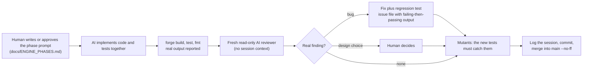
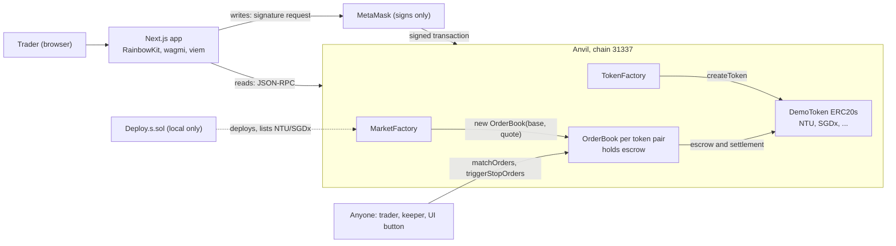
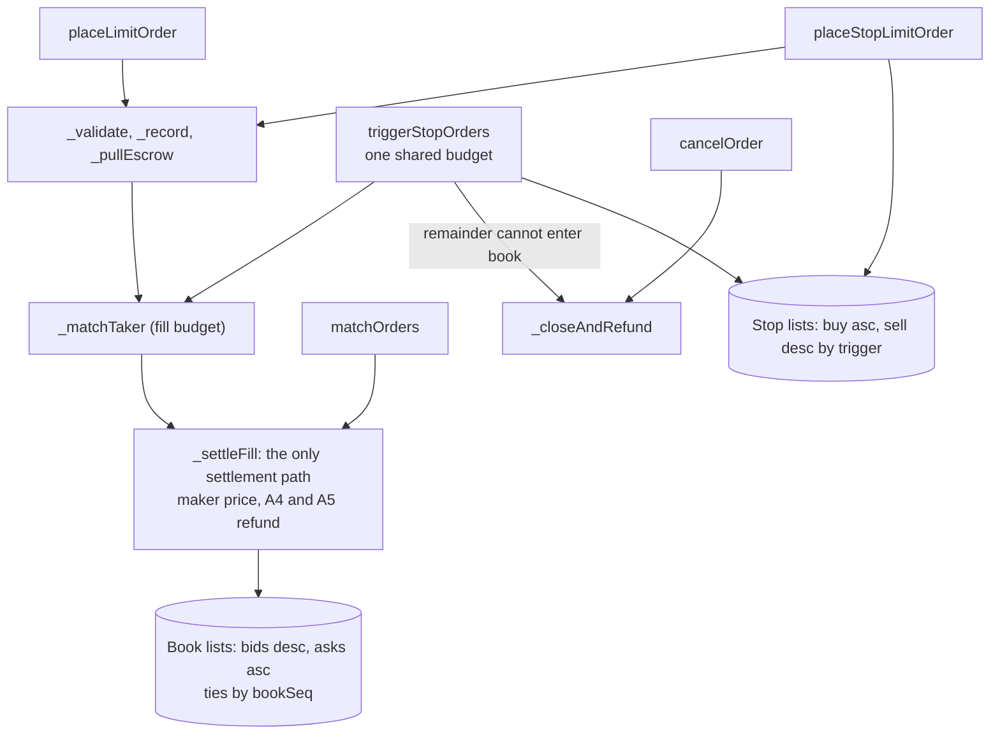

# SC4053 DEX: AI Audit Report

**Status:** full draft for team review, 8 Nov 2026. It is not yet the submission.

**Code basis:**
- `main` at the `engine-final` tag, commit `fd8869a`
- plus the documentation wrap-up that followed

**Team:**
- **Person 1:** trading engine (`OrderBook.sol`, its interface, specification and tests).
- **Person 2:** `TokenFactory`, `DemoToken`, `MarketFactory`, deployment script and exporter, Next.js front end, README.

**Brief:** `docs/Development_Project.pdf`. This report follows the brief's eight required sections (section 2.1) and the four-part breakdown for major issues (section 2.2).

**Rules used:**
- **Sources only.** Every statement is taken from a committed record, cited by file path or commit hash. Nothing is invented.
- **Two markers flag text that a teammate must confirm before submission:**
  - **[P2 to confirm]** marks text adapted from Person 2's records: [`docs/ai-audit/ai-audit-report-draft.md`](../ai-audit/ai-audit-report-draft.md), [`prompt-log-person2.md`](../ai-audit/prompt-log-person2.md), [`tooling-and-methodology.md`](../ai-audit/tooling-and-methodology.md) and the `p2-*` issue and evidence files.
  - **[P1 + P2 to confirm]** marks text that needs both teammates.
- **Person 1's parts** come from [`docs/ai-audit/prompt-log.md`](../ai-audit/prompt-log.md), issues 001 to 007, and the engine evidence.

---

## Executive summary
- **Product:** a minimal, non-custodial order-book DEX on a local Ethereum chain (Anvil). Anyone can issue an ERC20 (`TokenFactory`) and list a token pair (`MarketFactory`, one `OrderBook` per pair). Traders place limit orders from MetaMask through a Next.js app. Matching runs on-chain at the maker's price with price-time priority, partial fills and per-fill refunds of price improvement.
- **All three bonuses are implemented in the engine,** with no change to the interface frozen on 1 Nov:
  - cancellation of unfilled amounts (`cancelOrder`)
  - batched multi-party matching (`matchOrders`; 4 buyers and 4 sellers settled in one transaction)
  - conditional stop-limit orders (`placeStopLimitOrder`, `triggerStopOrders`)
- **The cancel UI (Person 2, P2-8B.2; its happy path was run with MetaMask by the owner) and the batch-matching UI (P2-8B.3; mock-wallet and real-chain verified, and its happy path confirmed with MetaMask by the owner on a scratch chain) are built, and the stop-limit UI (P2-8B.4; mock-wallet and real-chain verified, happy path run with MetaMask by the owner) is now built too, with its happy path run with MetaMask by the owner on a scratch chain (section 6.9): all three bonus features have a front end.** The regenerated ABI is already in `web/` (`e375ff6`). Person 2's local chain (8545) was found, by read-only calls on 2026-11-08 (P2-8B.1), to be already redeployed with the new engine.
- **AI use:** both teammates used Claude Code throughout, steered by specification files read every session (`CLAUDE.md`, `SPEC.md`, the frozen `CONTRACT_INTERFACE.md`, per-phase prompts). The human made every design trade-off. A fresh, read-only AI reviewer checked each phase.
- **Problems found in AI output:** 23 issues are logged in the four-part format: 7 engine (001 to 007) and 16 Person 2 (P2-001 to P2-016).
  - **Highest:** 006 (High availability: one 102-wei stop blocked every stop trigger, fixed) and 004 (High test quality: three matching bugs passed the suite, fixed). For Person 2, two Medium deployment-tooling defects (P2-013, P2-014, fixed).
  - **One Medium engine issue is accepted by design and pinned by a test:** 007 (a limit order can be sandwiched through the fill cap; the loss is bounded by the victim's limit).
- **Validation:**
  - **Tests:** 335 Foundry tests (245 engine, 90 Person 2) and 410 front-end unit tests (48 gated).
  - **Invariants:** a stateful invariant suite with an independent reference ledger held for 1,000 runs × depth 128 (128,000 calls, 0 reverts).
  - **Coverage:** `OrderBook.sol` 100% on lines, statements, branches and functions.
  - **Static analysis:** Slither found 0 real issues in the engine.
  - **Mutation testing:** caught every non-equivalent mutant per phase.
  - **Reviews:** a final independent audit found no Critical or High.
  - **Real chain:** scratch-chain `cast` journeys and a one-command demo replay passed.
- **Not proven:**
  - no human security audit
  - no public testnet
  - most manual MetaMask cases not performed, and the My orders history label for a stop cancelled before activation reads "Activated" (Person 2's `docs/TESTING.md`, Section F, Test 14)
  - a mock wallet is not MetaMask

## Contents
1. [Initial Specification and System Scope](#1-initial-specification-and-system-scope)
2. [Development Methodology and AI Tooling Infrastructure](#2-development-methodology-and-ai-tooling-infrastructure)
3. [Specification Engineering and Prompt Logs](#3-specification-engineering-and-prompt-logs)
4. [AI-Generated Architecture](#4-ai-generated-architecture)
5. [Problems Discovered and Vulnerability Analysis](#5-problems-discovered-and-vulnerability-analysis)
6. [Validation Process and Testing Strategy](#6-validation-process-and-testing-strategy)
7. [Improvements and Refinements](#7-improvements-and-refinements)
8. [Lessons Learned](#8-lessons-learned)
- [Requirements traceability](#requirements-traceability)
- [Evidence index](#evidence-index)

---

## 1. Initial Specification and System Scope
**[P1 + P2 to confirm]: the boundary before AI use.**
- **What the brief asks:** what the team intended *before engaging AI tools*.
- **What the repository records:**
  - the repository's initial commit (`095b2af`, 24 Oct, a one-line README)
  - then Person 1's first planning session, 28 Oct, which was already AI-assisted
- **The original plan was also AI-assisted.** `docs/DEX_Trading_Engine_Plan.md`, committed in `cd35f8b`, is titled "Person 1, built with Claude Code".
- **So no committed artefact predates AI use.** Both teammates must state what they had decided themselves before that. What follows is the scope as first written down.

**Requirements (brief, section 5.1, Option 1: DEX).** A minimal viable DEX on Ethereum with a simple web front end supporting token listing, order submission, order matching and execution, and user self-custody:
- **Asset issuer:** issue new tokens that adhere strictly to ERC20.
- **Users:** submit buy and sell orders (limit orders as the baseline); automatic execution of matched orders, with partial fulfilment.
- **Bonus:** (1) cancel unfulfilled amounts; (2) batched execution of multi-party matching; (3) conditional orders.
- **Tricky points to settle:** who triggers execution, how and how often; whether older orders get priority at identical conditions.

**Intended smart-contract logic (first written in commit `cd35f8b`, 28 Oct: `SPEC.md`, `CONTRACT_INTERFACE.md` draft, `docs/DEX_Trading_Engine_Plan.md` sections 3 to 6):**
- one `OrderBook` per token pair, with immutable base and quote tokens of 18 decimals
- escrow at placement
- execution at the maker's price, with price-time priority and partial fills
- price-improvement refunds
- no admin
- the three bonus functions designed up front as interface entries

The first interface draft (`cd35f8b`) already listed every function, event and error that ships today. The human added `InvalidTokens`, `requiredQuote` and lot and tick sizes on 28 Oct (Section 4).

**Intended UI (Person 2; `PRODUCT.md`, first committed in `3aba573` on 5 Nov) [P2 to confirm]:**
- wallet connection
- a market view with the live order book
- an order ticket that shows approval and escrow
- order history
- token issuance and market listing

---

## 2. Development Methodology and AI Tooling Infrastructure
### 2.1 Team and division of labour
| Area | Owner | Files |
|---|---|---|
| Trading engine | Person 1 | `contracts/src/OrderBook.sol`, `contracts/src/interfaces/`, `contracts/test/OrderBook*`, `contracts/test/invariant/`, `contracts/test/mocks/`, `SPEC.md`, `docs/ENGINE_PHASES.md` |
| Factories, deployment, front end, docs | Person 2 | `TokenFactory`, `DemoToken`, `MarketFactory`, `contracts/script/`, `web/`, `README.md` |
| Shared (both must agree) | Both | `CLAUDE.md`, `CONTRACT_INTERFACE.md`, `contracts/foundry.toml` |

- **The interface was the contract between the two halves.** It was frozen on 1 Nov (Person 2's approval was verbal, recorded in Person 1's log) and has not changed in signature since.
- **Neither AI edited the other teammate's files.** Needed changes were written down instead: in Person 2's audit (`p2-8a-audit.md`) and in Person 1's handoff (`docs/ENGINE_HANDOFF.md`).
- **The one cross-boundary change, with the owner's approval:** `web/lib/contracts/abis.ts` was regenerated with Person 2's own exporter (`e375ff6`).

### 2.2 Tools
| Tool | Person 1 (engine) | Person 2 [P2 to confirm] |
|---|---|---|
| **Claude Code** | Opus 5.5 (log header); plan mode for Phase 0 | Opus 5.5, Sonnet 5.5 and Haiku 5.5 by phase (models per phase: `tooling-and-methodology.md`; some not recorded) |
| **Independent reviewer** | A fresh, read-only Claude Code subagent per phase (1 to 7), plus a final audit | Fresh-context subagents in P2-1 to P2-6 (none for P2-5 wrap-up, P2-6.1, P2-7) |
| **Foundry 1.8.6** (`forge`, `anvil`, `cast`) | Unit, fuzz and invariant tests, gas, sizes, coverage, scratch-chain `cast` journeys | Contract tests, deploy script, scratch chains |
| **Static analysis** | Slither 0.11.6 and `forge lint` on `OrderBook.sol` (Phase 8) | Slither 0.11.6 on Person 2's contracts and script; `forge lint` |
| **Libraries** | OpenZeppelin 5.7.0 (`SafeERC20`, `ReentrancyGuard`, `Math.mulDiv`); forge-std 1.17.0 | Next.js, RainbowKit, wagmi, viem, TanStack Query; Vitest; `playwright-core` with a mock wallet |
| **Skills and MCPs** | Project commands `/review-engine` and `/log-issue` | Context7 (P2-3 to P2-5); shadcn and Awwwards MCPs; `frontend-design`, `ui-ux-pro-max`, `impeccable`, `taste-skill` (P2-4); `solidity-security` (P2-3, P2-8A); `react-best-practices` (P2-8A). The Playwright MCP was attempted but did not launch, and SkillSpector was not installed |
| **Node.js** | 26.13.0, installed 7 Nov to run Person 2's tests and exporter against engine changes | Node 22.18 or newer |

### 2.3 Custom AI infrastructure
- **Specification files, read every session:**
  - `CLAUDE.md` (source of truth, ownership, engine rules, "never weaken a failing test", "never claim something was run unless you ran it", log every session)
  - `SPEC.md` (accounting rules A1 to A8, lifecycle, per-function behaviour, known limitations)
  - the frozen `CONTRACT_INTERFACE.md`
  - `docs/ENGINE_PHASES.md` (build order, plus the verbatim prompt for each phase)
- **Project commands** (`.claude/commands/`): `review-engine` (spawns an independent reviewer), `log-issue` (the four-part issue format, "use only output actually produced in this session") and `explain-diff`.
- **Engine test infrastructure aimed at AI mistakes:**
  - `OrderBookHarness`, to see internal links without changing the interface
  - `assertSolvent` and `assertBookSorted`, called after almost every test
  - hostile tokens: `ReentrantERC20` (re-enters on the Nth transfer, optionally swallowing failures) and `ViewSpyERC20` (records views mid-transfer)
  - a mutation script with 67 hand-written mutants: `docs/ai-audit/test-evidence/mutants.sh`
  - an invariant handler with an independent reference model (Section 6)
- **Person 2's infrastructure [P2 to confirm]:**
  - a deploy script with a chain-id guard that asks the node
  - a dependency-free exporter (`contracts/script/export-web.mjs`) that refuses incomplete, stale or mismatched deployments
  - `scripts/check-local.sh`
  - a mock-wallet browser harness (`web/e2e/mock-wallet.mjs`)

### 2.4 Workflow per phase

Person 2 followed the same pattern [P2 to confirm]:
1. a read-only planning session approved by the owner
2. implementation, with tests written alongside the code
3. mutation checks and real-chain runs
4. for most phases, a fresh-context review
5. the session, including the AI's mistakes, logged in `prompt-log-person2.md`

---

## 3. Specification Engineering and Prompt Logs
### 3.1 Specification files
| File | Role |
|---|---|
| [`CLAUDE.md`](../../CLAUDE.md) | Standing rules loaded every session |
| [`SPEC.md`](../../SPEC.md) | The behaviour contract. Prompts cite its sections, and code and tests cite its rules (A1 to A8) by name |
| [`CONTRACT_INTERFACE.md`](../../CONTRACT_INTERFACE.md) | The frozen ABI. "Do not add any error, event or function that is not in the interface" forced fixes to stay inside the agreed surface (issues 001 and 006) |
| [`docs/ENGINE_PHASES.md`](../ENGINE_PHASES.md) | The phase table and the verbatim prompts. Tests that reviews found missing were added to the rows of later phases |
| [`docs/MARKET_FACTORY.md`](../MARKET_FACTORY.md), [`PRODUCT.md`](../../PRODUCT.md), [`DESIGN.md`](../../DESIGN.md) | Person 2's specifications [P2 to confirm] |

### 3.2 Representative prompt chains
**Engine (Person 1; full text in `docs/ai-audit/prompt-log.md`):**
1. **Phase 0 planning, 28 Oct (plan mode):**
   - The AI found seven specification gaps, (a) to (g). The human accepted most of its fixes but **replaced two**:
     - `AmountTooSmall` became lot and tick sizes, because the AI's fix only guarded the total cost, not each partial fill.
     - A per-activation trigger budget became one shared budget, because the AI's version multiplied the worst-case gas.
   - Writing SPEC exposed the order-ID tie problem, which led to `bookSeq` (O1).
2. **Phase 3a, 2 Nov:** implementation, then a review with 11 findings, then each finding back to the AI as "fix with a regression test and show the failing then passing output". Result: issues 002, 003 and 004.
3. **Phase 6, 7 Nov:** a review found a 102-wei denial of service (H1). The AI laid out four options and the human chose auto-cancel. The AI reproduced the bug on the old line (3 FAIL), fixed it (3 PASS), added mutants P6x and P6y, and logged issue 006.
4. **Phase 7, 7 to 8 Nov:** a review of the AI's own tests found tautological ghost variables and a regression test that could not fail. The AI rebuilt the handler around an independent reference ledger, which mutants P7c to P7h prove.
5. **Phase 8, 8 Nov:** the final audit found M-1. The human chose to document it rather than change the engine, and the AI reproduced it in the repo to the wei (issue 007).

**Person 2 [P2 to confirm]** (full text in `prompt-log-person2.md`):

| Chain | Iterations | Outcome |
|---|---|---|
| Prompt 00, planning | three plan revisions in read-only mode | scope, ownership, the MarketFactory proposal |
| P2-3 deployment | plan, implementation, mutants, review, fixes | a design contradicted by the Foundry docs was changed before coding; two Medium review findings fixed (P2-013, P2-014) |
| P2-5 limit orders | plan, implementation, fresh-context review | 13 findings; P2-006 to P2-009 |
| P2-7 hardening | plan, two owner refinements, implementation | evidence-based chain-reset detection; P2-012 |
| P2-8A audit | plan, one owner refinement round | the coverage matrix and the first report draft |
| P2-8B.3 batch matching | plan, implementation, test-first runner, real-chain and browser suites | decisions fixed in the plan: send the market's own limit (not a user-chosen count), review and simulate before the wallet, never loop or run a keeper, show results only from the receipt's `Trade` events; one real defect (P2-016) |
| P2-8B.4 stop-limit | plan (re-planned once after the owner's two refinements), implementation, test-first helpers and runners, real-chain and browser suites, a separate scratch pair | decisions fixed in the plan: read the engine's real rules (eligibility only at the stop-list heads, equality triggers, auto-cancel at activation) rather than assume exchange conventions; keep *waiting for price* and *eligible, awaiting a Trigger stops transaction* distinct everywhere; escrow strictly from the LIMIT price; detect market-wide eligibility with the contract's own `triggerStopOrders` simulation because the engine has no view of its stop lists; never report activation as execution; fresh MetaMask accounts for the manual test; no new audit issue |

### 3.3 Context management
- **The prompt logs carried state between sessions.** The AI wrote them and the human reviewed them. Each session started by reading `CLAUDE.md`, SPEC and the log.
- **A resumed session started with a recovery check, not code.** Person 1's 7 Nov session began with a read-only recovery and sync: uncommitted work, Person 2's 24 new commits, and a diff of the frozen files.
- **Exact context-window contents are not preserved** and are not claimed.

---

## 4. AI-Generated Architecture
### 4.1 System

This is adapted from Person 2's README diagram, with the keeper path for the bonuses added. [P2 to confirm]

**Front-end integration of Bonus 2 (P2-8B.3).** The Match orders action is a thin addition to the transaction machinery the order ticket and Cancel already use: `lib/crossed-book.ts` decides from the market's own `getBestBid` and `getBestAsk` whether the live book is crossed; `lib/match-runner.ts` re-reads, simulates and sends one `matchOrders(MAX_MATCHES_PER_TX)` call through the shared `useTxFlow` reducer and `waitBounded`; `decodeMatchReceipt` reads the market's `Trade` logs; the result is reconciled with `getOrder` before and after the block. There is no new transaction framework, no backend and no keeper.

**Front-end integration of Bonus 3 (P2-8B.4).** Stop-limit orders reuse the same machinery rather than add a framework: `lib/stop-orders.ts` holds the engine's rules (buy stop eligible at last trade >= trigger, sell stop at last trade <= trigger, equality included, only after a first trade), the validation (escrow from the limit price) and the wording; `lib/stop-runner.ts` places the order through the shared approval step and lifecycle and verifies it from `StopOrderPlaced` and `getOrder` (pending, nothing filled, exact escrow); `lib/trigger-runner.ts` sends one `triggerStopOrders(10)` call and verifies each activated stop from `StopOrderTriggered`, `Trade`, `OrderCancelled` and `getOrder` before and after the block, telling the engine's own auto-cancel from a fill. The ticket's flow ends in a union outcome (`TicketOutcome`); cancelling a pending stop is the unchanged Bonus 1 runner and a crossed remainder is cleared by the unchanged Bonus 2 panel. There is no new transaction framework, no backend and no keeper.

### 4.2 Engine internals

- **State:** `_orders`; the book heads with shared next and prev links; `_stopHead`; `_bookSeq`; `lastTradePrice`; `hasTradePrice`.
- **An order is in at most one list,** and its status says which: PendingTrigger orders are in a stop list, Open and PartiallyFilled orders in the book.
- **Size:** OrderBook 8,461 B runtime and MarketFactory 10,508 B, against the 24,576 B limit (`phase8/sizes.txt`).

### 4.3 What the AI proposed, and what happened to it
| Area | AI proposal (Phase 0, 28 Oct, unless stated) | Outcome |
|---|---|---|
| Market structure | One `OrderBook` per pair; immutable base and quote; 18 decimals only | Accepted. Person 2's AI later proposed `MarketFactory` (P2-2), which the owner accepted as the listing mechanism [P2 to confirm] |
| Book | Sorted doubly linked lists, best order at the head, insert bounded by `MAX_INSERT_SCAN` | Accepted |
| Priority | Price, then order ID | **Changed by the human (O1):** price, then an internal `bookSeq` stamped when an order enters the book, so a late-triggered stop queues fairly |
| Escrow order | Pull last (strict CEI) | **Changed (1 Nov):** pull before matching, which fills need. A second deviation, payouts during the match loop, was found by review (issue 002). Both are documented in SPEC section 5 |
| Dust | `AmountTooSmall` | **Rejected:** `LOT_SIZE = TICK_SIZE = 1e9` makes every fill cost exact (A1) |
| Buy escrow after a fill | (gap c) A5: re-lock `requiredQuote(remaining, limit)` and refund the rest | Accepted |
| Settlement | Maker price, at most 10 fills per call, one `_settleFill` | Accepted; reused by batch and stops |
| Stops | Two sorted stop lists | Accepted; in Phase 6 they reuse the book's list code |
| Trigger budget | `maxCount × MAX_MATCHES_PER_TX` | **Changed by the human:** one shared budget per call |
| Activation into a too-deep book | Revert (`BookTooDeep`) | **Changed after review (issue 006):** cancel and refund |
| Interface helpers | `requiredQuote`; `getOrder` returns zeros for an unknown ID | Accepted |
| Deployment and export | Script with an explicit deployer; an exporter tied to build artefacts and the live chain | AI proposals refined by review (P2-013, P2-014) [P2 to confirm] |
| Front-end state | A pure lifecycle reducer (`web/lib/order-flow.ts`), shared by order, approval, token creation and listing, with runners that simulate, sign, wait and reconcile | [P2 to confirm] which parts were the AI's first proposal |

---

## 5. Problems Discovered and Vulnerability Analysis
### 5.1 Inventory (most severe first)
| ID | Area | Problem | Class | Severity | Status |
|---|---|---|---|---|---|
| [006](../ai-audit/issues/006-stop-activation-booktoodeep-blocks-all-triggers.md) | Engine | One unplaceable stop blocked every stop activation, on both sides, for 102 wei | Gas bound becomes denial of service | High (availability) | Fixed (`1adcc59`) |
| [004](../ai-audit/issues/004-matching-test-gaps.md) | Engine tests | Three matching bugs (overfill, phantom fills, wrong Trade fields) passed the suite | Test quality | High (tests) | Fixed (`6d1d14c`) |
| [007](../ai-audit/issues/007-dust-sandwich-of-capped-limit-order.md) | Engine | A dust front-run sandwiches a limit order through the fill cap, so the victim pays up to their limit | Economic / ordering | Medium | **Accepted by design**; pinned by a test |
| [002](../ai-audit/issues/002-undocumented-cei-deviation-in-matching.md) | Engine spec | Second CEI deviation (payouts during matching) undocumented | Reentrancy reasoning | Medium (docs) | Fixed |
| [P2-013](../ai-audit/issues/p2-013-chain-id-guard-bypassed-by-forge-chain-override.md) | Deploy script | Chain-id guard bypassable with `--chain 31337` | Unsafe deployment | Medium | Fixed [P2 to confirm] |
| [P2-014](../ai-audit/issues/p2-014-exporter-accepted-a-partial-broadcast.md) | Exporter | A partial broadcast was exported as complete | Integrity | Medium | Fixed [P2 to confirm] |
| [P2-015](../ai-audit/issues/p2-015-stale-data-shown-as-live-after-the-rpc-died.md) | Front end | Stale balances shown as live after the RPC died | Misleading state | Medium | Fixed [P2 to confirm] |
| [P2-016](../ai-audit/issues/p2-016-crossed-book-crashed-the-spread-display.md) | Front end | A crossed book made the spread display throw and crashed the whole Trade page | Unhandled state (negative value) | Medium | Fixed (P2-8B.3, found by the new browser suite) [P2 to confirm] |
| [P2-006](../ai-audit/issues/p2-006-try-again-lost-a-late-signature.md), [P2-007](../ai-audit/issues/p2-007-result-not-bound-to-requested-order.md), [P2-008](../ai-audit/issues/p2-008-failure-after-submission-invited-a-duplicate.md), [P2-012](../ai-audit/issues/p2-012-replacement-detection-never-had-sender-and-nonce.md) | Front end | A late signature lost; a result not bound to the requested order; a failure after signing invited a duplicate escrow; replacement never detectable | Transaction lifecycle | Medium (P2-008 also Low for wording) | Fixed [P2 to confirm] |
| [P2-001](../ai-audit/issues/p2-001-token-errors-not-decoded.md), [P2-003](../ai-audit/issues/p2-003-review-step-survived-account-switch.md), [P2-005](../ai-audit/issues/p2-005-scratch-deploy-overwrote-exporter-record.md), [P2-009](../ai-audit/issues/p2-009-ui-fail-open-and-false-claims.md) | Front end and tooling | Token errors not decoded; review survived an account switch; scratch deploy overwrote the exporter record; five misleading UI states | Usability, correctness, workflow | Medium for usability / displayed correctness / workflow (no funds at risk) | Fixed [P2 to confirm] |
| [003](../ai-audit/issues/003-fill-cost-overflow.md) | Engine | An accepted order could panic when filled (`qty × price` overflow) | Integer math | Low | Fixed |
| [005](../ai-audit/issues/005-cancel-zero-address-owner-check.md) | Engine | `address(0)` treated as the owner of unknown orders | Access-control edge | Low | Fixed (`dab79f8`) |
| [001](../ai-audit/issues/001-unlink-empties-book-side.md) | Engine | `_unlink` could empty one side of the book | List integrity | Latent | Fixed (`dfe7318`) |
| [P2-002](../ai-audit/issues/p2-002-fill-cap-hides-crossed-remainder.md), [P2-004](../ai-audit/issues/p2-004-switch-network-no-guidance-in-ticket.md), [P2-010](../ai-audit/issues/p2-010-creation-flow-review-findings.md), [P2-011](../ai-audit/issues/p2-011-duplicate-key-ghost-row-on-market-switch.md) | Front end | Crossed-remainder warning missed; no network-switch guidance; creation-flow findings; ghost row | UI correctness | Low (P2-002: Low to Medium) | Fixed [P2 to confirm] |

### 5.2 Engine issues in the four-part format (Person 1)
The full text and the real before-and-after output are in each issue file.

**006: one unplaceable stop blocked every trigger.**
1. **Why the AI erred:** it reused the book's insert path, whose `BookTooDeep` revert is a gas bound, for stop activation. It missed that this reverts a permissionless call serving every stop, and that the failing stop stays at the head, so every later call fails too. It saw the revert but called it an accident.
2. **Impact:** a self-owned stop with the lowest trigger, plus 101 one-lot bids at 1 wei of escrow each (102 wei in all), made every `triggerStopOrders` call revert permanently. No stop-loss on either side could fire.
3. **Fix:** a non-reverting `_tryInsert`. An activated remainder that cannot enter the book is cancelled and refunded through the existing `OrderCancelled`. No ABI change. The human chose this option out of four.
4. **Evidence:** on the pre-fix line, 3 FAIL with `BookTooDeep()`; after the fix, 3 PASS. Mutant P6x (the pre-fix code) is caught by the unit suite and by the invariant suite alone.

**004: matching test gaps.**
1. **Why:** the tests were written from the prompt's list of shapes, never asking what would pass if the code were wrong.
2. **Impact:** three bugs would have passed green: overfilling a partly filled maker (paid from other traders' escrow), fills continuing after the taker was filled, and `Trade` reporting buyer and seller instead of maker and taker.
3. **Fix:** three targeted tests and a stronger `assertBookSorted`. In Phase 7 the issue's regression test was rewritten after review M3, because the first version could not fail on bug (a).
4. **Evidence:** 3 mutants SURVIVED (73 tests), then each fails one test. The Phase 7 regression fails on the pre-fix line (`ERC20InsufficientBalance`) and passes on the fixed code.

**007: limit-order sandwich through the fill cap (accepted).**
1. **Why:** two accepted limitations, the crossed book after the cap (O4) and dust using up fills, were analysed separately. Their composition against plain limit orders was written up only for stops.
2. **Impact:** a buy at limit 2.0 that expects an ask at 1.5 is front-run with 10 dust asks. It then pays 20e18 − 5.01e9 instead of 15e18, and the attacker makes 5e18 − 5.01e9. The loss is bounded by the victim's limit; solvency holds.
3. **Handling:** the human decided on 8 Nov not to change the engine at the end of the project. The attack is documented in SPEC section 8, with the mitigations not built (clear crossings first; do not rest a crossing remainder; a minimum fill), and the handoff advises the UI to encourage tight limits.
4. **Evidence:** `test_issue007_dustSandwichMakesAHonestBuyPayItsLimit` reproduces it and pins the figures to the wei. They match the auditor's independent proof of concept.

**002: CEI deviation understated.**
1. **Why:** the rationale was written for one external call, before matching existed.
2. **Impact:** incomplete security reasoning. A callback during a payout sees a partly filled taker that is not yet in the book.
3. **Fix:** documented in SPEC section 5, pinned by view-spy tests, and both exceptions named in `CLAUDE.md`.
4. **Evidence:** a documentation fix, so by design there is no failing-then-passing pair. `test_payout_viewsShowFillSettledAndRemainderNotYetRested` pins the behaviour.

**003: fill-cost overflow.**
1. **Why:** the same formula was written two ways: escrow used `mulDiv` and settlement plain `q × p / 1e18`.
2. **Impact:** an order accepted at placement could never be filled. Only reachable with open-mint tokens.
3. **Fix:** settlement uses `Math.mulDiv`.
4. **Evidence:** `panic 0x11`, then PASS. The 512-bit differential fuzz of `requiredQuote` passed (Phase 7).

**005: zero-address owner check.**
1. **Why:** the AI assumed `trader != msg.sender` rejects unknown IDs, forgetting the zero address. `Open` is the enum's zero value.
2. **Impact:** a wrong error for unknown IDs, and `cancelOrder(0)` succeeding from `address(0)`. No funds at risk.
3. **Fix:** `order.trader == address(0) || order.trader != msg.sender`, reverting with `NotOrderOwner`.
4. **Evidence:** `OrderNotActive() != NotOrderOwner()`, then PASS. Mutant Z is caught in every smoke set.

**001: `_unlink` could empty a side.**
1. **Why:** the AI took `prev == 0` to mean "this order is the head", and left the precondition as a comment.
2. **Impact:** one missed check would hide every resting order on that side, with its escrow still held.
3. **Fix:** a link guard that reverts with the existing `OrderNotActive`, since the interface was frozen.
4. **Evidence:** 3 FAIL (`0 != 1`), then 3 PASS.

### 5.3 Person 2 issues in the four-part format [P2 to confirm]
Adapted from Person 2's draft (section 5.1). Each row summarises an issue file holding the full analysis and the real before-and-after output.

| Issue | 1. Why the AI erred | 2. Why it is problematic | 3. Fix | 4. Evidence |
|---|---|---|---|---|
| [P2-001](../ai-audit/issues/p2-001-token-errors-not-decoded.md) token errors not decoded | the test built the error object by hand; it assumed viem decodes any revert | no approval or a low balance showed a generic message | token ABI errors added to the simulation ABI | the regression test replays the real revert data (red, then green) |
| [P2-002](../ai-audit/issues/p2-002-fill-cap-hides-crossed-remainder.md) fill cap hides a crossed remainder | read exactly 10 makers, not the cap plus one | the crossed-remainder warning failed exactly when needed | read the cap plus one | red then green; real chain with 12 makers |
| [P2-003](../ai-audit/issues/p2-003-review-step-survived-account-switch.md) review survived an account switch | the ticket kept its own `reviewing` state | the previous wallet's data shown as the new one's | review ends on an account, chain or market change | browser run failed, then 13 passed (mock wallet) |
| [P2-004](../ai-audit/issues/p2-004-switch-network-no-guidance-in-ticket.md) no guidance on the ticket's network switch | a second hook instance with separate state | a hidden wallet popup was unexplained | the same waiting notice on the ticket | browser run failed, then passed |
| [P2-005](../ai-audit/issues/p2-005-scratch-deploy-overwrote-exporter-record.md) scratch deploy overwrote the exporter record | missed that `--broadcast` overwrites an ignored record | a healthy chain reported as stale | record restored; scratch deploys redirect their output | exit 1, then passing |
| [P2-006](../ai-audit/issues/p2-006-try-again-lost-a-late-signature.md) "Try again" lost a late signature | an unconditional reset | two escrowed orders, the first invisible | abandoned attempts remembered | red reducer tests, then green |
| [P2-007](../ai-audit/issues/p2-007-result-not-bound-to-requested-order.md) result not bound to the order | any receipt with one `OrderPlaced` accepted | "Order confirmed" for a transaction the user did not sign | compare side, price and amount; replacements count as failures | red, then green |
| [P2-008](../ai-audit/issues/p2-008-failure-after-submission-invited-a-duplicate.md) failure after signing invited a duplicate | every post-hash error treated as retryable | a second escrow after an RPC drop | a "may still be mined" warning; correct revert wording | red, then green |
| [P2-009](../ai-audit/issues/p2-009-ui-fail-open-and-false-claims.md) five places the UI could mislead | happy-path reasoning | the UI stated things it did not know | five targeted fixes | no automated "before" (stated); after: type check, lint, build, browser assertion |
| [P2-010](../ai-audit/issues/p2-010-creation-flow-review-findings.md) creation-flow review findings | invisible characters listed by code point, and others | look-alike symbols, a stale link | Unicode categories, hash tracking, failure state | red-first tests; real chain and browser |
| [P2-011](../ai-audit/issues/p2-011-duplicate-key-ghost-row-on-market-switch.md) ghost row on market switch | a panel keyed by symbol | a misleading extra row | key by position | `12 passed, 1 failed`, then `13 passed` |
| [P2-012](../ai-audit/issues/p2-012-replacement-detection-never-had-sender-and-nonce.md) replacement never detectable | a fake `waitForReceipt`; viem never given sender and nonce | a sped-up order reads "not confirmed", inviting a duplicate | pass sender and nonce; evidence-based chain-reset detection | red `10 failed`, then green; real chain `3 failed`, then `9 passed` |
| [P2-013](../ai-audit/issues/p2-013-chain-id-guard-bypassed-by-forge-chain-override.md) chain-id guard bypass | reasoned from typical Forge behaviour, never tried hostile flags | broadcast to a non-local chain (11 transactions to a chain-1 node) | `run()` also asks the node with `eth_chainId` | the command now fails with `WrongChain(1)`; unit test; mutants caught |
| [P2-014](../ai-audit/issues/p2-014-exporter-accepted-a-partial-broadcast.md) exporter accepted a partial broadcast | "every check" left undefined | an interrupted deployment exported as complete | nothing pending, one receipt per transaction, all successful | unit tests; mutants E4 and E7 caught |
| [P2-015](../ai-audit/issues/p2-015-stale-data-shown-as-live-after-the-rpc-died.md) stale data shown as live | freshness designed around events; a dead node produces none | old balances shown as current before signing | a health probe, "last known" labels, transactions disabled while offline | controlled reproduction before and after; 17 + 7 unit tests; browser 11 passed |
| [P2-016](../ai-audit/issues/p2-016-crossed-book-crashed-the-spread-display.md) a crossed book crashed the spread display | the spread was `ask - bid` on the assumption the book is never crossed; the fix for P2-002 updated only the ticket warning, not every other consumer of the book | the page that should offer Match orders could not be drawn while the book was crossed | `bookSpread` returns none, crossed or an unsigned spread; the UI says "Crossed" | the first `e2e:match` run: 1 passed, 14 failed with `splitAmount expects an unsigned value`; then `crossed-book` unit tests and the suite green |

Person 2's P2-3 review also logged two lower findings without issue files: ABIs not tied to the deployed bytecode, and `deployments.ts` not reproducible. Both were fixed (Person 2's draft, section 5.2). [P2 to confirm]

### 5.4 Reviews, static analysis and audits
- **Engine Slither 0.11.6:** 27 results, 0 real (13 false positives, 14 accepted). **`forge lint`:** 6 warnings, 0 real. See [`phase8/slither-triage.md`](../ai-audit/test-evidence/phase8/slither-triage.md).
- **Person 2's Slither:**
  - `DemoToken` and `TokenFactory`: 0 results
  - `MarketFactory`: 5 accepted naming notes
  - `Deploy.s.sol`: 6 accepted `calls-loop` notes (11 when re-run in P2-8A)
  - [P2 to confirm]
- **Final independent engine audit (8 Nov):**
  - no Critical or High
  - M-1 accepted as issue 007
  - three Low documentation fixes applied
  - Info notes passed to the handoff
  - See [`ENGINE_SECURITY_SUMMARY.md`](../ai-audit/ENGINE_SECURITY_SUMMARY.md).
- **Person 2's P2-8A audit:** accessibility, RPC-cost and liveness findings, with their status (Person 2's draft, section 5.3). [P2 to confirm]

### 5.5 Accepted limitations (not defects)
Listed in SPEC section 8:
- **Stops:** `lastTradePrice` is manipulable; stops can be sniped when the shared trigger budget runs out.
- **Ordering and fill cap:** a capped placement can leave the book crossed (O4); a limit order can be sandwiched through the fill cap (007); dust can grief the insert bound.
- **Incentives:** no reward for calling `matchOrders` or `triggerStopOrders`.
- **Tokens and transfers:** push payouts; 18-decimal tokens only; tokens sent directly to the contract are stranded.
- **Trading rules:** self-trades are allowed.

Person 2's front-end limits are in `docs/FRONTEND.md`. [P2 to confirm]

---

## 6. Validation Process and Testing Strategy
### 6.1 Layers
| Layer | What it proves | Result (latest recorded) |
|---|---|---|
| Foundry unit, integration and regression tests | Behaviour against SPEC, with balances exact to the wei; factory market equal to a direct deployment | **335 passed** (245 engine, 90 Person 2) on `main` at `engine-final` |
| Engine reentrancy tests | Re-entry at every transfer reverts; swallow mode pays exactly once; view spies pin CEI | In the 245 |
| Property fuzz | Random prices and sizes for place, cancel, batch and trigger, against reference arithmetic; `requiredQuote` differential checks (including 512-bit) | 20 fuzz tests (15 engine, 5 Person 2): 1,000 runs at the default profile and 10,000 at deep. One exception: `testFuzz_coarsePlacementsKeepSolvencyAndBookOrder`, which is slow, runs 25 at default and 200 at deep |
| **Stateful invariants** | Solvency including pending stops; conservation; **an independent reference ledger equal to every balance**; order fields; lists; trade-price rules; uncrossed after `matchOrders` | All held: 256 × 64 (16,384 calls) and **1,000 × 128 (128,000 calls)**, 0 reverts |
| Mutation testing | The tests catch real bugs | Every non-equivalent engine mutant caught per phase; the invariant suite alone caught 15 of 17. Person 2: 11 of 11 (P2-3), 5 of 5 (P2-6.1, P2-7) [P2 to confirm] |
| Coverage | Which code the tests execute | **`OrderBook.sol` 100%** on lines (182/182), statements, branches (59/59) and functions |
| Static analysis | Known vulnerability patterns | Engine: 0 real (Slither and lint). Person 2: accepted notes only [P2 to confirm] |
| Real-chain runs | Person 2's deploy script on a scratch Anvil; `cast` journeys for cancel, batch and stop-limit; `contracts/script/demo-journey.sh` | Every balance check passed |
| Front-end unit tests | Pure logic, reducers, runners with fake chains, decoding | 576 passed, 75 gated skipped (P2-8B.4; 410 and 48 before the bonus UI) [P2 to confirm] |
| Front-end real-chain and browser tests | Runners on a scratch chain; the UI in Chromium with a **mock** wallet | Real chain 75 passed; browser suites (trade, create, dashboard, hardening, liveness, cancel, match, stop) 13 / 14 / 14 / 9 / 11 / 13 / 15 / 17 passed, all with a mock wallet (P2-8B.4) [P2 to confirm] |
| Independent AI reviews | A fresh-context reviewer per phase, plus a final engine audit | Findings are in Section 5 |
| Manual MetaMask | The real wallet | **Owner-reported only:** Tests 1 to 4, a DTT trade, the Bonus 1 cancel happy path (section 6.5) and the Bonus 2 match happy path (section 6.7); the Bonus 3 stop-limit happy path (section 6.9; chain-verified read-only by the AI); rejection, account-switch, outage, chain-reset and deep-book-refund cases not performed; most other steps and every negative case (including the MetaMask rejection and account-switch cases of the bonuses) not performed (`docs/TESTING.md`, Section F) [P2 to confirm] |

### 6.2 Engine invariant suite
- **Handler:** 5 actors, a `duster` (bursts of one-lot makers, so cap hits and crossed books are common) and a `flooder` (101 one-lot bids outside the price cluster, which exercises the issue 006 path).
- **Revert policy:** only verified-legitimate reverts are tolerated. Anything else fails an invariant.
- **Reference model:** the handler replays every `Trade` and `OrderCancelled` with its own arithmetic into a per-address ledger, which the invariants compare with real balances. This replaced a first version whose ghost variables could not fail (Phase 7 review, H1).
- **Reach** (deterministic, 600 steps; `phase7/forge-test-default.txt`):

| Path | Count |
|---|---|
| Crossing fills | 840 |
| Cap hits | 13 |
| Crossed-book calls | 390 |
| Cancels (open / partial / pending) | 32 / 15 / 15 |
| `matchOrders` calls that filled | 32 |
| Stop activations | 69 |
| Shared trigger budget used up | 9 |
| Auto-cancels | 6 |
| Violations | 0 |

- **Deep run** (`phase7/forge-test-deep.txt`): all invariants held over 128,000 calls in 7,088 s. Calls per action were about 21,000 each.

### 6.3 Gas and size (engine)
- **Maximum per call over the unit suites** (`phase8/gas-report.txt`):
  - `placeLimitOrder` 1,808,075
  - `matchOrders` 781,693
  - `triggerStopOrders` 1,998,747
  - `cancelOrder` 215,166
- **Every loop is bounded:** 10 fills per call, 100 insert steps, 10 activations per trigger call.

### 6.4 What this does not prove
- **Tests prove only what they check.** Invariants were checked on random sequences up to depth 128, not exhaustively.
- **Mutation results depend on the mutants written.**
- **Gas figures are measured cases,** not upper bounds.
- **Everything ran on a local Anvil,** not a public network.
- **Mock-wallet runs are not MetaMask.**
- **No human security audit was done.** All reviews were AI subagents.

### 6.5 Manual MetaMask evidence for Bonus 1 (2026-11-08)
Kept apart by source. **Owner-reported (real MetaMask, chain 31337):** Alice sold 5 NTU at 2; Bob bought 2 NTU at a limit of 2.2; it executed at the maker price of 2 (2 NTU, 4 SGDx, 0.4 SGDx returned); Bob's order Filled, Alice's PartiallyFilled with 3 NTU locked; Alice cancelled, the app showed the expected and event refund of 3 NTU, the transfer to Alice, escrow 0, and the order kept in My orders; the final wallet held 969,998 NTU and 970,004 SGDx. **Cross-checked read-only by the AI against the owner's chain (8545):** order 1 Cancelled with filled 2e18, order 2 Filled, one `Trade` at 2e18 for 2e18 base and 4e18 quote, `OrderCancelled` refund 3e18, market escrow 0, both wallets' balances as stated (the 0.4 refund is inferred from the balances, not read from an event). **Not performed manually:** rejection, account switch during an in-flight request, cancelling a buy, RPC outage, chain reset. **Outstanding:** screenshots and transaction hashes [P2 to supply]. Source: `person2/p2-8b2-cancellation.md` section 9.

### 6.6 Automated evidence for Bonus 2 (P2-8B.3, mock wallet and real chain; 2026-11-08)
Engine functionality (Person 1) is not re-claimed here. The new **front-end integration** was checked by: 50 new unit tests (crossed-book detection, the runner with a fake chain for success, no-op, revert, rejection, replacement, wallet cancellation, reset, timeout, RPC failure and account change, receipt decoding, error and wallet-prompt wording); a **real scratch-chain suite** (5 tests) reproducing the engine hand-off's scenario (Alice and Carol post 22 asks; Bob and the deployer each hit the 10-fill cap) in which a **keeper with no trading tokens** settles orders of four traders in one transaction, with the `Trade` events compared with an independent decode, exact token movements per trader, final statuses, escrow back to zero and the keeper's token balances unchanged; and a **mock-wallet browser suite** (15 cases: crossed and uncrossed books, review, wallet pending, result, repeated matching with nothing sent by itself, rejection, a book settled elsewhere, account switch, speed-up, wallet-cancelled request, outage with verified recovery, chain reset, mobile 375 px, console errors). axe-core found no violations in six states after one duplicate-id defect of the author's own was fixed. `forge test` was run once as a regression check. **None of the automated evidence above is MetaMask:** the wallet is an injected stand-in. The real-wallet evidence is separate, in section 6.7. Failed first runs are kept in `person2/p2-8b3-batch-matching.md`; the one real defect they exposed in earlier AI-written code is [P2-016](../ai-audit/issues/p2-016-crossed-book-crashed-the-spread-display.md).

### 6.7 Manual MetaMask evidence for Bonus 2 (2026-11-08)
Kept apart by source. **Owner-reported (real MetaMask, scratch chain 8546 through the scratch app on port 3100, keeper account `0x15d34AAf54267DB7D7c367839AAf71A00a2C6A65`, which holds no NTU or SGDx):** Review match showed calldata `matchOrders(10)`, about 2 fills, a gas estimate of 277124 and no ERC20 approval; after one MetaMask confirmation the app reported block 78, 2 actual fills (order #45 with #47 and #46 with #48, each 1 NTU at 2 SGDx), 2 NTU and 4 SGDx settled, 1.5 SGDx returned to buyers, orders #45 to #48 Filled, the book no longer crossed, and 224189 gas used; `scripts/seed-crossed-book.sh verify-after` passed. **Independently verified by the AI with read-only calls afterwards:** transaction `0x52162ab7d8b916a6aba588cbc940e30a2cebfe2e620f597cf63c072a111ec779` in block 78, sent by the keeper (nonce 0) to the market with input `matchOrders(10)`, status success, gas used 224189, exactly two `Trade` events and six token transfers matching the app's report, orders #45 to #48 Filled, an empty book, the keeper's trading balances unchanged and its ETH down by exactly the gas; `verify-after` re-run, all checks passed. **Not performed:** the MetaMask rejection case, an account switch during an in-flight request, an outage and a chain reset in MetaMask; screenshots are still to be supplied. This confirms the happy path only. Source: `person2/p2-8b3-batch-matching.md` section 9. The earlier defect P2-016 (a crossed book crashed the page) and its fix are unchanged and remain in sections 5.1 and 5.3.

### 6.8 Automated evidence for Bonus 3 (P2-8B.4, mock wallet and real chain; 2026-11-08)
Engine functionality (Person 1) is not re-claimed here (`forge test` was re-run once: 335 passed). The new **front-end integration** was checked by: 79 new unit tests (the engine's eligibility rule including equality and the one-tick boundary, wording that keeps *waiting for price* and *eligible now* apart, validation and the limit-price escrow, the placement runner and the trigger runner with a fake chain for success, no-op, revert, rejection, replacement, wallet cancellation, reset, timeout, RPC failure, account change and the reconciliation problems, and the new receipt decoders); a **real scratch-chain suite** (11 tests, through the real runners) covering a pending sell and buy stop with exact escrow and no presence in the book, no trigger before a first trade, not-eligible stops, the exact boundary, an activation without and with a fill (the stop as taker at the bid's price, a token-less keeper sending it), cancelling a pending stop with the Bonus 1 runner, a bounded multi-stop call, the engine's **auto-cancel** of a stop that cannot enter a book with 101 orders ahead, and the 10-fill budget leaving a crossed book that the Bonus 2 runner clears, with a solvency check after every scenario and the snapshot revert proven from the node; and a **mock-wallet browser suite** (17 cases). axe-core found no violations in 14 states, and the new text was read for contrast by sampling rendered pixels (all at or above 4.5:1; the pre-existing ticket button measures about 4.4:1). Five deliberate breakages each turned a test red. **None of the automated evidence is MetaMask:** the wallet is an injected stand-in, and **no manual MetaMask test of Bonus 3 has been performed**; the prepared procedure is `docs/TESTING.md` Test 14. No new audit issue was found; the one failed browser assertion was a case-sensitive regex in the test itself. Source: `person2/p2-8b4-stop-limit.md`.

---

### 6.9 Real MetaMask evidence for Bonus 3 (owner-performed 2026-11-08; AI read-only cross-check)
Kept apart by source. **Owner-reported (real MetaMask, scratch chain 8547 through the scratch app on port 3101, chain id 31337, stop owner Anvil account 5, keeper Anvil account 6):** a buy stop-limit (#3, trigger 1.8, limit 1.7, 10 NTU, escrow 17 SGDx) was placed and then cancelled with the full 17 SGDx refund; a sell stop-limit (#4, trigger 1.8, limit 1.7, 10 NTU) was placed and shown as Pending trigger and *Waiting for price* at a last trade of 2.0; the helper script moved the last trade to 1.9 (still waiting) and 1.8 (*Eligible now*, still pending and escrowed) and added a 4 NTU bid at 1.9; the keeper account reviewed `triggerStopOrders(10)` (estimate about 1 stop, gas estimate 227,434, no approval) and confirmed it; the app reported block 35, one stop activated, #4 partly filled for 4 NTU and 7.6 SGDx, a final last trade of 1.9 and 203,299 gas used; `scripts/seed-stop-orders.sh verify-after` passed every check. **Independently confirmed by the AI (read-only calls, no transaction sent, heads unchanged at 16, 78 and 35):** the full hashes, senders, nonces, calls and gas of every transaction (`TESTING.md` Test 14, section 14-4, and `p2-8b4-stop-limit.md`, section 9); `StopOrderPlaced` (and no `OrderPlaced`) for both stops; the cancellation's `OrderCancelled` and 17 SGDx transfer; the price path 2.0, 1.9, 1.8, 1.9 from `Trade` events; a simulated `triggerStopOrders(10)` returning 0 at blocks 24, 28 and 31, 1 at blocks 32 and 34 and 0 at block 35; one `StopOrderTriggered` in the chain's whole history (block 35, order #4, none for #3); one `Trade` at the **maker's price 1.9** (not the trigger 1.8 or the limit 1.7); #4 PartiallyFilled with the remaining 6 NTU resting at 1.7; the market holding exactly 6 NTU and 0 SGDx; the keeper holding no NTU or SGDx. **Not established independently:** what MetaMask and the app displayed, the owner's screenshots (not accessible to the AI), and which account the app was connected to at each moment. **Not performed:** MetaMask rejection, an account switch during a request, an RPC outage, a chain reset, the deep-book auto-cancel through the UI, another account cancelling a stop, `BookTooDeep`. **One defect found by this test (frontend correctness, low severity, no funds affected, not fixed in this phase):** My orders showed "Activated: it is now an ordinary order … (cancelled)" for the cancelled-before-activation stop #3, which the chain contradicts. Why: `getOrder` cannot tell a stop cancelled while pending from one that was activated and then cancelled, and none of the AI's tests cancelled a pending stop and asserted that history line. Recommended narrow fix for the UI follow-up: read the `StopOrderTriggered` log for the order id and show "Cancelled before activation" when there is none, with a regression test. It is recorded here as a limitation and lesson, not as a numbered issue entry.

## 7. Improvements and Refinements
**Engine (Person 1):**
- **All three bonuses,** within the frozen interface:
  - `cancelOrder`: owner-first; exact refund of the remainder; also cancels pending stops.
  - `matchOrders`: anyone may call it and the caller gains nothing; multi-party settlement in one transaction.
  - Stop-limit: escrow at placement; sorted stop lists; one shared fill budget; a fresh `bookSeq` at activation; auto-cancel when a stop cannot be placed.
- **One settlement path** (`_settleFill`) and **one list implementation,** reused across features. Shared helpers instead of duplicated code (`_validate`, `_record`, `_pullEscrow`, `_closeAndRefund`).
- **Guards the AI first left as comments,** now enforced in code (001, 005). `mulDiv` everywhere (003).
- **SPEC section 6** answers tricky point 1:
  - The taker matches inside `placeLimitOrder`.
  - Anyone can call `matchOrders` and `triggerStopOrders`.
  - Work per call is bounded, and there is no keeper reward.
- **SPEC section 2 (`bookSeq`)** answers tricky point 2.
- **Verification beyond the first output:**
  - a mutation script
  - an invariant suite with an independent reference ledger
  - a regression test per issue, each shown failing on the original bug where a code fix exists
  - real-chain verification
  - a one-command demo replay

**Front end and tooling (Person 2) [P2 to confirm]:**
- **Safer order flow:** exact approvals; simulation before signing; results bound to the requested order; duplicate guards.
- **Honest crossed-remainder warnings** (P2-002).
- **Transaction-replacement tracking and evidence-based chain-reset detection** (P2-7).
- **Unicode and decimals checks** before signing.
- **Deployment safety:** the chain-id guard; an exporter that refuses incomplete, stale or mismatched data.
- **`MarketFactory`** as the listing mechanism.
- **Multi-market dashboard.**
- **Accessibility, RPC-cost and liveness fixes** (P2-8A.1 and .2).
- **Planned UI follow-up (from the MetaMask run, section 6.9):** distinguish *cancelled before activation* from *activated* in My orders by reading `StopOrderTriggered`, and add a regression test that cancels a pending stop. No contract or ABI change is needed.
- **Stop-limit orders in the front end (P2-8B.4):** a Stop-limit mode in the ticket (trigger and limit price, escrow at the limit price, exact approval, review), pending stops that are shown apart from the order book with *waiting for price* told apart from *eligible now: needs a Trigger stops transaction*, cancelling through the existing flow, and a permissionless Trigger stops panel whose result comes only from the confirmed receipt and never calls activation a fill (it separates resting, partly filled, filled and the engine's own refund). It leaves the engine's accepted limitations visible: the trigger is the market's own last trade price, which trading can move, and a stop is not a guarantee of execution or price.
- **Permissionless batch matching in the front end (P2-8B.3):** a Match orders panel on Trade, shown only while the market itself reports a crossed book, with review and simulation before the wallet, one deliberate `matchOrders(10)` request, and a result built only from the confirmed receipt's `Trade` events and cross-checked against `getOrder` and the token transfers. It lets a token-less keeper settle orders of several traders in one transaction (shown on a real scratch chain with four traders), and it never repeats by itself. The engine's accepted economic limitation on capped placements (issue 007) is unchanged; the UI does not claim to remove it.
- **Local-deployment troubleshooting (follow-up to P2-8B.2):** a MetaMask nonce gap after an Anvil restart (the wallet kept the former chain's nonces, so transactions stayed pending) was diagnosed in the development environment. It is a wallet and node synchronisation issue, not a contract vulnerability, and is separate from the earlier leftover-allowance test contamination. The response was documentation only: `README.md` and `docs/DEPLOYMENT.md` now separate starting Anvil, `forge build`, deploying, exporting, `scripts/check-local.sh` and starting the frontend, and give read-only `cast` diagnostics and a recovery order (inspect first; drop an identified pending transaction and clear wallet activity only on a disposable local chain).

---

## 8. Lessons Learned
**Where AI excelled:**
- **Finding specification gaps before code existed:** seven in Phase 0.
- **Breadth of adversarial tests once asked:** reentrancy at every transfer point; exact balances to the wei.
- **Fresh-context reviewers.** They found the most important defects on both sides:
  - engine: 002, 004, 005, 006, the Phase 7 ghost tautology, and 007
  - Person 2: P2-013 and P2-014, and 13 findings in P2-5 [P2 to confirm]
- **Producing real failing-then-passing evidence for every fix.**

**Where AI failed (examples from the issue files):**
- **Tests written from the prompt, not from "what would pass if the code were wrong"** (004; the Phase 7 regression for 004; the tautological ghosts; P2-001 and P2-012 proving only their own fakes).
- **Hazards documented instead of enforced, or underrated** (001, 006).
- **Local reasoning about global properties** (002, 003, 007; P2-003 and P2-004, one component at a time).
- **Typical-case reasoning instead of hostile cases** (005; P2-013).
- **Unsupported status claims.** A "worst case" gas figure that was not one (Phase 3b). A deep run reported as dead that was alive (Phase 7). In Person 2's work, README lines about tests that did not exist [P2 to confirm].
- **Process slips.** An orphaned mutation script swapped mutants into the source for about 20 minutes, causing false failures. It was diagnosed and recorded, and DEBUGGING.md now explains how to stop a run safely.

**Lessons about wallet simulation (P2-8B.2 follow-up):**
- **A mock wallet checks the app's logic, not the wallet.** All 13 cancel browser tests passed against an injected stand-in, yet the real MetaMask run exposed an environment problem no test could: the wallet's own nonce cache after an Anvil restart left approvals pending. It was not a code defect, and a mock cannot expose it.
- **Keep three kinds of evidence apart:** automated tests, owner-observed manual runs (cross-checked read-only against the chain where the chain can show it), and what is still outstanding. The chain confirmed order states, events and balances; it could not confirm what MetaMask or the UI displayed.
- **Two failures that look alike have different causes.** A leftover ERC20 allowance contaminated one test run (test isolation); a stale wallet nonce blocked real transactions (environment synchronisation). Neither is a contract vulnerability, and each was documented with its own cause and fix.

**Lessons from the Bonus 3 integration (P2-8B.4):**
- **Read the rule before naming the states.** The engine's trigger rule makes an *eligible* stop and a *waiting* stop different things: the first needs a transaction, not another trade. Writing that distinction into the helper, the wording and the tests before the UI stopped the interface from implying either "it will fill soon" or "it must wait for the market".
- **The machinery you already trust is the feature.** Placement, approval, trigger and cancellation all reuse the same lifecycle, receipt waiting and failure handling; the real-chain suite passed on its first run, which is why it was then checked for vacuity (each test listed, three breakages made it fail).
- **Look at the other chains before you write a manual procedure.** All local chains share chain id 31337 and MetaMask caches nonces per chain id. Reading `cast nonce` on three chains showed the previous keeper account would have stranded its transaction on the new chain; fresh accounts with nonce 0 everywhere avoid it. This was caught by inspection, not by a test.
- **Project rules still apply to generated draft text.** An early draft of the trigger result formatted amounts with JavaScript floating-point numbers; only review caught it, because no test exercised that display.
- **Mock-wallet evidence stays mock-wallet evidence, and real-wallet evidence finds what it misses.** All 17 stop-limit browser cases used an injected stand-in. The owner's real MetaMask run (section 6.9) passed the happy path and, by cancelling a pending stop, exposed a misleading history label ("Activated" for a stop that never activated) that no automated case had asserted. The chain data disproved the label, which shows why a human journey and an independent on-chain read are worth doing even after a green suite.
- **Verify the owner's account against the chain, and say which part cannot be.** Hashes, events, gas, price path and balances were re-read read-only and matched; screenshots, wallet popups and on-screen text remain owner-reported. A suspected "My orders shows another user's orders" bug turned out, by the owner's own check, to be the app still connected to the previous account, so it was not recorded as a defect.

**Lessons from the Bonus 2 integration (P2-8B.3):**
- **A new feature creates states the old code never saw.** The first browser run of the Match orders suite failed 14 of 15 cases at once, because a crossed book (which only the fill cap can produce) made an earlier component compute a negative spread and crash the page (P2-016). The earlier fix for the same condition (P2-002) had updated one warning, not every consumer of the book.
- **A verification that is itself unverified can lie.** The real-chain suite checks that each snapshot revert really restored the chain by head block and order state. On its first run it reported a failed revert; the chain was in fact fine, and the check had read a block number that viem caches for its polling interval. The check now reads the node directly. Without that check, a balance comparison would have passed either way.
- **A test that is too weak should be strengthened, not loosened.** A first draft of the receipt reconciliation compared only the total quote paid out, which price-improvement refunds can mask. A deliberately corrupted receipt exposed it, and the check now compares each buyer's and seller's own payout with their own trades. Five deliberate breakages of the runner, the decoder and the detection each turned at least one test red before the code was restored byte-identical.
- **Mock-wallet evidence stays mock-wallet evidence.** All 15 matching browser cases ran against an injected stand-in. The owner's later real-MetaMask run confirmed the happy path and agreed with the chain field by field, but it did not cover rejection or account switching, and the report keeps the two kinds of evidence apart.

**Recommendations:**
1. **Specification files as the contract,** read every session, and a frozen interface. That frozen interface forced fixes to stay inside the agreed surface.
2. **Separate the author from the reviewer:** a fresh agent, given the code and not your conclusions.
3. **Trust a test only after seeing it fail on the bug it targets,** and back that with mutants.
4. **The human decides every design trade-off.** The AI's job is to surface the options and the evidence.
5. **Log everything, including the AI's mistakes,** and record the model per phase as it happens.
6. **Isolate destructive or long-running tools** (mutation, deep runs) and verify the source against HEAD afterwards.

**[P1 + P2 to confirm]:** the brief asks for the *team's* critical evaluation. Both teammates should edit this section in their own words.

---

## Requirements traceability
| Req. | Brief requirement | Code | Tests | Evidence | Status |
|---|---|---|---|---|---|
| M1 | Asset issuer: issue new ERC20 tokens | `DemoToken.sol`, `TokenFactory.createToken` | `DemoToken.t.sol`, `TokenFactory.t.sol` | `person2/p2-1-issuance.md` | Done [P2 to confirm] |
| M2 | Token listing | `MarketFactory.createMarket`; List market page | `MarketFactory.t.sol`, `MarketFactoryIntegration.t.sol`, `Integration.Factory.t.sol` | `person2/p2-2-listing.md`; `phase8` (engine side) | Done |
| M3 | Submit buy and sell limit orders | `OrderBook.placeLimitOrder`; `web/components/trade/` | `OrderBook.Place.t.sol`, front-end order tests | `phase7/forge-test-default.txt`; `person2/p2-5-trading.md` | Done |
| M4 | Automatic execution of matched orders | `_matchTaker`, `_settleFill` | `OrderBook.Match.t.sol`, invariant suite | `phase7` | Done |
| M5 | Partial fulfilment | same; A5 refunds | `test_match_*PartlyFilled*`, fuzz | `phase7`; demo step 1 | Done |
| M6 | Self-custody, non-custodial | no admin; escrow leaves only to the counterparty or the owner | invariants (ledger, conservation); Slither | `ENGINE_SECURITY_SUMMARY.md` | Done |
| M7 | Simple front end | `web/` | 410 unit, 48 real-chain, browser suites | `person2/p2-4` to `p2-8a2` | Done (baseline) [P2 to confirm] |
| B1 | Bonus 1: cancel unfilled amounts | `cancelOrder`, `_closeAndRefund` | `OrderBook.Cancel.t.sol` (52), regression 005 | issue 005; scratch-chain cast; demo step 2 | **Engine done. UI: built and verified with a mock wallet on a scratch chain in P2-8B.2** (Person 2; [evidence](../ai-audit/test-evidence/person2/p2-8b2-cancellation.md)); **MetaMask:** the happy path was run by the owner on 2026-11-08 (section 6.5); other manual cases pending |
| B2 | Bonus 2: batched multi-party matching | `matchOrders`; UI: `web/lib/crossed-book.ts`, `match-runner.ts`, `receipt.ts` (`decodeMatchReceipt`), `web/components/trade/match-panel.tsx` | `OrderBook.Batch.t.sol` (31), `test_batch_multiParty*` (4 + 4 traders, one transaction); UI: `crossed-book.test.ts`, `match-runner.test.ts`, `match.integration.test.ts` (5, real chain), `e2e/match.e2e.mjs` (mock wallet) | demo step 3; handoff; [evidence](../ai-audit/test-evidence/person2/p2-8b3-batch-matching.md) | **Engine done. UI: built and verified with a mock wallet and on a real scratch chain in P2-8B.3** (Person 2); **MetaMask:** happy path confirmed by the owner on a scratch chain (2026-11-08; section 6.7); rejection and account switch not run (`docs/TESTING.md` Test 13) |
| B3 | Bonus 3: conditional orders | `placeStopLimitOrder`, `triggerStopOrders`; UI: `web/lib/stop-orders.ts`, `stop-runner.ts`, `trigger-runner.ts`, `receipt.ts` (`decodeStopReceipt`, `decodeTriggerReceipt`), `web/components/trade/order-ticket.tsx`, `stop-result.tsx`, `trigger-panel.tsx`, `my-orders.tsx` | `OrderBook.Stop.t.sol` (42), regression 006; UI: `stop-orders.test.ts`, `stop-runner.test.ts`, `trigger-runner.test.ts`, `stop.integration.test.ts` (11, real chain), `e2e/stop.e2e.mjs` (17, mock wallet) | issue 006; demo step 4; [evidence](../ai-audit/test-evidence/person2/p2-8b4-stop-limit.md) | **Engine done. UI: built and verified with a mock wallet and on a real scratch chain in P2-8B.4** (Person 2); **MetaMask not tested** (procedure: `docs/TESTING.md` Test 14) |
| T1 | Tricky point: who triggers execution, and how often | SPEC section 6 | `test_batch_thirdPartyCallerGainsAndLosesNothing`, trigger tests | SPEC section 6 | Answered |
| T2 | Tricky point: priority of older orders | `bookSeq`, `_ranksAhead` | FIFO tests; `test_batch_makerFollowsBookSeqNotOrderId`; `test_trigger_activatedStopQueuesBehindEarlierOrdersAtItsPrice` | SPEC sections 2 and 7 (O1) | Answered |
| D1 | AI Audit Report, eight sections | this file | — | — | Draft (confirmations pending) |
| D2 | Four-part breakdown per major issue | `docs/ai-audit/issues/` (001 to 007, P2-001 to P2-016) | — | Section 5 | Done |
| D3 | Validation evidence | — | — | Section 6; evidence index | Done |
| D4 | Manual tests and screenshots | `docs/TESTING.md` | — | Section F | **Partly done (owner)** [P2 to confirm] |
| D5 | Peer evaluation | not in the repository | — | — | **Team to do** |

---

## Evidence index
| Claim area | File |
|---|---|
| Engine prompt history, decisions, the AI's mistakes | [`docs/ai-audit/prompt-log.md`](../ai-audit/prompt-log.md) |
| Person 2's prompt history | [`docs/ai-audit/prompt-log-person2.md`](../ai-audit/prompt-log-person2.md) |
| Tools and models per phase (Person 2) | [`docs/ai-audit/tooling-and-methodology.md`](../ai-audit/tooling-and-methodology.md) |
| All issues in four parts | [`docs/ai-audit/issues/`](../ai-audit/issues/) |
| Behaviour specification and limitations | [`SPEC.md`](../../SPEC.md) |
| Frozen interface | [`CONTRACT_INTERFACE.md`](../../CONTRACT_INTERFACE.md) |
| Engine phases and prompts | [`docs/ENGINE_PHASES.md`](../ENGINE_PHASES.md) |
| Engine security case | [`docs/ai-audit/ENGINE_SECURITY_SUMMARY.md`](../ai-audit/ENGINE_SECURITY_SUMMARY.md) |
| Full test run (default profile) | [`test-evidence/phase7/forge-test-default.txt`](../ai-audit/test-evidence/phase7/forge-test-default.txt) |
| Deep invariant run | [`test-evidence/phase7/forge-test-deep.txt`](../ai-audit/test-evidence/phase7/forge-test-deep.txt) |
| Mutation results | [`test-evidence/MUTANTS.md`](../ai-audit/test-evidence/MUTANTS.md), [`phase7/mutants-phase7.txt`](../ai-audit/test-evidence/phase7/mutants-phase7.txt) |
| Slither and lint | [`test-evidence/phase8/slither.txt`](../ai-audit/test-evidence/phase8/slither.txt), [`slither-triage.md`](../ai-audit/test-evidence/phase8/slither-triage.md) |
| Coverage, gas, sizes | [`phase8/coverage-summary.txt`](../ai-audit/test-evidence/phase8/coverage-summary.txt), [`gas-report.txt`](../ai-audit/test-evidence/phase8/gas-report.txt), [`sizes.txt`](../ai-audit/test-evidence/phase8/sizes.txt) |
| Debugging and replay | [`test-evidence/DEBUGGING.md`](../ai-audit/test-evidence/DEBUGGING.md) |
| Frontend handoff (signatures, flows, stale files) | [`docs/ENGINE_HANDOFF.md`](../ENGINE_HANDOFF.md) |
| Demo replay script | [`contracts/script/demo-journey.sh`](../../contracts/script/demo-journey.sh) |
| Person 2's audit and evidence | [`test-evidence/person2/`](../ai-audit/test-evidence/person2/) (P2-8A: `p2-8a-audit.md`, `p2-8a1-fixes.md`, `p2-8a2-liveness.md`) |
| Person 2's earlier report draft | [`docs/ai-audit/ai-audit-report-draft.md`](../ai-audit/ai-audit-report-draft.md) |
| Manual testing guide | [`docs/TESTING.md`](../TESTING.md) |
| Section drafts (engine) | [`docs/report/2-…` to `8-…`](README.md) |
